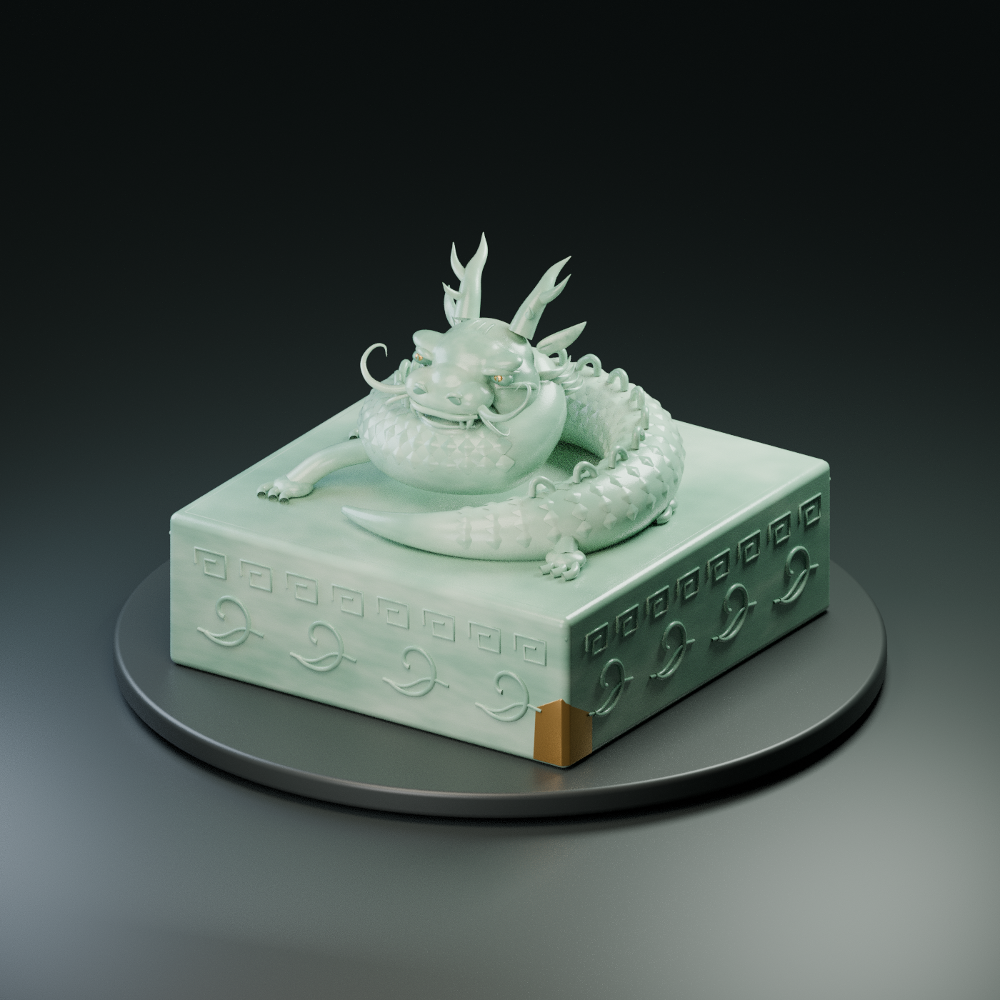

# 传国玉玺 · 艺术复原模型



## 下载

- [Blender 模型（约 32.6 MB）](imperial_jade_seal.blend)：完整玉石材质、展台、灯光及相机。
- [GLB 模型（约 16.3 MB）](imperial_jade_seal.glb)：便于兼容的三维软件或查看器导入。
- [底面刻字特写](underside.png)
- [生成源码](source/)

所有单个文件均小于 100 MB。模型与源码遵循仓库根目录的 [MIT 许可](../../LICENSE)；附带字体单独遵循 [SIL Open Font License 1.1](source/seal_assets/OFL.txt)。

以传统方形玉玺与盘龙钮为参考创作的三维模型。传国玉玺没有可据以精确复刻的现存实物，本模型属于艺术复原，不是经考证的历史原貌。

## 造型与尺寸

- 青白玉方印、盘龙钮及装饰纹样。
- 印体尺寸约 **96 × 96 × 33 毫米**，整体高度约 **82 毫米**。
- 底面为实际凹刻几何，文字为“**受命於天，既壽永昌**”；印面呈反字，钤印后正读。两列竖排，印文右列“受命於天”、左列“既壽永昌”。
- 印文使用 **Noto Serif CJK TC Bold** 繁体字形，为方便辨读的艺术处理；并非考据复原的秦代篆书。

## 文件使用

- **Blender `.blend` 文件**：保留模型部件、完整程序化玉石材质、灯光与相机，可直接在 Blender 中编辑和渲染。
- **glTF 二进制 `.glb` 文件**：便于导入兼容软件、网页或实时查看器；材质经过简化，玉石纹理与透光效果可能与 Blender 渲染不同。
- 预览图展示推荐灯光与相机下的效果。

模型由多个雕刻部件组成，存在相交几何，**尚未合并为适合三维打印的封闭实体**。打印前需要按目标尺寸进行网格合并、薄壁检查、支撑与切片处理。

## 重新生成

使用 Blender 4.3 或兼容版本，进入 `models/imperial-jade-seal` 目录后运行：

```sh
blender --background --python source/build_seal.py
```

默认输出到 `source/output/imperial_jade_seal`；可用环境变量 `SEAL_OUTPUT_DIR` 指定输出目录。字体与 SIL Open Font License 许可随源码附带。
