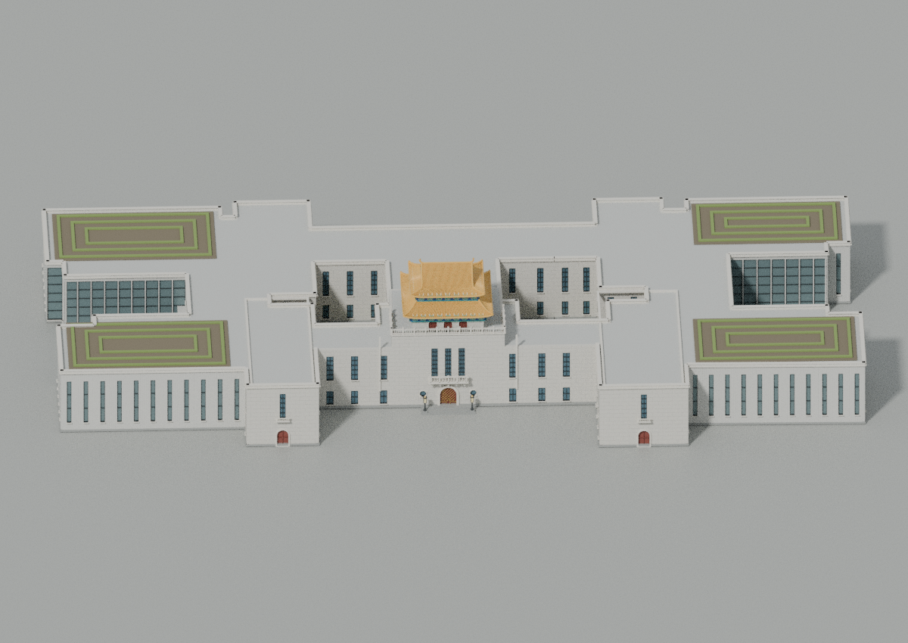
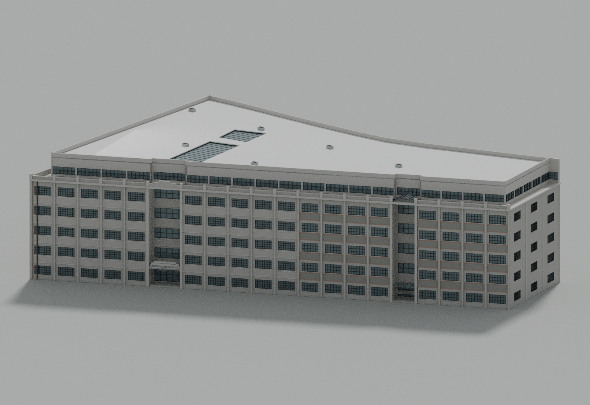
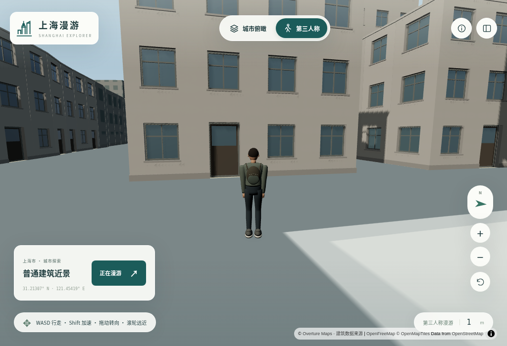

# 上海全景建模 · 历史交付记录

以下完整保留本次README重构前的说明原文。数量、“当前”、固定提交链接和验收范围均对应各历史版本；最新按区清单见[项目首页](README.md)，当前模型与验收见[CURRENT_STATE.md](CURRENT_STATE.md)。原文相对资产路径仍以本项目目录为基准。

---

# 上海漫游 · 宝山孔庙大成殿 v15

**[打开最新地标目录](https://raw.githack.com/ecojust/e-resource/master/projects/shanghai/latest.html)** · [最新第三人称漫游](https://rawcdn.githack.com/ecojust/e-resource/8cea0605a2d056bda107266357e11413eb9589e1/projects/shanghai/index.html#mode=walk) · [当前交付状态](CURRENT_STATE.md)

新增**宝山孔庙大成殿**：分别构造重檐歇山灰瓦、瓦垄与斗栱、暗红木柱和环廊、透空格扇、后侧白墙、石栏与御路石。已接入第三人称漫游；目录提供32处独立直达链接，包括外滩15栋、陆家嘴4栋和13栋逐栋复原建筑。

[直接到达宝山大成殿](https://rawcdn.githack.com/ecojust/e-resource/8cea0605a2d056bda107266357e11413eb9589e1/projects/shanghai/index.html#landmark=baoshan-confucian-dacheng-hall&mode=walk) · [网页GLB](assets/models/precise/14-13721-6684/baoshan-confucian-dacheng-hall/baoshan-confucian-dacheng-hall-web.glb) · [Blender](assets/native/precise/14-13721-6684/baoshan-confucian-dacheng-hall/baoshan-confucian-dacheng-hall.blend) · [建模源码与限制](source/precise/baoshan-confucian-dacheng-hall/README.md)

本栋原始GLB 29,752,792字节、网页GLB 11,876,292字节、远景GLB 2,939,940字节、Blender 14,479,200字节，均严格小于100,000,000字节。模型与本地浏览器验收通过，实际核对完整模型、远景、离开后返回、8栋邻楼保留和W键行走；32处目录链接检查通过，35件运行时文件保持不变。[实际验证范围](data/audit/precise-buildings-v15/baoshan-confucian-dacheng-hall/README.md)

这是按照片与公开资料制作的外观模型，尚非照片级真实复原，也不是测绘或摄影测量成果。13m名义高度来自《上海辞典》的二手公开节录；侧山墙、隐蔽木构、雕饰和材质风化仍有推估。建筑名称保持“宝山孔庙大成殿”，不混同相邻的现陈化成纪念馆；模型没有照片纹理。

全市16区底图继续保留，1,796,419个建筑及部件要素尚未全部完成逐栋照片复原，现有地标也不代表同等精度。下载ZIP仍为v13启动包，不包含v14导航改进和本轮宝山模型；体验更新请使用最新网页。地图和远程模型需要联网。

## v14导航与更早版本（历史保留）

以下原文完整保留，其数量、发布状态、固定提交链接和验证范围对应各自历史版本。

# 上海漫游 · 全部地标直达

**[打开最新地标目录](https://raw.githack.com/ecojust/e-resource/master/projects/shanghai/landmarks.html)** · [最新漫游网页](https://raw.githack.com/ecojust/e-resource/master/projects/shanghai/index.html#mode=walk) · [当前交付状态](CURRENT_STATE.md)

当前31处已建模地标均有独立直达链接：外滩15栋、陆家嘴4栋和12栋逐栋复原建筑，包括杨浦区图书馆、四行仓库、上海汽车博物馆与包玉刚图书馆。目录支持按建筑名称和行政区搜索；漫游页面顶部的“地标直达”可随时打开完整目录。点击导航中的建筑会直接进入第三人称漫游。

上述“最新”入口跟随仓库 master 更新；下方历史发布使用固定提交链接，只显示对应版本。地标目录的所有建筑链接使用同一版本内的相对路径，方便收藏和分享。首次打开若出现“Open the page”，点击后进入页面；地图及远程资源需要联网。

最新杨浦图书馆模型已上线；本次改善导航与网页入口，没有增加新建筑。全市16区均可探索，现有31处地标的精细程度有所不同，不代表全市建筑均已逐栋照片复原。现有下载ZIP仍为v13启动包；本次导航功能请使用上方最新网页。

## 历史版本记录

# 上海漫游 · Shanghai Explorer v13

新增**杨浦区图书馆整馆**：旧馆与扩建翼部、两处内院、重檐琉璃瓦、斗拱彩画、石栏与真实门窗，已接入第三人称漫游。

[杨浦图书馆入口](index.html#landmark=yangpu-library&mode=walk) · [网页模型](assets/models/precise/14-13722-6690/yangpu-library/yangpu-library-web.glb) · [Blender](assets/native/precise/14-13722-6690/yangpu-library/yangpu-library.blend) · [模型与预览](source/precise/yangpu-library/CURRENT_STATE.md)



本版精选导航31项、普通精模12项、目录10个宏块；源替换17项，覆盖11个宏块和15个近景分块。全市16区底图保留，1,796,419个建筑及部件尚未逐栋完成照片复原。

原始GLB 20.56MB、网页GLB 6.62MB、LOD 2.22MB、Blender 10.09MB，均严格小于100,000,000字节。实际检查包括原始/压缩几何、重新打开Blender、完整/LOD/返回、源与近远景替换、9邻居、W行走及最终目录采用；6张静态图和1张目录图已实际查看。[检查范围](data/audit/precise-buildings-v13/yangpu-library/README.md)

本轮31件生产运行时保持V12字节不变。模型没有照片纹理；背面和内院部分细节、尺寸和彩画仍是推估，非测绘或摄影测量。[来源与限制](data/bund/REALISM_V13.md) · [当前启动包状态](CURRENT_STATE.md)

使用时需要联网。完整模型读取超时后请刷新页面，当前没有自动重试。

## v12及更早记录（历史保留）

以下原文完整保留；其数量、链接、启动包及验证范围对应各自历史版本。

# 上海漫游 · Shanghai Explorer v12

新增**四行仓库与毗邻大陆银行仓库**完整双库模型：分别构造南侧两套立面、376处玻璃窗洞、两个凹入口、退台第六层、天窗、雨篷和西墙破损细部。

[四行仓库漫游](https://rawcdn.githack.com/ecojust/e-resource/893156002b860400f2c1c0442d83f1c346331d47/projects/shanghai/index.html#landmark=jingan-sihang-warehouse&mode=walk)（应用状态：已接入并发布） · [网页GLB](assets/models/precise/14-13720-6693/jingan-sihang-warehouse/jingan-sihang-warehouse-web.glb) · [Blender](assets/native/precise/14-13720-6693/jingan-sihang-warehouse/jingan-sihang-warehouse.blend) · [当前交付](source/precise/jingan-sihang-warehouse/CURRENT_STATE.md)。模型已单独发布于提交 `20e45cb3b33234e73bcef1a12528c249d98f3cac`。



本版为精选导航30项、普通精模11栋、目录9个宏块；源建筑替换登记16项、涉及10个宏块和14个近景分块。全市16区地图保留；1,796,419个建筑及部件要素仍以公开轮廓、高度和参数推定为基础，尚未逐栋完成照片复原。

新增原始GLB 25.72 MB、网页GLB 9.11 MB、远景GLB 5.51 MB、Blender 12.87 MB，四件文件均严格低于100,000,000字节。远景版省去细砖缝，保留主要门窗、字牌、破损墙体和屋顶构件。

网页增加一处 `map-scene.js` 修正：避免重复设置空建筑过滤器引起无效底图重载；其余30件运行时文件保持。实际网页验证：7项静态场景检查、3阶段目录检查及一次真实W行走通过，相关截图已逐张核对。[本轮范围](data/audit/precise-buildings-v12/sihang/README.md)。

[下载启动包](https://github.com/ecojust/e-resource/raw/refs/heads/master/projects/shanghai/downloads/shanghai-web-launcher.zip)：75,180,111字节，SHA256 `d08b38eda5f42b0c34ab174c298ecede6db6eeb94e95250a3340b5cbccdf1c4b`，验证状态：303件文件的归档和解压校验、31件运行时字节核对通过；从实际解压目录加载四行仓库完整模型并核对1张截图。包含14项本地导航模型和16项远程流式模型；数量已通过实际归档检查，底图、全城资源和远程模型需要联网。资源固定到应用提交 `893156002b860400f2c1c0442d83f1c346331d47`。[启动包范围](data/audit/launcher-v12/README.md)。

27.7米采用项目公布的名义总高，局部尺寸和隐藏构造仍有估计；照片用于形态参照，模型没有照片贴图。这是基于照片与图纸的建筑复原，不是测绘或摄影测量模型。[来源与限制](data/bund/REALISM_V12.md) · [当前状态](CURRENT_STATE.md)


使用时需要联网。若完整模型读取超时，请刷新页面重新加载；当前没有自动重试。

## v11及更早记录（历史保留）

以下保留既有正文；数量、应用版本及验证范围对应各自历史发布。

# 上海漫游 · Shanghai Explorer v11

- **[上海汽车博物馆漫游](https://rawcdn.githack.com/ecojust/e-resource/d99e8c9f1665f65871cef730e74a86a48a3483b4/projects/shanghai/index.html#landmark=jiading-shanghai-auto-museum&mode=walk)** · [网页模型](assets/models/precise/14-13706-6691/jiading-shanghai-auto-museum/jiading-shanghai-auto-museum-web.glb) · [Blender](assets/native/precise/14-13706-6691/jiading-shanghai-auto-museum/jiading-shanghai-auto-museum.blend) · [当前交付](source/precise/jiading-shanghai-auto-museum/CURRENT_STATE.md)。
- **[包玉刚图书馆漫游](https://rawcdn.githack.com/ecojust/e-resource/d99e8c9f1665f65871cef730e74a86a48a3483b4/projects/shanghai/index.html#landmark=minhang-baoyugang-library&mode=walk)** · [网页模型](assets/models/precise/14-13718-6705/minhang-baoyugang-library/minhang-baoyugang-library-web.glb) · [Blender](assets/native/precise/14-13718-6705/minhang-baoyugang-library/minhang-baoyugang-library.blend) · [当前交付](source/precise/minhang-baoyugang-library/CURRENT_STATE.md)。

本版精选导航29项、普通精模10栋、目录8个宏块；原27项导航与六个目录保持。全城仍未逐栋按照片完成。[两栋实际模型与网页范围](data/audit/precise-buildings-v11/two-modern-buildings/README.md)。

本版31件生产运行时文件与已发布v10阴影修复后的冻结字节相同；没有新增运行时修复。

[下载启动包](https://github.com/ecojust/e-resource/raw/refs/heads/master/projects/shanghai/downloads/shanghai-web-launcher.zip)：启动包75,160,933字节，SHA256 `f2ff0d34d3ae27df73e2e678070cd600f77f162f9a785198d8761fd1f9594156`，严格小于100,000,000字节。包含14项本地导航模型和15项远程流式模型，底图、全城资源及远程模型需要联网，资源固定到应用提交`d99e8c9f1665f65871cef730e74a86a48a3483b4`。

本次启动包仅从实际解压目录加载**包玉刚图书馆**完整模型并由root查看1张图；不等于29项导航、另一栋新楼、LOD、目录生命周期、所有区或设备帧率均已在ZIP中验证。[实际解压核对](data/audit/launcher-v11/README.md)。

[来源与限制](data/bund/REALISM_V11.md) · [当前状态](CURRENT_STATE.md)

## v10及更早记录（历史保留）

以下完整保留此前正文，其数量、“当前”和验证范围对应历史版本。

# 上海漫游 · Shanghai Explorer v10

新增**松江方塔**与**普陀真如寺大殿**：方塔按九级四面、八层上部回廊、曲瓦檐、真实门洞和镂空九相轮建模；真如大殿分出三间三进、柱架、歇山瓦顶、鸱吻及门窗，后方塔与前方天王殿仍是独立建筑。

- **[松江方塔漫游](https://rawcdn.githack.com/ecojust/e-resource/50b8becaa8d0e3de125c38c64a3de730e89465ea/projects/shanghai/index.html#landmark=songjiang-fangta-pagoda&mode=walk)** · [网页GLB](assets/models/precise/14-13709-6706/songjiang-fangta-pagoda/songjiang-fangta-pagoda-web.glb)（19,924,564字节）· [Blender](assets/native/precise/14-13709-6706/songjiang-fangta-pagoda/songjiang-fangta-pagoda.blend)（23,966,595字节）· [源码与当前状态](source/precise/songjiang-fangta-pagoda/CURRENT_STATE.md)。
- **[真如寺大殿漫游](https://rawcdn.githack.com/ecojust/e-resource/50b8becaa8d0e3de125c38c64a3de730e89465ea/projects/shanghai/index.html#landmark=putuo-zhenru-main-hall&mode=walk)** · [网页GLB](assets/models/precise/14-13716-6693/putuo-zhenru-main-hall/putuo-zhenru-main-hall-web.glb)（11,906,884字节）· [Blender](assets/native/precise/14-13716-6693/putuo-zhenru-main-hall/putuo-zhenru-main-hall.blend)（14,816,151字节）· [源码与当前状态](source/precise/putuo-zhenru-main-hall/CURRENT_STATE.md)。

本版精选导航27项、逐栋普通精模8栋、目录6个宏块。[两栋实际模型与网页范围](data/audit/precise-buildings-v10/two-districts/README.md)。方塔42.65m采用文献名义总高，层间比例、檐出和隐藏构造仍有估计；真如大殿总高及屋面尺度为模型估计，文献158m²口径未明，不能当作实测墙体尺寸。源建筑轮廓用于身份及精确替换，不证明墙线、檐线或台基范围。全城1,796,419个建筑及部件要素尚未逐栋按照片完成。

[下载启动包](https://github.com/ecojust/e-resource/raw/refs/heads/master/projects/shanghai/downloads/shanghai-web-launcher.zip)（75,129,522字节，SHA256 `1cae35145591aafbec74d0fb3d226461c69d2240d60e3855db33f8a2640557b3`）；[真实解压与松江方塔单点核对](data/audit/launcher-v10/README.md)。实际包含14项本地导航模型、13项流式导航模型，底图及全城资源需联网，固定到应用提交`50b8becaa8d0e3de125c38c64a3de730e89465ea`。两栋各4件模型和ZIP每个文件均严格小于100,000,000字节。

生产运行时仅有明确批准的`src/realistic-lighting.js`阴影修复，使不透明的`Inferred dark glazing`可投射阴影；其余运行时文件保持冻结字节。运行时差异SHA256 `6a415603a7e183f868f57607e58471bbd56649f9ec90cff1f130b93af0a87ea2`，修复后文件SHA256 `6cb2fb4dc1cca564d70f2718014c11600ba5846915df4d707caa5b56a873838c`。[实际差异](data/audit/precise-buildings-v10/two-districts/runtime-fix/runtime-delta.json)。

[来源与限制](data/bund/REALISM_V10.md) · [当前状态](CURRENT_STATE.md)

## v9及更早发布记录（历史）

以下保留原v9正文；数量、“当前”等词和验证范围对应当时版本，不是v10证明。

新增徐汇**龙华塔**：七层八面、六道高架回廊，分别构造曲檐瓦面、斗栱、真实门洞与盲壁龛、栏杆和塔刹。照片用于结构参照，没有把照片像素贴进模型。

**[进入龙华塔漫游](https://rawcdn.githack.com/ecojust/e-resource/72f845db12482c0c7a3c1fccca3f2dd4fb4b8336/projects/shanghai/index.html#landmark=xuhui-longhua-pagoda&mode=walk)** · [网页GLB](assets/models/precise/14-13719-6697/xuhui-longhua-pagoda/xuhui-longhua-pagoda-web.glb)（19,740,940字节）· [Blender](assets/native/precise/14-13719-6697/xuhui-longhua-pagoda/xuhui-longhua-pagoda.blend)（24,033,748字节）· [当前状态与源码](source/precise/xuhui-longhua-pagoda/CURRENT_STATE.md)

本版精选导航25项，其中逐栋街区建筑6栋、目录4个宏块。[模型与应用验收范围](data/audit/precise-buildings-v9/longhua/README.md)。40.64m采用官方志书公布的名义总高，并非本项目实测；门洞朝向的地理相位、层间比例和隐蔽处仍有推定。全城1,796,419个建筑及部件要素并未逐栋按照片完成。

[下载启动包](https://github.com/ecojust/e-resource/raw/refs/heads/master/projects/shanghai/downloads/shanghai-web-launcher.zip)（75,099,231字节，SHA256 `5200a5e0dca61b709e766b9724f9c89d1757f4763654027a94642ffd88a8bcc0`）；[实际解压与龙华塔运行核对](data/audit/launcher-v9/README.md)。全城及流式资源需联网，固定到应用提交`72f845db12482c0c7a3c1fccca3f2dd4fb4b8336`；下载地址随仓库版本更新。四件模型和启动包均严格小于100,000,000字节。

[来源与限制](data/bund/REALISM_V9.md) · [当前状态](CURRENT_STATE.md)

## v8及更早发布记录（历史）

以下保留原v8正文；其中导航数量、“当前”状态和验证范围均对应当时版本，不是v9证明。

新增虹口多伦路59号**鸿德堂**：砖塔的真实窗洞、双层曲檐、红柱、拱窗与圆窗按照片分别重建。两翼使用连续向后升起的檐面，窗格和2024年蓝色匾牌保留可辨特征。

**[进入鸿德堂漫游](https://rawcdn.githack.com/ecojust/e-resource/d483eba6a4636797f7e461fb834d8d80f20ecf72/projects/shanghai/index.html#landmark=hongkou-hongde-church&mode=walk)** · [网页GLB](assets/models/precise/14-13720-6692/hongkou-hongde-church/hongkou-hongde-church-web.glb)（10,619,436字节）· [Blender](assets/native/precise/14-13720-6692/hongkou-hongde-church/hongkou-hongde-church.blend)（39,953,968字节）· [当前状态、下载与源码](source/precise/hongkou-hongde-church/CURRENT_STATE.md)

导航现为24项：15栋外滩、4栋陆家嘴、5栋街区建筑。鸿德堂已完成本版静态网页、目录加载/退出/返回及实际图像核对；[验证范围](data/audit/precise-buildings-v8/hongde/README.md)。保留邻楼，修正了旧OSM体块遮挡门窗的问题。

[下载启动包](https://github.com/ecojust/e-resource/raw/refs/heads/master/projects/shanghai/downloads/shanghai-web-launcher.zip)（75,085,094字节，SHA256 `dec586d0da788b16354f967ae637ab14cbaea44720ef9bc8a40efb8213a0c4a2`）；[归档与实际运行范围](data/audit/launcher-v8/README.md)。下载地址随仓库版本更新，包内应用版本见该记录。

参考Livelikerw2014年与Windmemories2024年照片，均为CC BY-SA 4.0。采用2024年可见配置，白天图辅助辨认材质，不把夜间泛光当作墙面固有颜色。后部、绝对高度和部分尺寸仍为推定；全城1,796,419个建筑及部件要素尚未逐栋照片复原。新增四件模型及本启动包均严格小于100,000,000字节。

[来源与限制](data/bund/REALISM_V8.md) · [当前状态](CURRENT_STATE.md)

## v7发布记录（历史）

以下保留v7正文，23项导航及其验证仅指当时版本，不是v8证明。历史固定提交链接不会因身份改写自动跳转；master下载入口可能已更新。

本批接入武康路129号、武康路210号住宅和青浦北大街208–212号茶楼：**新制模型2栋，既有129号模型首次接入HTML，共3处新替换**。连同既有222号，普通小楼增至4栋，导航为**23项：15栋外滩历史建筑、4栋陆家嘴地标、4栋普通小楼**。129号已完成21项静态导航候选中的单栋网页验收；210号与茶楼v3已制成GLB和Blender，修正后的原生斜视图已由root实际查看并接受。两栋已通过23项静态候选中的v3网页检查及root对全部11张截图的实际复核；候选应用的武康与青浦两宏目录分别通过实际浏览器和root图像复核；新ZIP通过归档核对及青浦{222、茶楼}代表宏实际解压运行，不声称武康ZIP浏览器验收。

直接进入新增地点：[武康路210号漫游](https://rawcdn.githack.com/ecojust/e-resource/53ee12a60fcd613d82f73cb50cdf0b36436052eb/projects/shanghai/index.html#landmark=xuhui-wukang-210&mode=walk) · [江南第一茶楼漫游](https://rawcdn.githack.com/ecojust/e-resource/53ee12a60fcd613d82f73cb50cdf0b36436052eb/projects/shanghai/index.html#landmark=qingpu-beidajie-208-212&mode=walk)。

可见细节按各栋照片分别重建，保留真实开口、独立框架及有据外形；未见后部、构件尺度和绝对高度仍有推定。全城**1,796,419个建筑及部件要素**仍以来源轮廓、高度与参数推定为基础，不代表全市已经逐栋照片复原，也不代表各地标具有同等精度。

前两轮A/B网页均技术通过、实际图像未获整组接受：茶楼镜头进入对街建筑。最终修正晚到碰撞数据的相机更新、近距取景限制，以及普通楼水平投影单位不一致；v3正式11组网页与root实际图像复核通过，邻楼和模型几何保持。该静态结果仅覆盖两栋；候选两宏目录与ZIP青浦代表宏验证分别记录。

新在线预览：[23项在线预览](https://rawcdn.githack.com/ecojust/e-resource/53ee12a60fcd613d82f73cb50cdf0b36436052eb/projects/shanghai/index.html#mode=walk)。新启动包：[下载启动包](https://github.com/ecojust/e-resource/raw/refs/heads/master/projects/shanghai/downloads/shanghai-web-launcher.zip)，75,069,903字节，SHA256 `6ba119780b3e81b9965ab4fa75cd07c9009be51b7137f25558a9ae00f8dcab5c`；实际归档与解压运行结果：[实际ZIP验证](data/audit/precise-buildings-v7/release/launcher/README.md)。该ZIP已通过实际归档及解压运行核对；v6.1的20项预览和ZIP仅为上一版历史。下载地址跟随master更新；包内应用资源固定到第一提交，ZIP与本说明同批发布。

四栋普通小楼的raw、web、LOD、native均已核对小于**100,000,000字节**，具体下载与字节数见[普通小楼索引](source/precise/README.md)。新ZIP也已独立核对低于该上限。[v7范围与限制](data/bund/REALISM_V7.md) · [本批验收范围](data/audit/precise-buildings-v7/release/README.md)。


## v6.1 新增接入与普通小楼（历史范围）

以下保留v6.1发布时的范围；其中“当前”“本轮”“尚未”均指该版。20项导航、75,039,313字节ZIP与当轮验证不是v7结果，原master下载地址也可能已指向新版。

上海16区三维地图与第三人称漫游项目，当前有**20栋独立建筑与地标：15栋外滩历史建筑、4栋陆家嘴地标、青浦北大街222号普通民宅前楼**。本轮将已单独发布的外滩7号、9号和222接入HTML。外滩模型按逐栋照片参照制作；陆家嘴的细化范围不同；全市普通楼仍是来源轮廓与高度支撑的参数推定，不能称20栋或179万要素具有同等照片精度。

[v6.1固定预览（历史20项）](https://rawcdn.githack.com/ecojust/e-resource/f5ba36ae1eaa4241ab0084841ded78b6ef50d248/projects/shanghai/index.html#mode=walk)（固定应用提交`f5ba36ae1eaa4241ab0084841ded78b6ef50d248`）。新启动包已构建并通过归档校验：75.04 MB／75,039,313字节，本地14栋、联网加载6栋，含1个普通楼目录记录；按需联网，不表示全市模型全部装入ZIP。[可变启动包入口（现可能为新版）](https://github.com/ecojust/e-resource/raw/refs/heads/master/projects/shanghai/downloads/shanghai-web-launcher.zip)。下载地址跟随master更新，属于可变入口；包内资源固定到上述应用提交。实际解压ZIP中的222目录已通过静态20项复用、受控19项动态加载／退出／返回及索引SHA拒绝检查，27个邻楼保留、29／29个几何对象释放；root实际查看5张截图，page／shader／HTTP错误为0。此项未重跑07／09全部视角或全部20栋。 见[实际启动包验证范围与报告](data/audit/precise-buildings-v6/release-next/launcher/README.md)。


7号保留四层3＋5＋3分组立面、真实洞口与独立窗框，修正门窗、金属顶帽及后排屋顶窗；9号保留通透外廊、不同柱式、真实拱洞、石券缝、阳台角柱与南侧连续搭接瓦。222把逐栋工作扩展到青浦普通小楼，保留门牌、三开间木廊、木格与实际门洞，而非用通用盒子替代可见身份细节。未见后部、绝对高度、墙厚及精细雕刻仍有推定，未建立可游览室内。

7号6窗18片和9号南短翼2窗20片使用原CC0照片玻璃；222只保留中央牌匾的CC BY-SA 4.0原照片。它的远景模型也保留这张图，不能归入“无照片远景”。原图固定拍摄时光影不是去光照PBR或动态反射。

07／09门前新增**317.9618㎡**估计铺装，本轮v6楼前追加累计**1,162.4622㎡**；既有05／06／14和更早v5铺装保留。面积、支持面高程及材质尺度是构造估计，不是新测绘。详见[v6.1来源、文件与验证](data/bund/REALISM_V6_1.md)。

本轮三栋HTML技术检查通过，共15组采集、6份近／远景资产核验；root实际查看10张截图并接受有限接入表现。另有独立目录检查：生产20项静态记录复用，以及仅测试响应移除222后的19项动态加入／退出／返回和索引SHA失败保留基线。目录另经root实际图像复核，包含动态退出后返回的叠楼回归视图。三栋静态采集与运行时修复后的回归范围分别记录，不把旧图冒充全部修复后重跑；这不重跑全部20栋或全城逐栋核验。 见[本轮网页与目录审计](data/audit/precise-buildings-v6/release-next/README.md)。

普通楼基线仍为**1,708宏块、1,796,419建筑及部件要素、169,320近景分块**。两批v6模型动态接管6个精确源对象，退出后恢复；历史98处替换、401处父体残余及126处有源屋顶保持。单文件严格小于100,000,000字节。全城真实窗位仍未逐栋核实；[武康路129号](source/precise/xuhui-wukang-129/DELIVERY.md)已制成独立GLB与Blender下载包，尚未接入HTML或通过网页场景验收，不计入这20栋。

## v6 首批逐栋照片重建（历史范围）

以下保留首批05／06／14发布时的模型和验证范围；17栋及首批三栋计数仅描述该轮，当前范围见本文顶部v7说明。

新增三栋保留各自真实地图轮廓和地理锚点。日清大楼重建双山花、三面凸窗、门柱及分组阳台；中国通商银行重建五山墙、四圆尖塔、三拱柱廊和独立附翼；交通银行重建四排八轴窗、黑石入口、实体字牌和阶梯塔冠。照片只用于逐片选中的玻璃，避开黑框与遮挡物；墙体、窗洞、厚框及雕饰仍由几何构件形成。

三栋玻璃现位于对应窗框前脸后约**20mm**的槽内，避免玻璃脱离厚框；该深度是构造估计，不是测量值，墙洞、窗框和照片UV保持原值。HTML对明确标记的照片玻璃直接显示已捕获的光照与反射，取消重复场景受光、阴影及额外HDR；仍保留原材质颜色系数和应用统一色调映射，不把照片假装成去光照的PBR纹理，照片石墙与普通玻璃沿用原路径。

正常设备局部阴影使用4096×4096贴图、48m半范围；低内存设备使用1024×1024，并受硬件贴图上限约束。三栋楼前另新增约**844.50㎡**有界灰石铺装与3个行走支持面，顶面沿用模型0.075m基准；这是依据临街边与既有道路边界的估计范围，保留道路、水体、已有铺装、源孔洞、草床和已知建筑排除边界。[逐栋细化验收标准](data/audit/precise-buildings-v6/DETAIL_STANDARD.md)列明证据和几何要求。

三栋细模加载并可见时，分别替换相应的普通建筑源对象；卸载后恢复原表示，邻楼与全市基线计数保持不变。模型、原生预览、压缩与照片字节检查已通过，完整自动测试已通过。首批三栋已通过15组网页技术记录与10张截图的有限视觉核对；该轮采集早于后续网络／样式补丁；补丁后的实际解压启动包另通过05号与清单重置冒烟。范围见[本轮网页审计](data/audit/precise-buildings-v6/release/README.md)。

[本轮范围、来源与验证](data/bund/REALISM_V6.md) · [三栋重建源码与下载](source/bund/photo-rebuild-v6/README.md)。原10栋外滩建筑及v5城市近景、街景成果继续保留。07、09及222在首批发布时尚未接入；本轮状态见[v6.1增量](data/bund/REALISM_V6_1.md)。

## v5 城市近景与外滩环境（保留成果）

外滩10栋临街建筑前补齐约3,357.13m²铺装；17、18号对面的两条草床加入按2010年照片定位与估计的7棵树、支撑和近景草叶。滨江灯、道路灯及护栏按公开照片调整实体形态，地面、低路缘与街景设施加入对应的行走及镜头碰撞。沥青在中距离保留更自然的细微变化。

普通建筑近景采用家宅、公寓、工业、办公和未知五类生成实体门窗，保留源轮廓、高度依据与126处已核验屋顶。完整GeoParquet审计未发现新增真实窗门资料，因此新窗位、入口和构件尺度均保留推定标记。近景分块 **169,320** 个，合计 **9,329,009,466** 字节。全量文件与覆盖、全部远景解码、87份近景分层解码样本及126处屋顶检查均已通过，见[发布审计](data/audit/city-detail-v5/release/README.md)；[浏览器场景验收](data/audit/city-detail-v5/release/browser.json)也已通过。



详见[本轮范围、来源与验证](data/bund/REALISM_V5.md)、[普通建筑细化源码](source/city/detail/README.md)和[外滩街景源码](source/bund/street/README.md)。完整防汛平台高差和每栋普通楼的真实窗位尚未复原。

## 历史更新

以下记录各版本发布时的范围；“本次”“尚未”等表述对应当时状态，当前情况以顶部v7说明为准。

### v4.4 墙面、逐窗与屋顶修正

修正外滩9栋建筑近看时的墙面黑线与虚线。2、3、12、15、17、19、20、23号原先相邻墙块留下了反向重叠的内部面，部分墙面边缘也未共用节点；现将结构墙整合，保留真正的窗洞、洞口侧壁和内退。18号补连续墙芯，封住原先贯通的空缝；石材本身的接缝与凹槽继续保留。13号未发现同类问题，保持原模型。

字林西报大楼24扇主窗、汇丰大楼右翼六窗改用各自的实景玻璃采样，并按照片修正实体主窗框。字林顶部的旧开放亭纠正为厚石塔、深窗、层叠檐帽和浅弧顶冠。照片保留原字节、作者与CC0许可；不是整面墙照片平板，细格栅和帘布仍有照片细节。

华俄道胜银行同时修正十个窗帘体的面朝向，并去掉造成窗内竖向杂纹的穿插构件，保留窗洞和主窗框。

远处12、17号使用无照片的几何变体，离开区域后释放隐藏的大照片模型；正常设备局部阴影提高到2048。详见[本轮修改、来源及限制](data/bund/REALISM_V4_4.md)。本次仍是外滩局部完善，全市普通建筑尚未达到近距离真实复原精度。

### v4.3 外滩近景修正

外滩18号重新校正中央开间、柱距、窗宽及窗格比例，保留三维窗洞、独立窗框、柱和檐口。部分下部石墙与六块主窗分别映射2021年实景照片；交通灯遮挡、檐口和容易错位的区域保留几何材质，避免窗框重影。原图完整嵌入近景、远景和Blender文件，模型资产按 **CC BY-SA 4.0** 署名发布；[重建源码与照片控制点](source/bund/chartered_bank/photo-v4.3/README.md)。

17、18号前两处原来留白的凹口，依据能定位建筑和路口的2010年CC0俯视照片，按源四角补为浅种植带；新增石边、草土表面与扫描材质。玻璃增加上海沿江实拍HDR反射；它是光照素材，不是外滩原址的全景。已有照片玻璃保留拍摄时反射，避免重复染色。

[本轮范围与验证](data/bund/REALISM_V4_3.md)。此次改善仍是局部照片参照重建；主立面未见部分、树木、平台完整高差和全城普通建筑细节尚未完整复原，不能称为全市摄影测量。照片纹理也保留拍摄时的阴影，不是经过消光照处理的PBR颜色数据。

### v4.2 外滩前景铺装

外滩18号前方两处地图过街线之间，按现有道路边带和步行区边缘补充约189㎡连接铺装；这是施工边界估算，并非新发现的测绘足迹。保留两处用途不明的来源凹口及已标注内洞，不把它们推定为平整地面。现有场景仍采用统一地面高程，未复原实际台阶、坡道和滨江平台高差。

参照[滨江实景照片](source/bund/street/references/README.md)，石板调为中性灰、较宽板块和较弱接缝。1.20×0.60m板块及4mm接缝为照片比例估算；继续复用原有CC0表面纹理。建筑几何、道路、岸线和全部城市分块保持此前版本，新增几何仅为连接铺装。

### v4.1 局部屋顶补充

从已保存的179万条源要素中筛出126个可核验的屋顶：29个双坡、97个单坡，分布在嘉定3个、普陀79个、长宁27个、黄浦17个。原先平顶体块的相应部分现按原始屋型、坡高和方向生成斜屋面；总高、足迹与建筑ID保持一致，双坡采用居中对称屋脊。只重建6个分块，其余1,702个模型及其构建状态保持原字节。

[屋顶筛选与全部来源](data/roofs/README.md)、[几何核验](data/roofs/geometry-validation.json)和[分块核验](data/roofs/roof-validation.json)记录每个采用的OSM历史版本及生成假设。这里增加的是局部参数化屋顶；其余普通建筑仍以简模为主，也没有由屋顶标签推造真实窗位或照片纹理。全城逐栋真实复原尚未完成。

### v4 近景观感

[v4 表现与限制](data/bund/REALISM_V4.md)说明渲染、街道与模型切换的具体范围。本版保留 v3 的建筑几何和全市范围，改进外滩近距离观看：石材与路面使用 CC0 扫描表面纹理，细微法线与粗糙度随距离衰减；玻璃加入天空反射，附近建筑使用缓存的日光投影。外滩 2、3、17 号修复了部分构件的反向面序，保持原有顶点位置和尺寸；原始 `.blend` 和近景 GLB 没有因远景优化而降低精度。网页新增的表面效果由渲染模块应用，不包含在旧版原始 GLB 材质里。

中山东一路的路面、车道线与过街线按公开道路资料制作；漫游时不把地下隧道地图线画成地面道路。10辆静态车辆用于街景尺度示意，位置限定在公开道路范围内，不代表实时交通；排水口间距、部分线位和表面纹理尺度仍有推定。纹理是表现材料质感的通用扫描样本，不能当作这些建筑真实石种或风化分布的测量。v4初版反射使用程序天空；v4.3改用上海沿江实拍HDR并保留程序天空作为读取失败时的回退，并非外滩现场全景。详见[表面来源与许可](assets/materials/realism-v4/README.md)、[街道输入与范围](source/bund/street/README.md)。

远处外滩建筑在相机距离约400米后切换为轻量变体，回到300米内恢复完整近景模型；两套模型原子替换，加载失败保留已显示的版本。新角色与较低的跟随视角为立面留出更多画面。默认从外滩步道开始，仍可切换城市俯瞰并访问全部16区。

## 打开页面与操作

无需npm安装或构建。在本目录运行：

```sh
python -m http.server 8000
```

打开 **http://localhost:8000**。入口为[index.html](index.html)，需HTTP加载模块与GLB，不能直接用file://打开。道路、水体、中文标注及远景地图仍需联网。

- **城市俯瞰**：拖动、缩放；选择行政区或建筑，或双击地图选择上海范围内的街区起点。
- **第三人称**：WASD/方向键行走、Shift加速、拖动转向、滚轮调镜头；Q/E转动、R重置。
- **手机**：左侧摇杆、按住加速、拖动视角；支持区级跳转和面板收起。
- 支持建筑、水体碰撞和落点检查；外滩已加载街景增加铺装、低路缘、种植带和设施碰撞。地图加载后可能校正落点。完整桥面、立交和滨江平台高差尚未恢复。

## 外滩近景模型

网页使用优化后的GLB；原始GLB和Blender文件供继续编辑。所有发布文件均受 **100,000,000字节**上限检查，按建筑或城市分块保存，无需Git LFS。

| 建筑 | 可见结构重点 | GLB下载 | Blender原生文件 |
|---|---|---|---|
| 2号 · 上海总会 | 六柱柱廊、顶层拱窗与双亭 | [网页版](assets/models/bund/web/bund02.glb) · [原始GLB](assets/models/bund/bund02.glb) | [.blend](assets/native/bund/bund02.blend) |
| 3号 · 有利大楼 · 外滩3号 | 转角塔楼、双街立面与窗套 | [网页版](assets/models/bund/web/bund03.glb) · [原始GLB](assets/models/bund/bund03.glb) | [.blend](assets/native/bund/bund03.blend) |
| 5号 · 日清大楼 | 双山花、三面凸窗、门柱与112片照片玻璃 | [网页版](assets/models/bund/web/bund05.glb) · [原始GLB](assets/models/bund/bund05.glb) | [.blend](assets/native/bund/bund05.blend) |
| 6号 · 中国通商银行旧址 | 五山墙、四圆尖塔、三拱柱廊与127片照片玻璃 | [网页版](assets/models/bund/web/bund06.glb) · [原始GLB](assets/models/bund/bund06.glb) | [.blend](assets/native/bund/bund06.blend) |
| 7号 · 大北电报公司大楼（现盘谷银行） | 四层分组窗、铁门、金属顶帽与18片照片玻璃 | [网页版](assets/models/bund/web/bund07.glb) · [原始GLB](assets/models/bund/bund07.glb) | [.blend](assets/native/bund/bund07.blend) |
| 9号 · 轮船招商局大楼 | 两层开放外廊、石券、连续搭接瓦与阳台角柱 | [网页版](assets/models/bund/web/bund09.glb) · [原始GLB](assets/models/bund/bund09.glb) | [.blend](assets/native/bund/bund09.blend) |
| 12号 · 汇丰银行大楼 | 六柱柱廊、鼓座、穹顶与中庭 | [网页版](assets/models/bund/web/bund12.glb) · [原始GLB](assets/models/bund/bund12.glb) | [.blend](assets/native/bund/bund12.blend) |
| 13号 · 江海关大楼 | 钟塔、凹窗与源轮廓四角亭 | [网页版](assets/models/bund/web/bund13.glb) · [原始GLB](assets/models/bund/bund13.glb) | [.blend](assets/native/bund/bund13.blend) |
| 14号 · 交通银行旧址 | 八轴窗、黑石入口、阶梯塔冠与137片照片玻璃 | [网页版](assets/models/bund/web/bund14.glb) · [原始GLB](assets/models/bund/bund14.glb) | [.blend](assets/native/bund/bund14.blend) |
| 15号 · 华俄道胜银行大楼 | 柱廊、拱券与窗洞 | [网页版](assets/models/bund/web/bund15.glb) · [原始GLB](assets/models/bund/bund15.glb) | [.blend](assets/native/bund/bund15.blend) |
| 17号 · 字林西报大楼 | 窄面深进、照片窗与双侧屋顶石塔 | [网页版](assets/models/bund/web/bund17.glb) · [原始GLB](assets/models/bund/bund17.glb) | [.blend](assets/native/bund/bund17.blend) |
| 18号 · 麦加利银行 · 外滩18号 | 爱奥尼柱廊、山花与栏杆 | [网页版](assets/models/bund/web/bund18.glb) · [原始GLB](assets/models/bund/bund18.glb) | [.blend](assets/native/bund/bund18.blend) |
| 19号 · 和平饭店南楼 · 汇中饭店 | 红砖壁柱、山花与角亭 | [网页版](assets/models/bund/web/bund19.glb) · [原始GLB](assets/models/bund/bund19.glb) | [.blend](assets/native/bund/bund19.blend) |
| 20号 · 和平饭店北楼 · 沙逊大厦 | 装饰艺术窗带、退台与铜屋顶 | [网页版](assets/models/bund/web/bund20.glb) · [原始GLB](assets/models/bund/bund20.glb) | [.blend](assets/native/bund/bund20.blend) |
| 23号 · 中国银行大楼 | 主楼、后接西翼与中式屋檐 | [网页版](assets/models/bund/web/bund23.glb) · [原始GLB](assets/models/bund/bund23.glb) | [.blend](assets/native/bund/bund23.blend) |

[外滩源码与逐栋资料](source/bund/README.md)说明每栋的生成入口、参考照片、尺寸依据与推定部分；[外滩资产清单](data/bund/manifest.json)记录地理原点、模型链接、包围高度和照片署名。细部可查看[汇丰柱廊](assets/previews/bund/hsbc-column-detail.png)、[麦加利柱廊](assets/previews/bund/chartered-column-detail.png)、[海关窗洞](assets/previews/bund/customs-window-detail.png)。

这里的建筑细节是照片参照下的几何重建，**不是测绘、激光扫描或摄影测量成果**。窗洞具有实际退距，柱、窗框、栏杆等采用几何构件；雕刻纹样有简化。不可见侧后立面、墙厚、洞深和部分楼层高度含推定，未重建可游览室内。海关总高约79.2m有官方文字依据；其余建筑的总高或屋顶附属部分需结合逐栋说明判断，不能把清单中的小数视为实测精度。模型包围高度可能包含旗杆、灯亭或尖顶，不等于主檐口高度。

## 普通小建筑逐栋复原

| 建筑 | 可见结构与范围 | 模型与源码 |
|---|---|---|
| 青浦朱家角北大街222号民宅前楼 | 两层三跨、通透木廊、真实门洞、木格、灰瓦搭接与中央草书牌；不含邻铺226号或后进 | [网页版](assets/models/precise/14-13701-6700/qingpu-beidajie-222/web.glb) · [原始GLB](assets/models/precise/14-13701-6700/qingpu-beidajie-222/raw.glb) · [Blender](assets/native/precise/14-13701-6700/qingpu-beidajie-222/model.blend) · [来源及重建](source/precise/qingpu-beidajie-222/README.md) |
| 徐汇武康路129号住宅 | 左山墙、中央退进、右圆端与弧形阳台；后部和尺度有推定 | [网页版](assets/models/precise/14-13718-6695/xuhui-wukang-129/web.glb) · [原始GLB](assets/models/precise/14-13718-6695/xuhui-wukang-129/raw.glb) · [Blender](assets/native/precise/14-13718-6695/xuhui-wukang-129/model.blend) · [当前交付](source/precise/xuhui-wukang-129/DELIVERY.md) |
| 徐汇武康路210号住宅 | 南弯栏阳台、中部凹门厅、北三联窗与红檐瓦顶；只替换981主楼 | [网页版](assets/models/precise/14-13718-6695/xuhui-wukang-210/web.glb) · [原始GLB](assets/models/precise/14-13718-6695/xuhui-wukang-210/raw.glb) · [Blender](assets/native/precise/14-13718-6695/xuhui-wukang-210/model.blend) · [当前交付](source/precise/xuhui-wukang-210/DELIVERY.md) |
| 青浦北大街208–212号茶楼前楼 | 三砖拱、开放木廊、栏杆、灯笼与搭接瓦；按历史照片可见形态 | [网页版](assets/models/precise/14-13701-6700/qingpu-beidajie-208-212/qingpu-beidajie-208-212-web.glb) · [原始GLB](assets/models/precise/14-13701-6700/qingpu-beidajie-208-212/qingpu-beidajie-208-212-raw.glb) · [Blender](assets/native/precise/14-13701-6700/qingpu-beidajie-208-212/qingpu-beidajie-208-212.blend) · [当前交付](source/precise/qingpu-beidajie-208-212/DELIVERY.md) |

222的原始轮廓来自Overture所用Zenodo／East Asian Buildings，OSM只辅助核对门牌与街桥。模型保留2022年可见状态，以2016年照片交叉核对；檐高、后坡、局部格数和狮雕仍有明确推定。中央匾为模型唯一照片采样，右门采用统一的估计玻璃材质。模型为CC BY-SA 4.0；2022图为钉钉CC BY-SA 4.0，2016参考为Fayhoo CC BY-SA 3.0。

## 陆家嘴与全市建筑

| 地标 | 公开总高 | GLB下载 | Blender原生文件 |
|---|---:|---|---|
| 上海中心大厦 | 632 m | [网页版](assets/models/optimized/shanghai-tower.glb) · [原始GLB](assets/models/shanghai-tower.glb) | [四地标合并场景](assets/native/shanghai-landmarks.blend) |
| 东方明珠电视塔 | 468 m | [网页版](assets/models/optimized/oriental-pearl.glb) · [原始GLB](assets/models/oriental-pearl.glb) | [四地标合并场景](assets/native/shanghai-landmarks.blend) |
| 上海环球金融中心 | 492 m | [网页版](assets/models/optimized/swfc.glb) · [原始GLB](assets/models/swfc.glb) | [四地标合并场景](assets/native/shanghai-landmarks.blend) |
| 金茂大厦 | 420.5 m | [网页版](assets/models/optimized/jin-mao.glb) · [原始GLB](assets/models/jin-mao.glb) | [四地标合并场景](assets/native/shanghai-landmarks.blend) |

陆家嘴四栋复原球体、扭转塔身、环球金融中心顶部通孔及金茂退台等可辨识造型；与外滩逐栋近景模型的细化范围不同。[高度与坐标来源](data/audit/poi-sources.json)保留官方或可靠公开资料。

16区覆盖黄浦、徐汇、长宁、静安、普陀、虹口、杨浦、闵行、宝山、嘉定、浦东新区、金山、松江、青浦、奉贤、崇明。[全域分块清单](assets/city/README.md)与[机器清单](assets/city/manifest.json)提供下载和地理定位信息；每块具有独立经纬度原点与米制坐标。assets/districts/仅保留旧版每区1km²样本，当前HTML使用全域分块。

普通建筑近景的门窗具有实体厚度与退距，窗位、开间和多数材料仍由参数推定；远景保留较轻的建筑表示。道路宽度优先公开width/lanes字段，否则按等级估算。全域公开源仍可能漏楼、错分轮廓或具有年代差异；“全域”指本次来源范围内的处理覆盖。v5近景覆盖见上方保留记录；v7替换清单覆盖9个明确源对象，不改变该基线统计。各栋当前接入和验证范围见顶部及逐栋交付。

## 数据依据与版本变化

- **全域来源**：Overture 2026-10-21.0。v2核验检查2,892个相交z14格，其中1,734个有源瓦片；下载/解码失败及全局重复UUID均为0。保留1,796,667个唯一地上建筑/部件，地下11个另行记录。[轮廓快照](data/fullcity-raw/manifest.json)支持离线重建。
- **行政边界**：OSM的16区几何有效，45个检查点通过，覆盖崇明、长兴、横沙、机场、临港及外围区域。河海行政水域面积不等于官方6,340.5km²陆域面积。[地理审计](data/audit/ACCURACY.md)保留政府资料对照和边界处理说明。
- **父体剩余足迹**：v2逐一核验551个父体，恢复402处原先被分部处理遗漏的剩余足迹，约953,690m²；这些是历史核验总量。v3中国银行详细模型接管其中1处，当前普通模型保留**401处**。残差高度单独估算，不把塔楼总高直接用作裙房高度；原始阈值、面积及402处证据仍保留供追溯。
- **精确替换**：v3按源对象ID及组件关系替换**98个可渲染要素**。普通模型当前计数为 **1,796,116 − 98 + 401 = 1,796,419**，不是独立楼宇数量。外滩细模不按半径粗删邻楼；海关仅替换确认的前楼、钟楼和四角亭，独立后翼继续保留。[v3分块核验](data/bund/validation/city-patches.json)与[构件核验记录](data/bund/validation/)记录替换依据。

v7的9个精确源对象来自3个宏块、7个近景块；保留同块其余116个要素，1,796,419要素基线不减去这9条。替换以明确对象ID及细模可见状态管理，卸载后恢复，不按半径删除邻楼。实际运行验收范围见[v7说明](data/bund/REALISM_V7.md)，历史v6.1的6目标/49邻楼记录继续保留。

高度优先级为：源height → 楼层数×3.2m → CMAB严格轮廓匹配的预测高度 → CNBH 10m栅格估计 → GHSL区域均高 → 明确标注的12m缺省。CMAB在16区抽样1,280个足迹作对齐检查，不采用简单最近邻或无依据的GCJ偏移。

**栅格估计会明显低估高楼。** 在375条来源高度/楼层的一致性检查中，CNBH绝对差中位16.45m、P90为124.47m；这不是独立地面真值评估。CMAB、CNBH、GHSL与Overture年代也不同，不能据此宣称全城真实天际线或测绘级精度。[高度数据及比较](data/heights/HEIGHT_SOURCES.md)保留v2来源、许可和验证证据；其中历史计数应与上述v3替换变化区分。

[全域高细节数据可行性核查](data/audit/HIGH_DETAIL_DATA.md)补充检查了六类来源，分别记录实际细节等级、上海覆盖、许可及访问结果。本轮未取得可直接公开分发的全市精细模型包；有照片和尺寸依据的单体仍可继续逐栋重建。

## 加载、检查与重建

页面按当前位置加载附近城市分块和详细建筑；普通楼近景准备好后才替换相应远景，失败时保留已有模型。网页GLB经过压缩，地标原始可编辑GLB继续保留。v5普通楼的可重建产物以源码、输入和压缩分块提供。城市分块离开缓存范围后释放；加载失败时保留在线建筑回退。正常的Overture建筑通过GERS标识与本地分块直接关联。服务临时不可用、切换到OSM备用建筑时，则先检查完整建筑几何是否被已加载且可见的模型覆盖，再按实际OpenMapTiles建筑要素ID隐藏重复体块；两者不是同一套ID，也不假定两套数据逐栋对应。跨出覆盖范围、缺少ID、存在未覆盖瓦片片段或精细地标尚未加载的建筑会保留，模型退出后恢复备用建筑。

备用模式的包含检查处理凹多边形和孔洞，替代了地图引擎不支持建筑多边形的`within`表达式。部分OSM要素把多栋独立建筑合并为同一ID：这时按原有多边形组件判断覆盖，未覆盖组件以原轮廓、孔洞、属性和高度保留在独立备用图层，待其完成渲染才隐藏原ID；不裁剪轮廓、不扩大覆盖边界。跨界的单个多边形仍保留，无法判定的重叠瓦片碎片也保留原表示。真实OpenMapTiles要素23809960的46组件案例和失败恢复顺序由[组件回归测试](tests/osm-building-residual-plans.test.mjs)覆盖，另有[包含与ID测试](tests/osm-building-suppression.test.mjs)及[备用图层生命周期测试](tests/osm-residual-layer.test.mjs)。帧率与内存占用取决于设备、浏览器、视野和模型密度，不承诺固定帧率。[运行验证](tests/verification.json)和[建筑几何验证](data/bund/validation/)记录各自的检查范围。

```sh
python tools/check_assets.py
npm test
python data/audit/build_audit.py --project .
python data/heights/verify_release.py
```

- [外滩源码说明](source/bund/README.md)：13栋建筑、配套街道及各自输入资料。
- [全域生成说明](source/city/FULLCITY_BUILD.md)：建筑分块、精确替换、父体残差与压缩。
- [高度重建说明](data/heights/REBUILD.md)：下载、裁剪、匹配与配置锁；超限上游原始下载不纳入仓库。
- [陆家嘴源码](source/landmarks/)：四地标生成与导出，运行方式见文件头部。

普通建筑近景发布为 `.glb.gz`。下载时保留同一宏块的 `READY.json` 和 `near/` 相对路径，工具会校验压缩文件与解码GLB，再转换为可导入Blender等编辑器的普通GLB。外滩也可直接下载上表原始GLB或.blend。以下示例从项目根目录运行：

```sh
npm ci --prefix source/city/detail/tooling --ignore-scripts
python tools/unpack_model.py assets/city-detail/macros/14-13719-6695/near/-3_1-s1-s0-s0.glb.gz exported/ordinary-near.glb --gltfpack source/city/detail/tooling/node_modules/.bin/gltfpack
```

随后在Blender选择“文件 → 导入 → glTF 2.0”打开 `exported/ordinary-near.glb`。该普通楼样本已实际导入Blender 4.3.2：转换文件963,416B，4,144个网格实例、91,936个三角，三角数与源清单一致、坐标有限。[导入记录](data/audit/city-detail-v5/blender-import.json)只验证这个样本，不是全城Blender审计。

## 许可与署名

原创界面、控制器和生成代码采用[MIT](LICENSE)。OSM/Overture轮廓及派生建筑数据库遵循ODbL-1.0，署名 **© OpenStreetMap contributors** 及相应来源；East Asian Buildings、CMAB、CNBH、GHSL按各自CC BY 4.0记录署名。Microsoft比较栅格采用CDLA-Permissive 2.0，仅用于验证。第三方库许可位于[licenses/](licenses/)。

外滩参考照片保留原作者和各自的CC0、CC BY或CC BY-SA许可；逐栋署名以[data/bund/manifest.json](data/bund/manifest.json)及[源码照片表](source/bund/README.md#参考照片与许可)为准，补充照片见各源码包的引用文件。外滩18号局部石墙和主窗使用CC BY-SA 4.0照片；v4.4的17号24扇主窗、12号右翼六窗使用Suicasmo的CC0原照片，其余照片用于几何参照；随附照片仍受原许可约束，**代码的MIT许可不覆盖照片、字体和外部数据**。

新增表面贴图及上海沿江HDR采用 Poly Haven CC0-1.0，作者与来源见[表面署名](assets/materials/realism-v4/SOURCES.md)。原创示意车辆与角色代码采用项目 MIT 许可；车辆摆放使用的道路数据仍保留 OSM/ODbL 说明。

