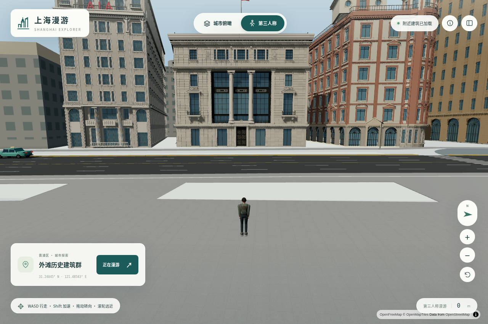

# 上海漫游 · Shanghai Explorer v4.1

上海16区三维地图与第三人称漫游项目。**外滩10栋历史建筑提供近景建筑细节，另有4栋陆家嘴地标；全市背景由1,708个建筑分块、1,796,419个普通建筑及部件要素组成。** 外滩模型根据公开照片与地图轮廓逐栋制作，包含真实凹窗、门洞、柱廊、檐口和屋顶构件；普通建筑以轮廓与高度体块为主，126处另有已核验来源参数的双坡或单坡屋顶。

[在线预览](https://rawcdn.githack.com/ecojust/e-resource/72e344b6e927b1a3130b2ff6e6901875f260eb3e/projects/shanghai/index.html)（首次出现托管提示时点击 **Open the page**）。



[网页启动包](downloads/shanghai-web-launcher.zip)约38.8MB，包含14栋地标、滨江街道、表面纹理、远景变体和参考照片；解压后按包内说明启动HTTP服务。普通建筑分块按需从固定版本联网加载，地图仍需联网。完整模型、可编辑文件及重建源码也在本项目内。

## v4.1 局部屋顶补充

从已保存的179万条源要素中筛出126个可核验的屋顶：29个双坡、97个单坡，分布在嘉定3个、普陀79个、长宁27个、黄浦17个。原先平顶体块的相应部分现按原始屋型、坡高和方向生成斜屋面；总高、足迹与建筑ID保持一致，双坡采用居中对称屋脊。只重建6个分块，其余1,702个模型及其构建状态保持原字节。

[屋顶筛选与全部来源](data/roofs/README.md)、[几何核验](data/roofs/geometry-validation.json)和[分块核验](data/roofs/roof-validation.json)记录每个采用的OSM历史版本及生成假设。这里增加的是局部参数化屋顶；其余普通建筑仍以简模为主，也没有由屋顶标签推造真实窗位或照片纹理。全城逐栋真实复原尚未完成。

## v4 近景观感

[v4 表现与限制](data/bund/REALISM_V4.md)说明渲染、街道与模型切换的具体范围。本版保留 v3 的建筑几何和全市范围，改进外滩近距离观看：石材与路面使用 CC0 扫描表面纹理，细微法线与粗糙度随距离衰减；玻璃加入天空反射，附近建筑使用缓存的日光投影。外滩 2、3、17 号修复了部分构件的反向面序，保持原有顶点位置和尺寸；原始 `.blend` 和近景 GLB 没有因远景优化而降低精度。网页新增的表面效果由渲染模块应用，不包含在旧版原始 GLB 材质里。

中山东一路的路面、车道线与过街线按公开道路资料制作；漫游时不把地下隧道地图线画成地面道路。10辆静态车辆用于街景尺度示意，位置限定在公开道路范围内，不代表实时交通；排水口间距、部分线位和表面纹理尺度仍有推定。纹理是表现材料质感的通用扫描样本，不能当作这些建筑真实石种或风化分布的测量。反射使用程序生成的天空，并非现场全景。详见[表面来源与许可](assets/materials/realism-v4/README.md)、[街道输入与范围](source/bund/street/README.md)。

远处外滩建筑在相机距离约400米后切换为轻量变体，回到300米内恢复完整近景模型；两套模型原子替换，加载失败保留已显示的版本。新角色与较低的跟随视角为立面留出更多画面。默认从外滩步道开始，仍可切换城市俯瞰并访问全部16区。

## 打开页面与操作

无需npm安装或构建。在本目录运行：

```sh
python -m http.server 8000
```

打开 **http://localhost:8000**。入口为[index.html](index.html)，需HTTP加载模块与GLB，不能直接用file://打开。道路、水体、中文标注及远景地图仍需联网。

- **城市俯瞰**：拖动、缩放；选择行政区或建筑，或双击地图选择上海范围内的街区起点。
- **第三人称**：WASD/方向键行走、Shift加速、拖动转向、滚轮调镜头；Q/E转动、R重置。
- **手机**：左侧摇杆、按住加速、拖动视角；支持区级跳转和面板收起。
- 支持建筑、水体碰撞和落点检查；地图加载后可能校正落点。桥面、立交与地形未恢复真实高程，不能作为现实导航。

## 外滩近景模型

网页使用优化后的GLB；原始GLB和Blender文件供继续编辑。所有发布文件均受 **100,000,000字节**上限检查，按建筑或城市分块保存，无需Git LFS。

| 建筑 | 可见结构重点 | GLB下载 | Blender原生文件 |
|---|---|---|---|
| 2号 · 上海总会 | 六柱柱廊、顶层拱窗与双亭 | [网页版](assets/models/bund/web/bund02.glb) · [原始GLB](assets/models/bund/bund02.glb) | [.blend](assets/native/bund/bund02.blend) |
| 3号 · 有利大楼 · 外滩3号 | 转角塔楼、双街立面与窗套 | [网页版](assets/models/bund/web/bund03.glb) · [原始GLB](assets/models/bund/bund03.glb) | [.blend](assets/native/bund/bund03.blend) |
| 12号 · 汇丰银行大楼 | 六柱柱廊、鼓座、穹顶与中庭 | [网页版](assets/models/bund/web/bund12.glb) · [原始GLB](assets/models/bund/bund12.glb) | [.blend](assets/native/bund/bund12.blend) |
| 13号 · 江海关大楼 | 钟塔、凹窗与源轮廓四角亭 | [网页版](assets/models/bund/web/bund13.glb) · [原始GLB](assets/models/bund/bund13.glb) | [.blend](assets/native/bund/bund13.blend) |
| 15号 · 华俄道胜银行大楼 | 柱廊、拱券与窗洞 | [网页版](assets/models/bund/web/bund15.glb) · [原始GLB](assets/models/bund/bund15.glb) | [.blend](assets/native/bund/bund15.blend) |
| 17号 · 字林西报大楼 | 窄面深进、窗带与双亭 | [网页版](assets/models/bund/web/bund17.glb) · [原始GLB](assets/models/bund/bund17.glb) | [.blend](assets/native/bund/bund17.blend) |
| 18号 · 麦加利银行 · 外滩18号 | 爱奥尼柱廊、山花与栏杆 | [网页版](assets/models/bund/web/bund18.glb) · [原始GLB](assets/models/bund/bund18.glb) | [.blend](assets/native/bund/bund18.blend) |
| 19号 · 和平饭店南楼 · 汇中饭店 | 红砖壁柱、山花与角亭 | [网页版](assets/models/bund/web/bund19.glb) · [原始GLB](assets/models/bund/bund19.glb) | [.blend](assets/native/bund/bund19.blend) |
| 20号 · 和平饭店北楼 · 沙逊大厦 | 装饰艺术窗带、退台与铜屋顶 | [网页版](assets/models/bund/web/bund20.glb) · [原始GLB](assets/models/bund/bund20.glb) | [.blend](assets/native/bund/bund20.blend) |
| 23号 · 中国银行大楼 | 主楼、后接西翼与中式屋檐 | [网页版](assets/models/bund/web/bund23.glb) · [原始GLB](assets/models/bund/bund23.glb) | [.blend](assets/native/bund/bund23.blend) |

[外滩源码与逐栋资料](source/bund/README.md)说明每栋的生成入口、参考照片、尺寸依据与推定部分；[外滩资产清单](data/bund/manifest.json)记录地理原点、模型链接、包围高度和照片署名。细部可查看[汇丰柱廊](assets/previews/bund/hsbc-column-detail.png)、[麦加利柱廊](assets/previews/bund/chartered-column-detail.png)、[海关窗洞](assets/previews/bund/customs-window-detail.png)。

这里的建筑细节是照片参照下的几何重建，**不是测绘、激光扫描或摄影测量成果**。窗洞具有实际退距，柱、窗框、栏杆等采用几何构件；雕刻纹样有简化。不可见侧后立面、墙厚、洞深和部分楼层高度含推定，未重建可游览室内。海关总高约79.2m有官方文字依据；其余建筑的总高或屋顶附属部分需结合逐栋说明判断，不能把清单中的小数视为实测精度。模型包围高度可能包含旗杆、灯亭或尖顶，不等于主檐口高度。

## 陆家嘴与全市背景

| 地标 | 公开总高 | GLB下载 | Blender原生文件 |
|---|---:|---|---|
| 上海中心大厦 | 632 m | [网页版](assets/models/optimized/shanghai-tower.glb) · [原始GLB](assets/models/shanghai-tower.glb) | [四地标合并场景](assets/native/shanghai-landmarks.blend) |
| 东方明珠电视塔 | 468 m | [网页版](assets/models/optimized/oriental-pearl.glb) · [原始GLB](assets/models/oriental-pearl.glb) | [四地标合并场景](assets/native/shanghai-landmarks.blend) |
| 上海环球金融中心 | 492 m | [网页版](assets/models/optimized/swfc.glb) · [原始GLB](assets/models/swfc.glb) | [四地标合并场景](assets/native/shanghai-landmarks.blend) |
| 金茂大厦 | 420.5 m | [网页版](assets/models/optimized/jin-mao.glb) · [原始GLB](assets/models/jin-mao.glb) | [四地标合并场景](assets/native/shanghai-landmarks.blend) |

陆家嘴四栋复原球体、扭转塔身、环球金融中心顶部通孔及金茂退台等可辨识造型；与外滩逐栋近景模型的细化范围不同。[高度与坐标来源](data/audit/poi-sources.json)保留官方或可靠公开资料。

16区覆盖黄浦、徐汇、长宁、静安、普陀、虹口、杨浦、闵行、宝山、嘉定、浦东新区、金山、松江、青浦、奉贤、崇明。[全域分块清单](assets/city/README.md)与[机器清单](assets/city/manifest.json)提供下载和地理定位信息；每块具有独立经纬度原点与米制坐标。assets/districts/仅保留旧版每区1km²样本，当前HTML使用全域分块。

普通建筑的通用窗格属于显示效果，不代表真实窗位或材料。道路宽度优先公开width/lanes字段，否则按等级估算。全域公开源仍可能漏楼、错分轮廓或具有年代差异；“全域”指本次来源范围内的处理覆盖，不等于全上海逐栋实测。

## 数据依据与版本变化

- **全域来源**：Overture 2026-10-21.0。v2核验检查2,892个相交z14格，其中1,734个有源瓦片；下载/解码失败及全局重复UUID均为0。保留1,796,667个唯一地上建筑/部件，地下11个另行记录。[轮廓快照](data/fullcity-raw/manifest.json)支持离线重建。
- **行政边界**：OSM的16区几何有效，45个检查点通过，覆盖崇明、长兴、横沙、机场、临港及外围区域。河海行政水域面积不等于官方6,340.5km²陆域面积。[地理审计](data/audit/ACCURACY.md)保留政府资料对照和边界处理说明。
- **父体剩余足迹**：v2逐一核验551个父体，恢复402处原先被分部处理遗漏的剩余足迹，约953,690m²；这些是历史核验总量。v3中国银行详细模型接管其中1处，当前普通模型保留**401处**。残差高度单独估算，不把塔楼总高直接用作裙房高度；原始阈值、面积及402处证据仍保留供追溯。
- **精确替换**：v3按源对象ID及组件关系替换**98个可渲染要素**。普通模型当前计数为 **1,796,116 − 98 + 401 = 1,796,419**，不是独立楼宇数量。外滩细模不按半径粗删邻楼；海关仅替换确认的前楼、钟楼和四角亭，独立后翼继续保留。[v3分块核验](data/bund/validation/city-patches.json)与[构件核验记录](data/bund/validation/)记录替换依据。

高度优先级为：源height → 楼层数×3.2m → CMAB严格轮廓匹配的预测高度 → CNBH 10m栅格估计 → GHSL区域均高 → 明确标注的12m缺省。CMAB在16区抽样1,280个足迹作对齐检查，不采用简单最近邻或无依据的GCJ偏移。

**栅格估计会明显低估高楼。** 在375条来源高度/楼层的一致性检查中，CNBH绝对差中位16.45m、P90为124.47m；这不是独立地面真值评估。CMAB、CNBH、GHSL与Overture年代也不同，不能据此宣称全城真实天际线或测绘级精度。[高度数据及比较](data/heights/HEIGHT_SOURCES.md)保留v2来源、许可和验证证据；其中历史计数应与上述v3替换变化区分。

[全域高细节数据可行性核查](data/audit/HIGH_DETAIL_DATA.md)补充检查了六类来源，分别记录实际细节等级、上海覆盖、许可及访问结果。本轮未取得可直接公开分发的全市精细模型包；有照片和尺寸依据的单体仍可继续逐栋重建。

## 加载、检查与重建

页面按当前位置加载附近城市分块和详细建筑，网页GLB经过压缩，原始可编辑GLB保留。城市分块离开缓存范围后释放；加载失败时保留在线建筑回退。正常的Overture建筑通过GERS标识与本地分块直接关联。服务临时不可用、切换到OSM备用建筑时，则先检查完整建筑几何是否被已加载且可见的模型覆盖，再按实际OpenMapTiles建筑要素ID隐藏重复体块；两者不是同一套ID，也不假定两套数据逐栋对应。跨出覆盖范围、缺少ID、存在未覆盖瓦片片段或精细地标尚未加载的建筑会保留，模型退出后恢复备用建筑。

备用模式的包含检查处理凹多边形和孔洞，替代了地图引擎不支持建筑多边形的`within`表达式。部分OSM要素把多栋独立建筑合并为同一ID：这时按原有多边形组件判断覆盖，未覆盖组件以原轮廓、孔洞、属性和高度保留在独立备用图层，待其完成渲染才隐藏原ID；不裁剪轮廓、不扩大覆盖边界。跨界的单个多边形仍保留，无法判定的重叠瓦片碎片也保留原表示。真实OpenMapTiles要素23809960的46组件案例和失败恢复顺序由[组件回归测试](tests/osm-building-residual-plans.test.mjs)覆盖，另有[包含与ID测试](tests/osm-building-suppression.test.mjs)及[备用图层生命周期测试](tests/osm-residual-layer.test.mjs)。帧率与内存占用取决于设备、浏览器、视野和模型密度，不承诺固定帧率。[运行验证](tests/verification.json)和[建筑几何验证](data/bund/validation/)记录各自的检查范围。

```sh
python tools/check_assets.py
npm test
python data/audit/build_audit.py --project .
python data/heights/verify_release.py
```

- [外滩源码说明](source/bund/README.md)：10栋建筑、配套街道及各自输入资料。
- [全域生成说明](source/city/FULLCITY_BUILD.md)：建筑分块、精确替换、父体残差与压缩。
- [高度重建说明](data/heights/REBUILD.md)：下载、裁剪、匹配与配置锁；超限上游原始下载不纳入仓库。
- [陆家嘴源码](source/landmarks/)：四地标生成与导出，运行方式见文件头部。

压缩GLB可先转换，再导入Blender/Godot等编辑器；外滩也可直接下载上表原始GLB或.blend：

```sh
npm install -g gltfpack
python tools/unpack_model.py assets/city/tiles/14-13720-6694.glb exported/block.glb
```

## 许可与署名

原创界面、控制器和生成代码采用[MIT](LICENSE)。OSM/Overture轮廓及派生建筑数据库遵循ODbL-1.0，署名 **© OpenStreetMap contributors** 及相应来源；East Asian Buildings、CMAB、CNBH、GHSL按各自CC BY 4.0记录署名。Microsoft比较栅格采用CDLA-Permissive 2.0，仅用于验证。第三方库许可位于[licenses/](licenses/)。

外滩参考照片保留原作者和各自的CC0、CC BY或CC BY-SA许可；逐栋署名以[data/bund/manifest.json](data/bund/manifest.json)及[源码照片表](source/bund/README.md#参考照片与许可)为准，补充照片见各源码包的引用文件。照片未作为模型贴图，但随附参考图仍受原许可约束，**代码的MIT许可不覆盖照片、字体和外部数据**。

新增表面贴图采用 Poly Haven CC0-1.0，作者与来源见[表面署名](assets/materials/realism-v4/SOURCES.md)。原创示意车辆与角色代码采用项目 MIT 许可；车辆摆放使用的道路数据仍保留 OSM/ODbL 说明。
