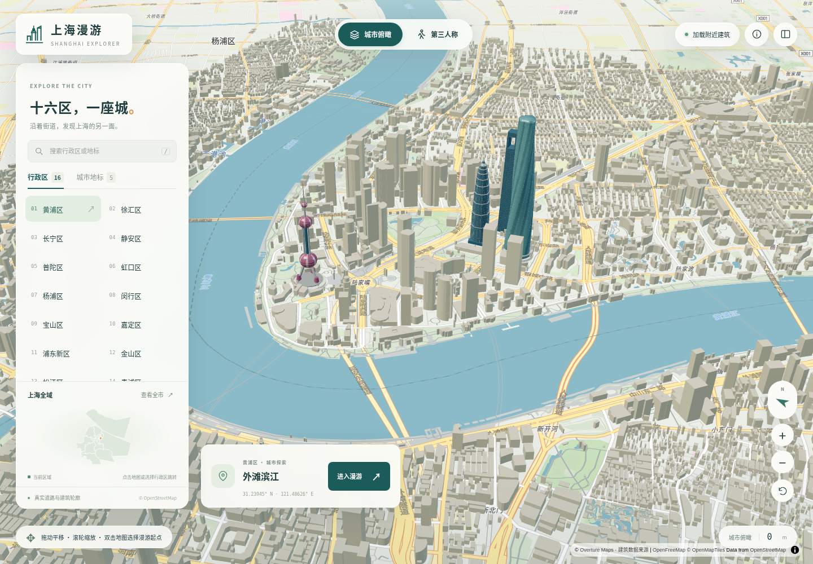

# 上海漫游 · Shanghai Explorer

独立的上海16区三维模型与第三人称漫游项目。**1,708个全域建筑分块、1,796,435个建筑及部件、5个单独细化的地标**。采用真实公开轮廓和有出处的高度数据；页面只加载当前位置附近的模型。

[在线预览](https://raw.githack.com/ecojust/e-resource/master/projects/shanghai/index.html)（首次出现托管提示时点击 **Open the page**）。



## 打开页面与操作

无需npm安装或构建。在本目录运行：

```sh
python -m http.server 8000
```

打开 **http://localhost:8000**。入口为[index.html](index.html)，需HTTP加载模块与GLB，不能直接双击用file://打开。道路、水体、中文标注及远景地图仍需联网；全域建筑GLB和5个地标已保存于仓库。

- **城市俯瞰**：拖动、缩放；选择行政区/地标，或双击地图选择上海范围内的任意街区起点。
- **第三人称**：WASD/方向键行走、Shift加速、拖动转向、滚轮调镜头；Q/E转动、R重置。
- **手机**：左侧摇杆、按住加速、拖动视角；支持区级跳转和面板收起。
- 建筑与水体碰撞、桥梁通行判断、落点检查；加载中的地图可能稍后校正落点。当前模型未恢复桥面/立交的真实高程，不能作为现实导航。

## 模型覆盖与下载

| 内容 | 当前交付 |
|---|---|
| 全部16区 | 黄浦、徐汇、长宁、静安、普陀、虹口、杨浦、闵行、宝山、嘉定、浦东新区、金山、松江、青浦、奉贤、崇明 |
| 完整建筑分块 | [1,708个GLB及16区下载清单](assets/city/README.md)，共1,796,435个建筑/部件，模型总量约285.7MB |
| 地标 | [东方明珠468m](assets/models/oriental-pearl.glb)、[上海中心632m](assets/models/shanghai-tower.glb)、[环球金融中心492m](assets/models/swfc.glb)、[金茂420.5m](assets/models/jin-mao.glb)、[海关前楼79.2m](assets/models/customs-house.glb) |
| Blender | [陆家嘴四地标原生场景](assets/native/shanghai-landmarks.blend)；其余GLB可转换后导入，全部附生成源码 |
| 可复现数据 | [全域轮廓快照](data/fullcity-raw/manifest.json)、[高度数据与校验锁](data/heights/HEIGHT_SOURCES.md)、[地理审计](data/audit/ACCURACY.md) |

完整模型位于 **assets/city/**。assets/districts/保留旧版每区1km²的历史样本，当前HTML不再使用这些样本作为全域模型。每块GLB具有独立经纬度原点与米制坐标，按manifest地理定位；不把整座城市拼成一个超大文件。

所有发布文件均受 **100,000,000字节**上限检查。当前全域GLB最大0.94MB，原生Blender约5.1MB，最大的高度数据文件约24.3MB，没有Git LFS。

## 精度、来源和实际修正

城市普通建筑为**足迹与高度挤出的LoD1体块**，不是逐栋摄影测量。通用窗格是显示效果，未声称复原真实窗户、材质、内饰。道路宽度优先公开width/lanes字段，否则按等级估算；桥梁、立交与地形高程尚未实测重建。

- Overture 2026-10-21.0：检查2,892个相交z14格，其中1,734个有源瓦片；下载/解码失败和全局重复UUID均为0。保留1,796,667个唯一地上建筑/部件，地下11个单独记录。全域源几何已经离线保存，不依赖旧版PMTiles永久在线。
- OSM行政边界与WGS84坐标：16个区几何有效，45个检查点全部通过，覆盖崇明/长兴/横沙、机场、临港和外围区域。与16区政府资料对照；河海行政水域的面积不能当作官方6,340.5km²陆域面积。
- 建筑分部核验：551个父体逐一检查，恢复402处被塔楼分部处理误删的剩余足迹，面积约953,690m²。残差高度单独估算，父楼总高不作为裙房高度。42处总残差≤1m²、以及环面积<0.01m²的微小碎片明确记录阈值与面积。
- 精细地标：按OSM对象及父子关系精确替换83个可渲染要素，未用半径粗删邻楼。海关按官方79.2m总高、36.2m主楼、5.4m钟盘和照片比例重做；前楼采用OSM真实轮廓及朝向，后翼继续由城市模型表示。
- CMAB对齐检查：16区抽样1,280个足迹，直接坐标与假设偏移对照，排除明显统一GCJ误移；仅允许严格重叠匹配，不把最近邻的楼高搬过来。

### 高度来源分布

| 类型 | 普通模型要素 |
|---|---:|
| 来源自带高度 | 2,504 |
| 楼层数 × 3.2 m | 8,575 |
| CMAB 严格匹配的预测高度 | 67,785 |
| CNBH 10 m 栅格估计 | 1,333,435 |
| GHSL 区域均高估计 | 376,429 |
| 明确标注的 12 m 缺省值 | 7,707 |

优先源height与楼层，其次CMAB严格匹配预测、CNBH 10m、GHSL约80×93m区域均高，最后标注12m缺省。**这些公开估计会明显低估高楼**：375条参考高度/楼层的一致性检查中，CNBH绝对差中位16.45m、P90为124.47m；这不是独立地面真值评估。不能用本项目宣称全城真实天际线或测绘级精度。[高度数据、匹配规则与逐项比较](data/heights/HEIGHT_SOURCES.md)给出全部证据及限制。

模型完整性指本次公开源范围内的完整处理；源数据仍可能漏楼、错分轮廓或具有年代差异。CMAB/CNBH/GHSL的年代与Overture发布日不同。历史OSM飞地/远方离散成员保留于原始边界，城市展示范围的裁切有记录。

## 加载与性能

空间索引选择附近分块，最多同时显示6块、缓存8块、并发加载2块；离开后取消或释放资源。Meshopt对约2km小块进行16位位置量化，数值舍入约厘米级，未要求三角形简化。五个地标网页副本使用GPU实例化降低重复绘制，原始可编辑GLB保留。

地标或某个分块加载失败时保留在线建筑回退；精确GERS ID引用计数避免双重体块。普通窗格按像素大小抗锯齿，近景道路保持米制宽度。桌面、手机、缓存和缺失资源回退的验证记录见[tests/verification.json](tests/verification.json)。帧率取决于设备与WebGL实现；软件GPU测试不能代表真实手机/显卡性能。

## 检查与重建

```sh
python tools/check_assets.py
npm test
python data/audit/build_audit.py --project .
python data/heights/verify_release.py
```

全域几何、地标精确替换、父体残差和压缩模型的重建步骤见[source/city/FULLCITY_BUILD.md](source/city/FULLCITY_BUILD.md)。高度下载与裁剪见[data/heights/REBUILD.md](data/heights/REBUILD.md)；原始300MB以上下载仅供本地处理，不进仓库。源码与已发布数据均可独立复现。

转换一个压缩模型供Blender/Godot等编辑器导入：

```sh
npm install -g gltfpack
python tools/unpack_model.py assets/city/tiles/14-13720-6694.glb exported/block.glb
```

也可按生成器的`--no-compress`选项重新构建。地标源码位于source/landmarks/，运行方式写在文件头部。

## 许可

原创界面/控制器/生成代码采用[MIT](LICENSE)。OSM/Overture轮廓及派生建筑数据库遵循ODbL-1.0；East Asian Buildings、CMAB、CNBH、GHSL按各自CC BY4.0来源署名。海关照片参考作者Diomidis Spinellis，CC BY2.5；未把照片作为贴图或转载全文。Microsoft比较栅格采用CDLA-Permissive2.0，仅用于验证。第三方库许可保存在licenses/，所有数据许可和作者记录随源码附带，不能被代码MIT许可覆盖。
