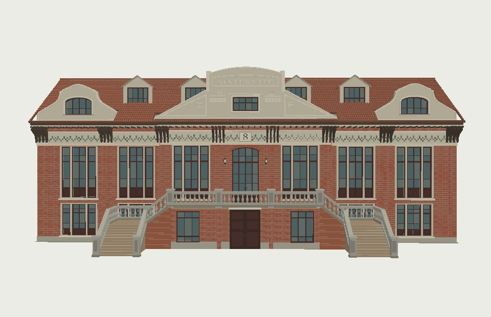

# 广慈医院原产科楼庭院立面与双梯门廊

瑞金二路197号，原广慈医院25舍，今瑞金医院8号楼。模型覆盖庭院一侧的七个窗轴、双梯门廊、三处山花和相接的坡屋顶。市政府铭牌记载1921年，医院院史记载1922年建成。砖皮尺度、楼梯踏深与屋面进深取自照片估算。[建筑与尺度说明](../../../../source/precise/huangpu-guangci-maternity-pavilion-twin-stair/README.md) · [摄影及文献来源](../../../../source/precise/huangpu-guangci-maternity-pavilion-twin-stair/reference-review.json)

## 模型下载

| 版本 | 三角面 | 字节 | SHA-256 |
| --- | ---: | ---: | --- |
| [原始 GLB](huangpu-guangci-maternity-pavilion-twin-stair-raw.glb?raw=true) | 92,962 | 6,129,704 | `7fd4517cdd3e5789131517609909ff687defb9a30538e757dc91bf5780015463` |
| [网页近景 GLB](huangpu-guangci-maternity-pavilion-twin-stair-web.glb?raw=true) | 92,962 | 2,350,260 | `eb1d148b09e43b88246b99cb837368167b8487650b65db83f5753992f7eb7cd1` |
| [远景 GLB](huangpu-guangci-maternity-pavilion-twin-stair-lod.glb?raw=true) | 52,290 | 1,168,816 | `948336f1d79c0ccda951b87c22a4d3771d4a792c63502ed8b1cb07c08e1bff0e` |

此制作快照提供三份 GLB。可编辑 Blender 原件、独立网页的四项下载和全城地图验收仍在进行。

## 模型图

| 部位 | 近景模型 | 远景模型 |
| --- | --- | --- |
| 庭院正面 | [近景](../../../../data/audit/guangci-maternity-pavilion-twin-stair-v1/preflight/full-views/courtyard.jpg) | [远景](../../../../data/audit/guangci-maternity-pavilion-twin-stair-v1/preflight/lod-views/courtyard.jpg) |
| 双梯与上层平台 | [近景](../../../../data/audit/guangci-maternity-pavilion-twin-stair-v1/preflight/full-views/paired-stairs.jpg) | [远景](../../../../data/audit/guangci-maternity-pavilion-twin-stair-v1/preflight/lod-views/paired-stairs.jpg) |
| 上下层入口 | [近景](../../../../data/audit/guangci-maternity-pavilion-twin-stair-v1/preflight/full-views/terrace.jpg) | [远景](../../../../data/audit/guangci-maternity-pavilion-twin-stair-v1/preflight/lod-views/terrace.jpg) |
| 曲线山花 | [近景](../../../../data/audit/guangci-maternity-pavilion-twin-stair-v1/preflight/full-views/curved-gable.jpg) | [远景](../../../../data/audit/guangci-maternity-pavilion-twin-stair-v1/preflight/lod-views/curved-gable.jpg) |
| 交坡屋顶 | [近景](../../../../data/audit/guangci-maternity-pavilion-twin-stair-v1/preflight/full-views/roof.jpg) | [远景](../../../../data/audit/guangci-maternity-pavilion-twin-stair-v1/preflight/lod-views/roof.jpg) |
| 中央题名 | [近景](../../../../data/audit/guangci-maternity-pavilion-twin-stair-v1/preflight/full-views/maternity.jpg) | [远景](../../../../data/audit/guangci-maternity-pavilion-twin-stair-v1/preflight/lod-views/maternity.jpg) |
| 檐下木托 | [近景](../../../../data/audit/guangci-maternity-pavilion-twin-stair-v1/preflight/full-views/brackets.jpg) | [远景](../../../../data/audit/guangci-maternity-pavilion-twin-stair-v1/preflight/lod-views/brackets.jpg) |
| 上层长窗 | [近景](../../../../data/audit/guangci-maternity-pavilion-twin-stair-v1/preflight/full-views/high-windows.jpg) | [远景](../../../../data/audit/guangci-maternity-pavilion-twin-stair-v1/preflight/lod-views/high-windows.jpg) |
| 西侧转折梯 | [近景](../../../../data/audit/guangci-maternity-pavilion-twin-stair-v1/preflight/full-views/west-stair.jpg) | [远景](../../../../data/audit/guangci-maternity-pavilion-twin-stair-v1/preflight/lod-views/west-stair.jpg) |

建筑、砖纹和构件由项目制作，题名字形附 SIL Open Font License。照片用于量测和观察，模型采用自制纹理。[许可](../../../../source/precise/huangpu-guangci-maternity-pavilion-twin-stair/SOURCES-LICENSE.md) · [作者复核](../../../../data/audit/guangci-maternity-pavilion-twin-stair-v1/preflight/model-review.json) · [逐图观察](../../../../data/audit/guangci-maternity-pavilion-twin-stair-v1/preflight/visual-comparison.json) · [源网格和压缩模型比较](../../../../data/audit/guangci-maternity-pavilion-twin-stair-v1/preflight/decoded-surface-comparison.json)
