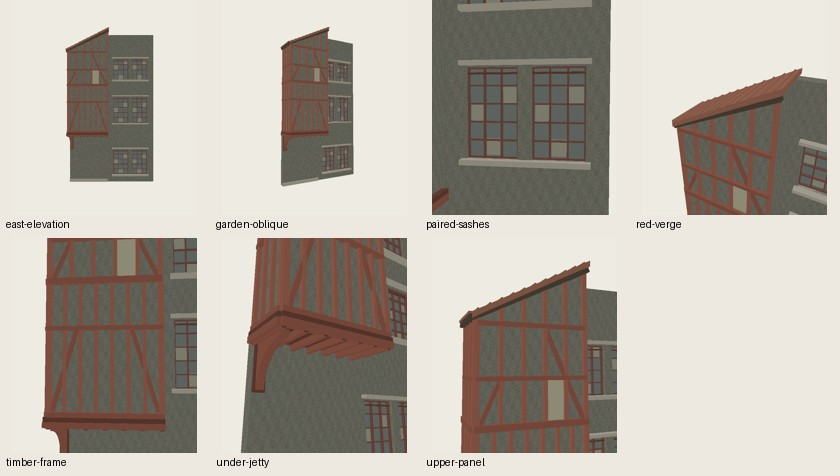

# 安福路284号花园住宅露木构初稿

长面七格和脚梁下的弧形托木已按两面斜照成形。横木的位置经三张照片复算，现距脚梁约1.84米。上层的两道横木及斜檐仍在用较正面的照片校正。[对照照片](https://www.sohu.com/a/420379562_802458)

近景含3,280个三角面、60个可编辑组。远景含2,996个三角面。[两档几何记录](geometry-study.json)

[查看较大图](near-detail.jpg)
