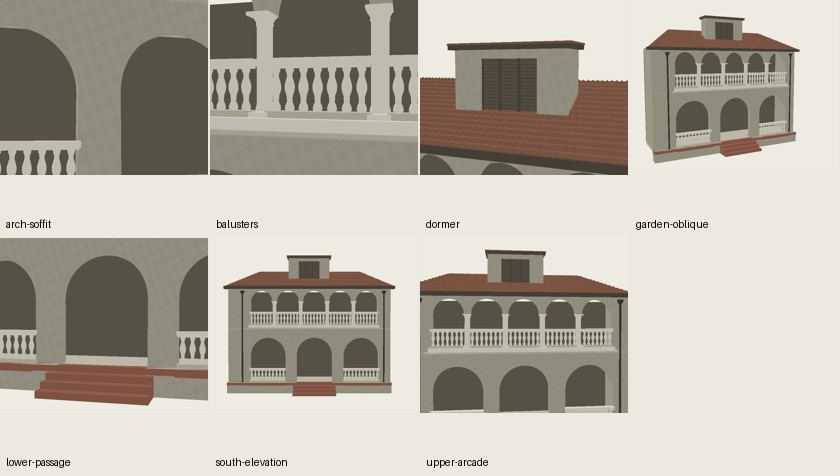

# 东平路5号南敞廊初稿

底层三道拱券、中间的入口台阶、上层五连券及四圆柱均已成形。对照花园南照后，继续细化拱下可见的门洞、廊后立柱与背光深度。[对照照片](https://www.thepaper.cn/newsDetail_forward_21629034)

近景含26,600个三角面、65个可编辑组。远景含10,024个三角面。[两档几何记录](geometry-study.json)

[查看较大图](near-detail.jpg)
