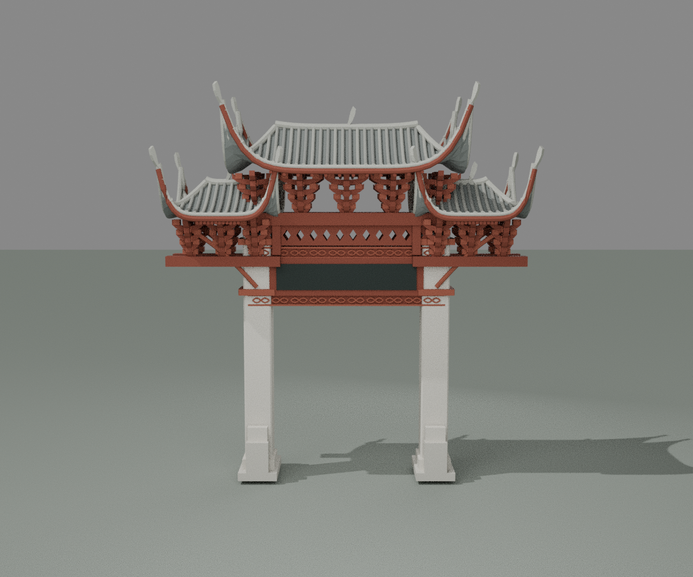
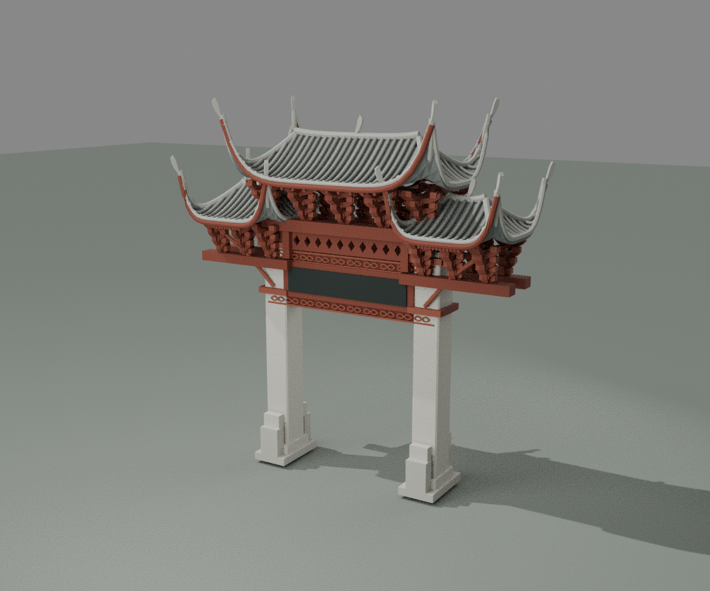
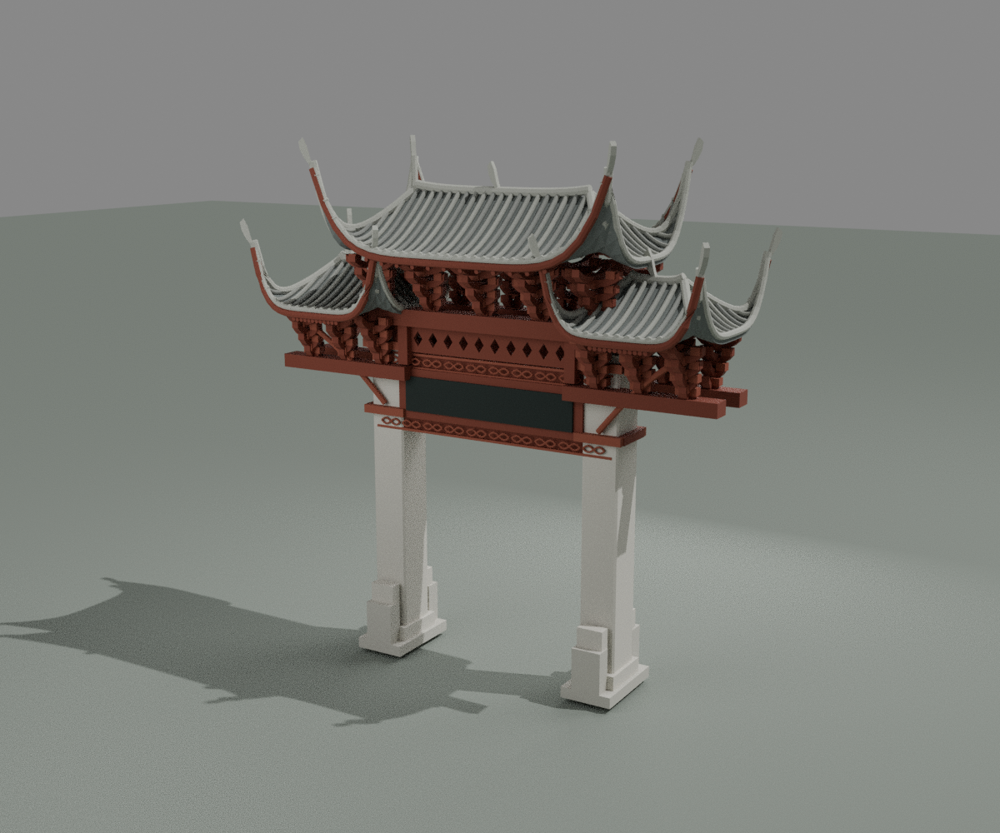
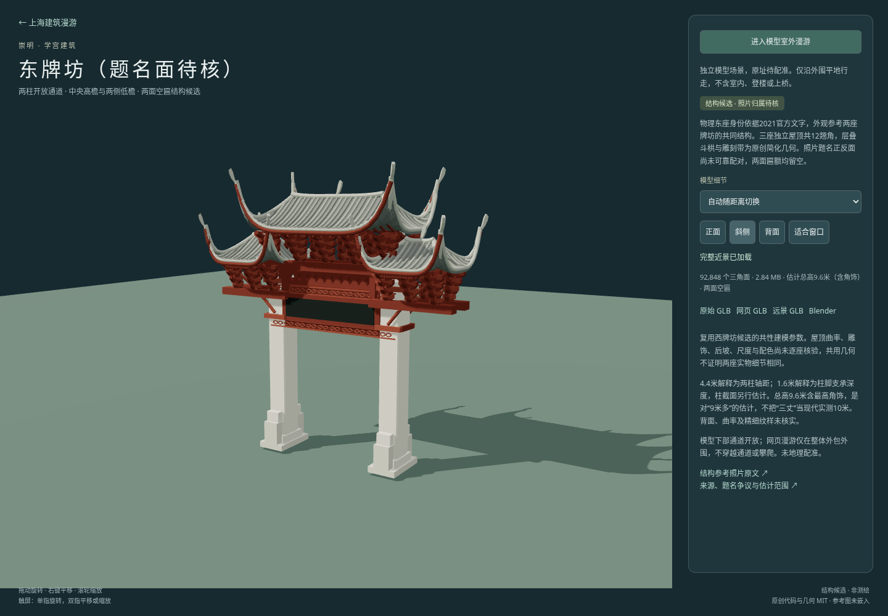

# 东牌坊结构候选检查

[独立预览](../../../east-paifang.html) · [来源与构建](../../../source/precise/chongming-chaozong-paifang/README.md) · [资产清单](../../../assets/models/candidates/chongming-chaozong-paifang/manifest.json)

交付ID `chongming-chaozong-paifang`，中文名为崇明学宫东牌坊（题名面待核）。物理东座身份采用2021年官方文字，两座照片仅用于共性结构参照；没有完成单座正反面照片身份绑定。两面匾额均为空，不把保留的资产ID当成题字验收。没有照片贴图、再分发、城市配准或西座场景。

本件完整复用[西牌坊候选](../../../source/precise/chongming-xuehai-paifang/README.md)在提交 `6673d31dee681d219078b58bc658d77a0aa4e1e5` 的共用几何假设。独立重新导出东座资产并运行以下检查，不表示两座实物的雕饰、尺度、曲率、后坡或隐蔽支承已核验一致。2021官方东组“德配天地／朝宗”作为来源字段保留，旧ID不绑定“朝宗”近景。

## 资产与同批哈希

下表使用十进制 MB。下表、manifest、原生重开和网页检查均对应当前同批资产，所有交付文件小于100 MB。

| 文件 | 大小 | 三角面 | SHA256 |
|---|---:|---:|---|
| chongming-chaozong-paifang-raw.glb | 7.125616 MB | 92848 | `d4dd86e79c53ffd88acc6403c8c72d35003b70c88c2f7b5f4dcde9bc5c25d900` |
| chongming-chaozong-paifang-web.glb | 2.844624 MB | 92848 | `2a13806e447dec28b963c3facfbdee1066dbc86d1c25673109a4d2c259c1a6dc` |
| chongming-chaozong-paifang-lod.glb | 0.631828 MB | 20996 | `d2fd15c663747db9da284acb7074b8e81c80082bc004a7606c31b9f052dce5a2` |
| chongming-chaozong-paifang.blend | 3.312493 MB | 92,848（模型部分） | `6fb5ab2839f9147172308ac3c0c7d028529afc1d250d58fab9acf34ff6b17d86` |

## 实际几何与原生检查

- 近景92,848面，1,037个作者构件；远景20,996面，505个作者构件。每个作者构件均为封闭正体积实体；整体允许构件相接或相交，不宣称整栋是单一布尔并集。
- 原始近景、未压缩远景检查有限顶点、无退化面、绕序一致和构件水密；最终网页GLB及远景GLB再用gltfpack解码检查，面数、外包与源模型一致，无退化面、绕序一致。两档均保留东座身份、空匾、共用假设和估计范围的extras，无嵌入图片。
- 三个独立封闭屋面壳：中央一高、左右两低；每单元四个翘角，共十二角。两块空匾为真实几何，无字形或文字纹理。
- 全部构件实际外包为宽9.088909、深3.488909、高9.600000米。总高包括最高简化角饰；这些是模型计算值，不是现场量测。4.4米解释为两柱轴距；1.6米解释为每柱支承总深度，不称每根石柱截面实测。
- 下部通道沿完整深度射线检查：X为−1.65、0、1.65米，标高为0.10、0.25、1.00、2.50、4.25米，共15条水平射线均无阻挡；对应梁上方与石柱位置的对照射线命中实体。射线计算实际净宽：柱身处3.720000米、柱脚处3.440000米。梁底4.30米为模型估计。
- Blender 4.3.2文件保存后从磁盘重新打开，模型部分92,848面，几何摘要前后一致；渲染地面和灯光不计入模型摘要。导入原始GLB的SHA与当前raw一致。

原生重开几何摘要：`f3d81c78da47971060550aa6af15688c4975fec216353efe62a04165e7fdbcc9`。

详细机器记录：[geometry.json](geometry.json)、[native.json](native.json)、[packaged.json](packaged.json)、[近景构件标记](raw-features.json)、[远景构件标记](lod-features.json)。

## 实际预览与网页

三图均由当前原生文件渲染。已对照参考拼图检查两大石柱、开放通道、三屋顶不同标高、层叠栱件和两面空匾的结构表达；不是逐构件或题名归属照片复原验收。此处为本件实际渲染的结构显示复核。





Chromium实际加载并通过身份、按manifest SHA256校验的GLB读取、近景→远景→近景、正面／背面／斜侧／适合窗口按钮、相机距离、模型外包生成的独立边界、进入外围漫游、实际前进和Escape退出。页面无异常或失败HTTP响应。网页边界限制在模型外包外围，不提供柱间穿行或攀爬。

[网页检查结果](browser.json) · [可重跑脚本](qa-browser.cjs)



## 保留限制

9.6米是对“9米多”的明确估计，不把“三丈”固定换成实测10米。两柱轴距及柱脚深度解释、截面、檐伸、明显上翘曲率、简化四坡端部、重复栱件密度、雕刻和角饰均未实测。后坡采用对称假设，隐蔽支承和接头也为估计；没有精确龙凤、脊兽、榫卯或文字复刻。照片拍摄日期不独立确认，不宣称2026现状。2021官方题名组、旧馆1998题名组和照片环境关联之间的差异仍保留在来源登记中。

## 重跑

先按来源README完成两档生成、原生保存及打包，再在仓库根目录执行：

```sh
python projects/shanghai/source/precise/chongming-chaozong-paifang/source/verify_geometry.py --assets /tmp/east-paifang --out projects/shanghai/data/audit/east-paifang-v1/geometry.json
python -m http.server 8777 --directory projects/shanghai
# 另一个终端；要求系统Chromium和Playwright。输出到/tmp/east-paifang-browser.*，复核后同步至本目录。
node projects/shanghai/data/audit/east-paifang-v1/qa-browser.cjs
python projects/shanghai/source/precise/chongming-chaozong-paifang/source/verify_packaged.py --assets projects/shanghai/assets/models/candidates/chongming-chaozong-paifang --audit projects/shanghai/data/audit/east-paifang-v1 --gltfpack projects/shanghai/source/city/detail/tooling/node_modules/.bin/gltfpack
```

主代理实际查看斜侧、背面及最终网页图，独立复核四件资产大小/SHA256、三档GLB东座身份与共用假设，以及几何/原生报告的资产对应；见[视觉复核](root-visual-review.json)。网页题名说明采用直接描述，资料中的旧资产ID解释保留在来源文档。
