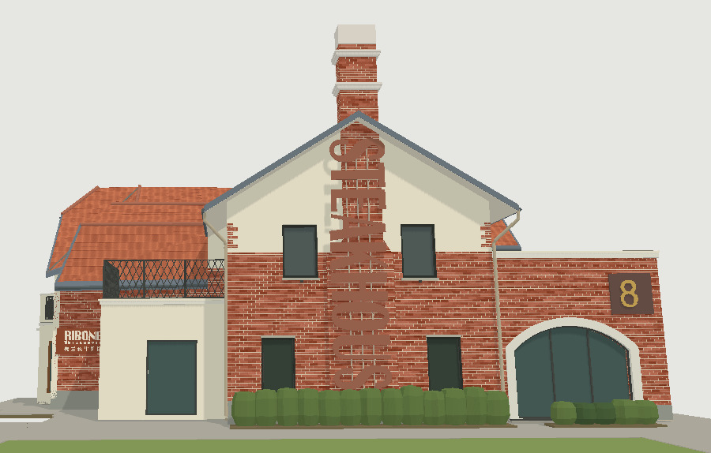
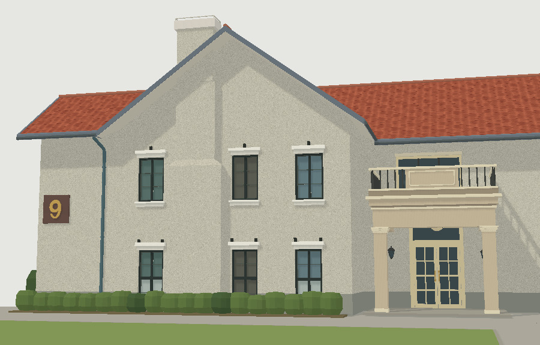

# 弘基创意国际园8、9号楼模型复核

[打开两宅与庭院](../../../hongji-yuyuan-garden-houses-8-and-9.html) · [模型文件与哈希](../../../assets/models/candidates/changning-hongji-yuyuan-garden-houses-8-and-9/manifest.json) · [外观依据与估计范围](../../../source/precise/changning-hongji-yuyuan-garden-houses-8-and-9/README.md)

| 2023年外观 | 原始模型 | 完整网页模型 | 远景网页模型 |
| --- | ---: | ---: | ---: |
| 三角面 | 49,876 | 49,876 | 36,888 |
| 文件字节 | 4,271,324 | 2,286,376 | 1,766,044 |
| 生成时划分的闭合实体 | 1,583 | 1,583 | 1,142 |

8号楼、9号楼与庭院分开生成。近景源码有714个命名组，远景有688个。每个实体均检查棱边配对、绕序和带符号体积。两个网页文件经过实际解码，每个面的方向、位置和材质相符。四种砖瓦和粉刷纹理的图像逐字节相同，近景27,936个、远景13,416个带纹理的三角形角点均保留原UV。[实体闭合](preflight/editable-parts-closure.json) · [解码表面](preflight/oriented-surfaces.json) · [材质、原图哈希与角点](preflight/render-uv.json)

## 从照片中的位置看模型

下列五幅图使用实拍的透视机位，呈现模型自身的几何和纹理。庭院房屋正面中点相距约26.28米，两处主山墙有不同的屋脊、窗洞、烟囱和门厅。北侧及背面的局部尺寸仍是估计值。[六个原始机位](preflight/six-front-registration.json) · [五幅渲染参数](preflight/registered-views/camera-render-checks.json)

| 8号楼临草坪山墙 | 9号楼临草坪山墙 |
| --- | --- |
|  |  |

[8号北侧门廊和招牌](preflight/registered-views/8-north-door.jpg) · [9号南面三处山墙](preflight/registered-views/9-south-gables.jpg) · [9号北面错层山墙](preflight/registered-views/9-north-gables.jpg)

- **8号入口和文字。** 单靠共面的窗和山墙拟合时，照片04的机位落入对面房屋。加入三个不同深度的构件后得到一处可站立的庭院步道机位，原图的26处入口点在近远两档均先击中相应构件。两种解保存在记录中。2016年可辨的十个烟囱字母逐字建模，2023年的最低字母被绿篱遮住。北侧咖啡馆三处招牌在两幅斜照分别有16/18、18/22个原始像点先击中预期材质。远处遮挡和细笔画均按实际结果列出。[入口与两套机位](preflight/eight-entrances-full.json) · [十字及孔洞](preflight/eight-chimney-letters-full.json) · [三处招牌](preflight/eight-signs-full.json)
- **9号窗洞。** 两张2023年照片38个像点和2015年照片24个像点中的22个先击中对应构件，另两条先遇相邻窗格。北面七窗共49个正交探点均通过。34处北面原图记录在8像素内均能找到相应构件，其中近景22处、远景23处精确命中。[草坪面近景](preflight/nine-lawn-windows-decoded-full.json) · [北窗近景](preflight/north-windows-decoded-full.json) · [北窗远景](preflight/north-windows-decoded-lod.json)
- **屋面与檐底。** 从上方取44和38个点核对两座楼的屋面，近远两档均命中。下方36条射线中35条先遇浅色檐底，另一条正穿8号烟囱。地面照片和航片的边缘像点结果另外保留，可辨读遮挡与配准差异。[屋面、两侧照片与航片复核](preflight/roof-and-north-windows-review.json) · [屋面与北山墙图](preflight/roof-and-north-gables.jpg)

2023年用于确定本版外观，依据为组照发布日期。同一窗在早年照片中可有不同遮挡。新模型只嵌入独立生成的四张纹理。出处、摄影日期和发布日分别见[来源与许可](../../../source/precise/changning-hongji-yuyuan-garden-houses-8-and-9/SOURCES-LICENSE.md)。
