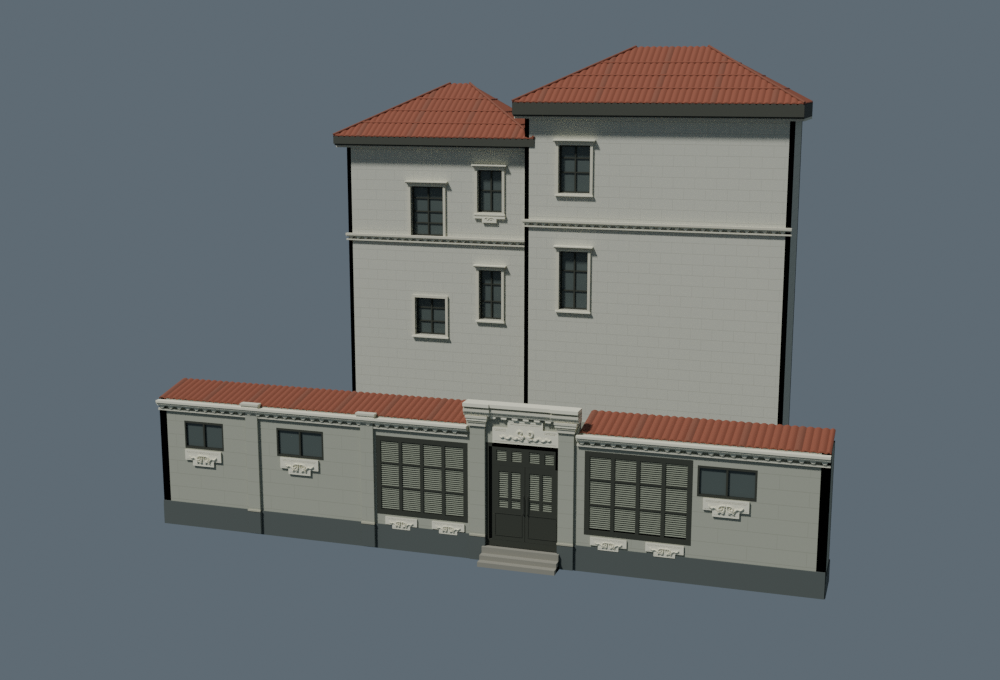

# 康平路196号住宅可编辑工程

用 Blender 4.3.2 生成工程后，另起一个进程重新打开交付的 BLEND。338 组可编辑网格保留 58,688 个三角面，逐材质的顶点位置与面朝向均与原始 GLB 相符。工程包含 15 种材质和 9 台可编辑相机。[重开检查](reopened.json) · [两次进程记录](blender-exits.json)

临街灰绿粉刷的 684 个纹理角点最大 UV 偏差为 3.36 × 10⁻⁸，后楼横线粉刷的 576 个角点逐一相同。两张原创纹理都打包在工程里，按重复平铺读取。[作者输入](editable-inputs.json) · [两档解码纹理复核](../mesh-verification/decoded-texture-comparisons.json)

下图由工程总览相机渲染。前景可见两侧百叶、窗下卷花与中央门额，后楼两级红瓦檐完整入镜。原始近景、网页近景及远景独立解码后，各自通过 63 处饰件、157 处窗扇与 55 处后楼和屋面的首击检查。窗扇检查中的 85 处为留出点。[三档检验](../mesh-verification/three-role-summary.json) · [四项文件摘要](four-role-manifest.json)

