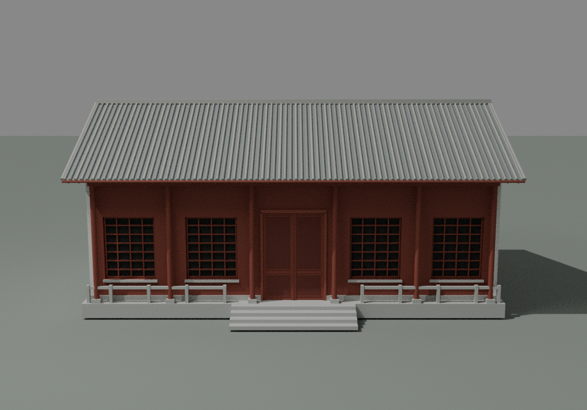
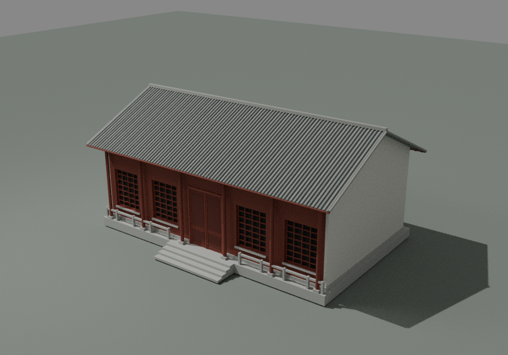
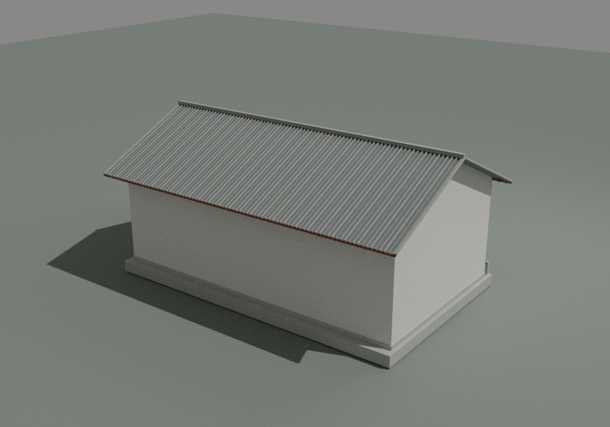
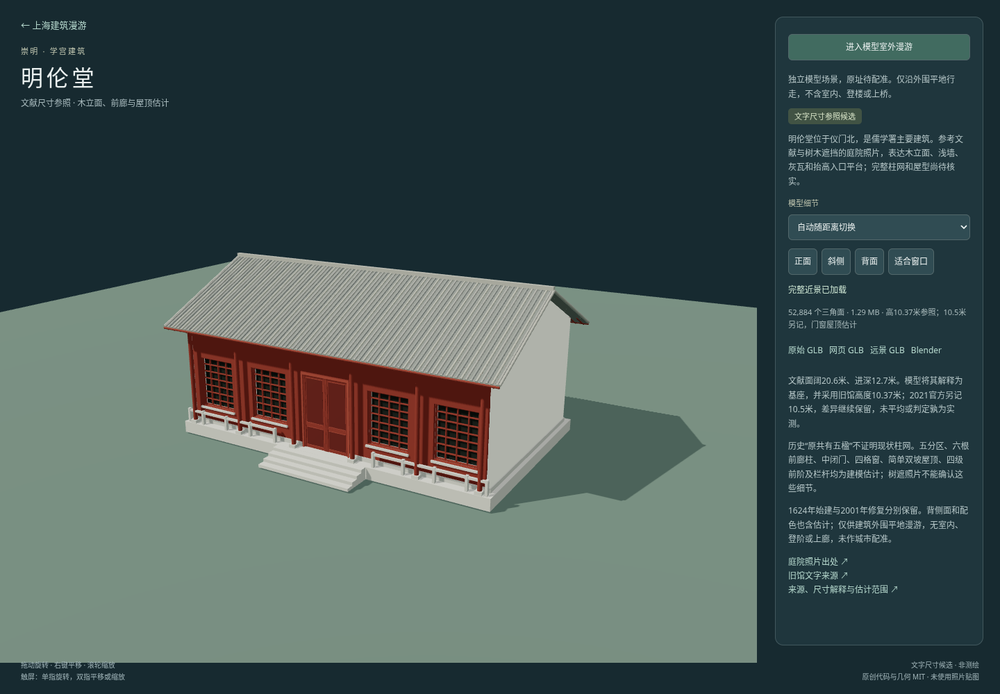

# 明伦堂文字尺寸参照候选检查

[独立预览](../../../minglun-hall.html) · [来源与构建](../../../source/precise/chongming-minglun-hall/README.md) · [资产清单](../../../assets/models/candidates/chongming-minglun-hall/manifest.json)

本件独立身份是仪门北的儒学署主要建筑。旧馆面阔20.6、进深12.7、高10.37米作为参照；2021官方10.5米高度另存未解。五分区、六前柱、中闭门、四格窗、简单双坡、四级阶与简栏是明确估计，树遮照片只提供局部色材和入口概念；不将历史五楹当现状柱网。

## 同批资产

使用十进制 MB，全部单文件小于100 MB。四文件大小与SHA256均和manifest及最终检查相符。

| 文件 | 大小 | 三角面 | SHA256 |
|---|---:|---:|---|
| chongming-minglun-hall-raw.glb | 3.849468 MB | 52884 | `52b6c5ff980bab535b92f785bd101ba065efefa016ba21960fe3cf67bdfcbf4d` |
| chongming-minglun-hall-web.glb | 1.292168 MB | 52884 | `bf3c12e5358dc1b6b97c0add6c589ef88b6398e2c4050a29e9ec5368715b6148` |
| chongming-minglun-hall-lod.glb | 0.167132 MB | 7748 | `e86e1ed7e63d9b31035dba958ac5852d2ecd96603e9fc6ad619b35679d058fc6` |
| chongming-minglun-hall.blend | 1.791012 MB | 52884 | `97df7e8b2ae1781e4527253289232fbc9b34b8ed76c12bf8544f387a7ef5d1aa` |

## 几何与原生

- 近景52,884面、1,815作者构件；远景7,748面、259构件，均为封闭、绕序一致、正体积实体。允许构件相接／相交，不宣称整个建筑已布尔并集。
- 两档源几何有限、零退化面；四处格窗射线穿过实际格洞到达凹入背衬，中央闭门命中实体。裙脚侧段接头避开外露共面端盖，原生三图未见墙角黑块。
- 20.6×12.7米采用局部基座解释；全部GLB外包宽21.6499996、深15.2205529、高10.3699999米，包含檐瓦、素脊和估计前阶。高度取旧馆10.37，未平均10.5版本；面积乘积261.62与记载261.6分列，量测端点仍未知。
- 四级前阶是一个闭合截面棱柱，不用嵌套盒共面底边；六前柱、浅廊深度、开口/栏杆/屋顶拓扑和瓦数都是估计。
- Blender 4.3.2保存后从磁盘重开，模型52,884面及几何摘要一致，raw输入SHA匹配；地面灯光相机排除在建筑摘要之外。

原生几何摘要：`45d4fe67ba245801ac6de4d3e9735ecd32a7bfd30f227d477cb96f9d99a7f7e1`。

[geometry.json](geometry.json) · [native.json](native.json) · [packaged.json](packaged.json) · [raw-features.json](raw-features.json) · [lod-features.json](lod-features.json) · [独立原文核查](source-independent-check.json)

## 实际原生三视图

制作者实际查看三图，木立面、闭门、格窗和估计平台前阶均可读；仅验收候选显示和实体接头，不是完整照片复原验收。

## 网页与最终打包

Chromium真实加载身份与SHA校验一致；近景→远景→近景切换、四相机按钮、48米初始距离、全外包加0.05米外围边界、进入漫游、前进及Escape退出均通过。页面异常和失败HTTP响应均为0。Playwright timeout位于第三参数，第二参数为null。制作者实看最终网页图，未见新增墙角黑块或明显窗旁细线。

网页／LOD由gltfpack解码后独立检查，面数、有限顶点、零退化、绕序和外包与源记录一致；三GLB都保留明伦堂身份、10.37/10.5高度版本、历史五楹不作现状依据及摄影限制，没有嵌入照片。仅供建筑整个外包之外平地行走，不含室内、登阶或上廊。

[browser.json](browser.json) · [qa-browser.cjs](qa-browser.cjs)

## 范围限制

1624始建、2001修复和2001–2002多建筑工程阶段各归其来源；不把文献年代当完整相应形态或2026现况证明。未题注崇賢館图和其他建筑歇山／五开间描述均未转用。677×451树遮照片不能确认门窗、柱网、完整屋型和台阶数量；当前中央闭门也不是对照片浅色竖区的事实解释。侧后面、配色、栏杆和屋顶端部仍为估计，铭文、精确雕饰、室内、庭院树木与两边碑廊均未建模。未做城市配准或照片尺度验收。

重跑命令与依赖见[来源README](../../../source/precise/chongming-minglun-hall/README.md)。

主代理独立核对四资产大小／SHA及两版高度原文，实看最终三原生图和网页图；见[root-visual-review.json](root-visual-review.json)。

固定提交的[公开预览](https://rawcdn.githack.com/ecojust/e-resource/0edf42c76ba0ffaabeaf8047d71f01297c0f9161/projects/shanghai/minglun-hall.html)已通过真实浏览器加载，身份、52,884面、模型校验和两版高度来源匹配，异常为0；见[public-browser.json](public-browser.json)与[qa-public.cjs](qa-public.cjs)。
