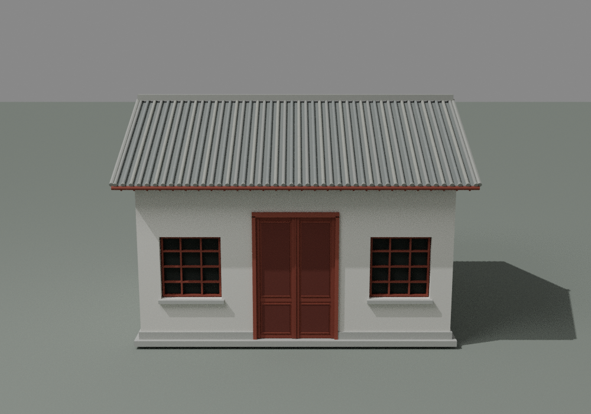
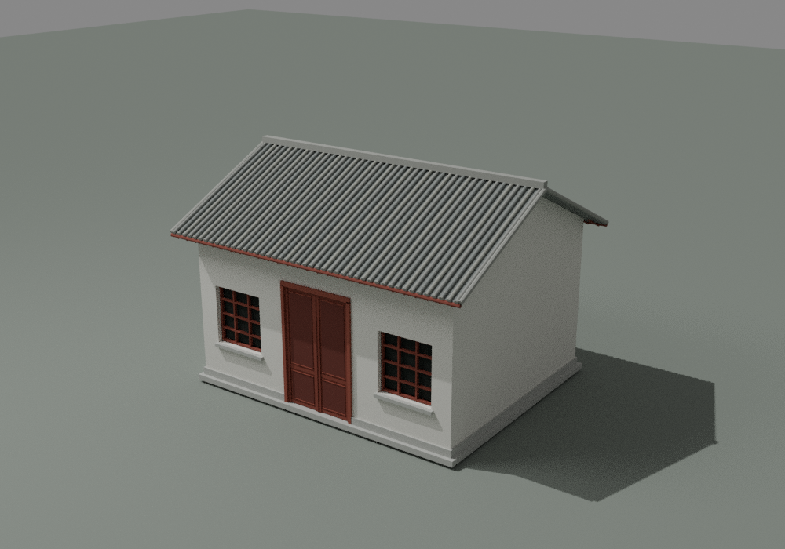
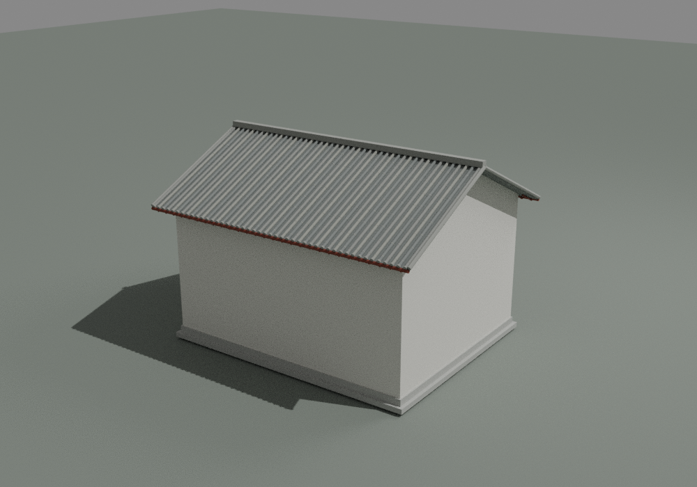
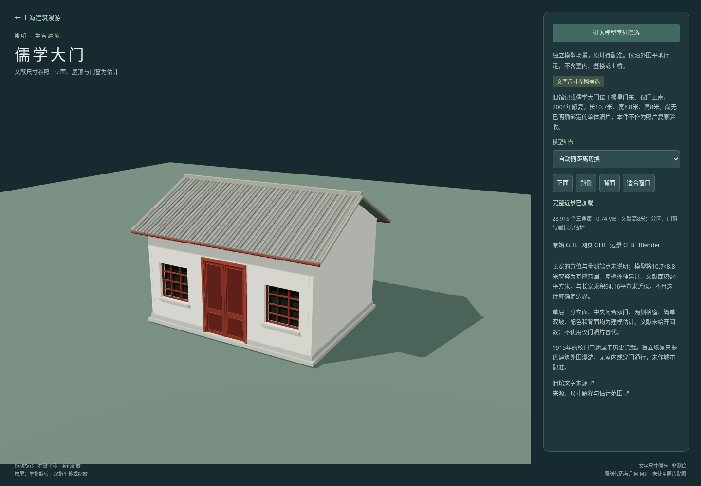

# 儒学大门文字尺寸参照候选检查

[独立预览](../../../ruxue-gate.html) · [来源与构建](../../../source/precise/chongming-ruxue-gate/README.md) · [资产清单](../../../assets/models/candidates/chongming-ruxue-gate/manifest.json)

本件ID为 `chongming-ruxue-gate`，独立身份是旧馆记载位于棂星门东、仪门正南的儒学大门。文献长10.7、宽8.8、高8米及2004年修复作为参照；没有已完整绑定的单体照片，不使用仪门照片，也不声称照片复原验收。三等分立面、中闭合双门、两格窗、单层双坡、配色与背侧面全部是建模估计。

## 同批资产

下表使用十进制 MB；大小和SHA256与当前manifest、原生重开及网页检查一致。全部交付文件小于100 MB。

| 文件 | 大小 | 三角面 | SHA256 |
|---|---:|---:|---|
| chongming-ruxue-gate-raw.glb | 2.248732 MB | 28916 | `eee5166a1007da84dce2c86ce35ac034f77c400446b83eb2cb30cad174aa9974` |
| chongming-ruxue-gate-web.glb | 0.738172 MB | 28916 | `c7d53cd8ed130c690f74c4597571a3e1f8e7759369f7dd21808b2e731b416e50` |
| chongming-ruxue-gate-lod.glb | 0.092552 MB | 3684 | `9d57af2e7f0056f3f38fc87685ffce8b04d0b971d3019de8f160cdc7795bcb90` |
| chongming-ruxue-gate.blend | 1.047415 MB | 28,916（模型部分） | `67f4903e5a5b6b0e49bc4d0f4ac37ece61ce7af8586d19b0d1392328c0cb0dcc` |

## 实际几何及原生文件

- 近景28,916面、1,031个作者构件；远景3,684面、155个作者构件。每个作者构件均为封闭、绕序一致的正体积实体。构件可以相接或相交，不宣称全部构件已做单一布尔并集。
- 原始近景和源远景均检查有限顶点、无退化面、绕序及构件水密。最终web和LOD用gltfpack解码再检查，面数、外包和源数据一致，无退化面；三份GLB保留儒学门身份、文字候选及未借用仪门照片的说明，均无嵌入图像。
- GLB实际基座为10.6999998×8.8000002米，采用局部X为10.7、Y为8.8的解释；方向及量测端点没有文献保证。含瓦端、屋顶边帽和素脊帽的实际总包围盒为宽11.6499996、深9.7417612、高8米。文献尺寸不冒充檐口外包。
- 10.7×8.8=94.16平方米仅为计算值，与文献94平方米取整近似；不把二者的近似关系当作边界线或真实方位证据。
- 两处格窗各在一个实际格洞发射水平射线，首个交点到达有意凹入的背板，未被错误实体墙或填平格洞阻挡。中央闭门射线命中实体，符合不做室内和穿门通行的范围。
- 踢脚侧段端面落在前后段内侧接头，不与外露墙平面共面；原生三视图中未见此前官厅修复过的墙角／踢脚黑块。
- Blender 4.3.2保存后从磁盘重新打开，模型面数仍为28,916，几何摘要一致；预览地面、灯光和相机从模型几何摘要中排除，导入raw的SHA匹配本批资产。

原生重开几何摘要：`50319eaac484a5485f9972226b64371ac2899522e60229166f6f1665f7006fa2`。

详细记录：[geometry.json](geometry.json)、[native.json](native.json)、[packaged.json](packaged.json)、[近景构件标记](raw-features.json)、[远景构件标记](lod-features.json)。

## 实际预览

三图均由当前Blender模型实际渲染并查看。这里只核查估计方案的显示、实体接头和模型范围，没有把无单体照片的建筑写成照片验收。





## 网页检查及显示限制

Chromium实际加载身份正确，按manifest大小/SHA256校验GLB；完成近景→远景→近景、四视角按钮、32米初始相机距离、模型外包生成的外围边界、进入漫游、前进及Escape退出检查。页面异常和失败HTTP响应均为0。Playwright timeout作为waitForFunction的第三参数，第二参数为null。

网页局部窗旁仍可见极细竖向线；这是当前显示限制，未归因为已证实的阴影、法线或压缩问题。采用既有有阴影显示方案，不据此修改估计形体或再次展开无结论调参。页面只有建筑外包外围行走，不含室内、穿门或攀爬。

[网页检查结果](browser.json) · [可重跑脚本](qa-browser.cjs)



## 资料与范围限制

1760修葺、1915用作县立初级中学校门是历史记录。2004为文献修复年份，不等同唯一建造年份、完整2004形态或2026现状。三分区不称三楹文献证据；中门及两窗并非实测柱网，后墙与双坡端部为假设。没有复制仪门的曲线端墙、门帘或任何照片像素，没有加入精确牌匾、雕饰、内装和相邻建筑。代码复用西官厅通用流程不能证明两座实物相似；本件独立尺寸、门窗参数和身份均已重新生成。未作城市配准。

## 重跑

依来源README完成两档生成、Blender和打包后，在仓库根目录执行：

```sh
python projects/shanghai/source/precise/chongming-ruxue-gate/source/verify_geometry.py --assets /tmp/ruxue-gate --out projects/shanghai/data/audit/ruxue-gate-v1/geometry.json
python -m http.server 8778 --directory projects/shanghai
# 另一个终端；要求系统Chromium和Playwright。检查输出到/tmp/ruxue-gate-browser.*，复核后同步本目录。
node projects/shanghai/data/audit/ruxue-gate-v1/qa-browser.cjs
python projects/shanghai/source/precise/chongming-ruxue-gate/source/verify_packaged.py --assets projects/shanghai/assets/models/candidates/chongming-ruxue-gate --audit projects/shanghai/data/audit/ruxue-gate-v1 --gltfpack projects/shanghai/source/city/detail/tooling/node_modules/.bin/gltfpack
```

主代理独立核对四资产大小／SHA、文献原文及原生记录，并实看斜侧、背侧及网页图；结果见[root-visual-review.json](root-visual-review.json)。
