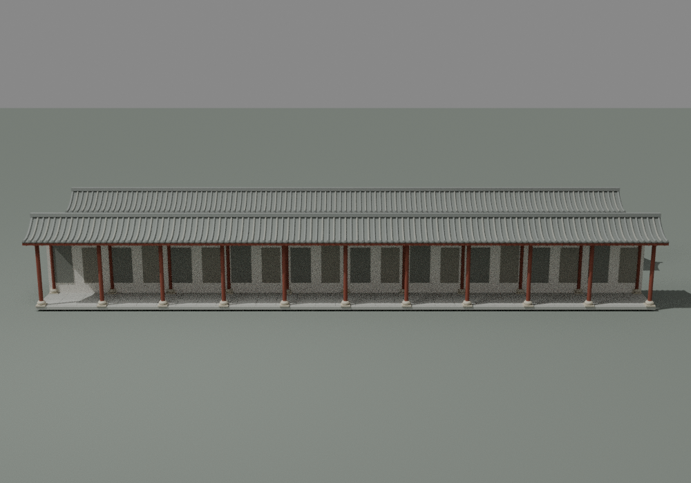
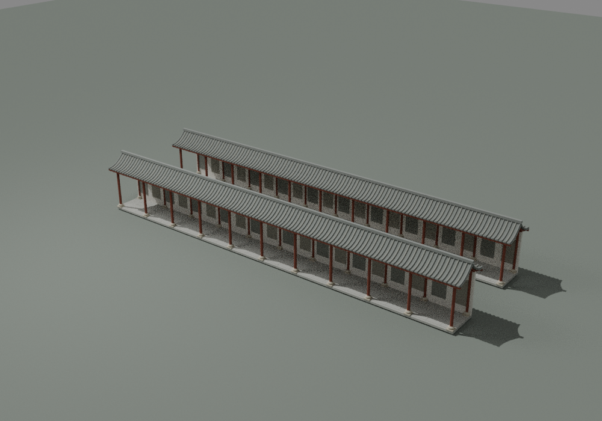
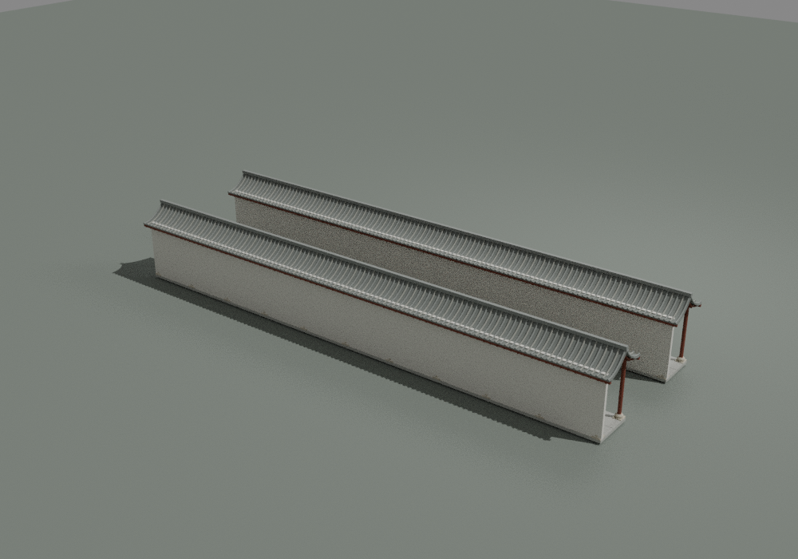
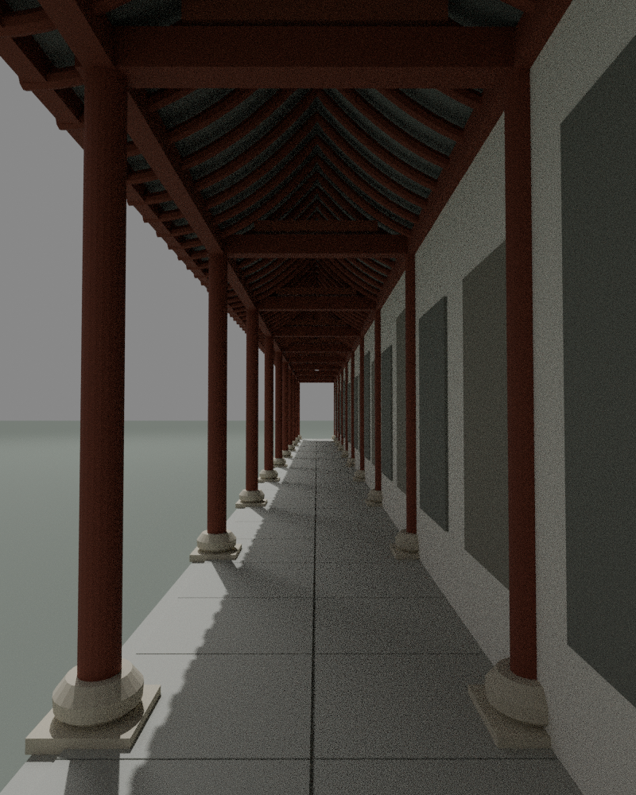
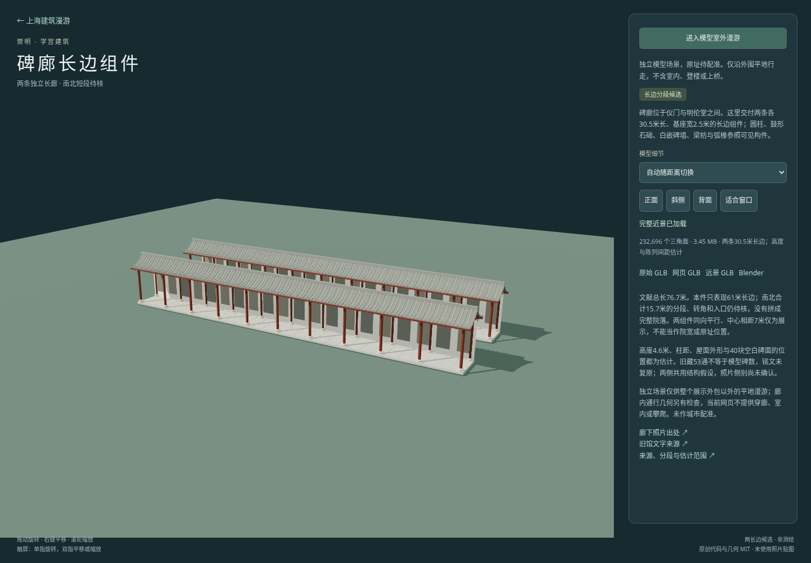

# 碑廊两长边分段候选检查

[独立预览](../../../stele-corridors.html) · [来源与复跑](../../../source/precise/chongming-stele-corridors/README.md) · [资产清单](../../../assets/models/candidates/chongming-stele-corridors/manifest.json)

本件只交付两条独立30.5米长边组件，基座各宽2.5米，合计表现61米。**原文总长76.7米和南北合计15.7米预算继续保留；南北具体短段、转角、入口及完整院落布局尚待核实，没有均分或制作虚构短段。**两组件并排同向、中心间距7米仅供展示，不代表院宽、实际方位或原址配准。两侧复用共性结构假设，不证明实物细节一致或照片分别属于东西哪一侧。

## 同批资产

下表使用十进制 MB，全部单文件小于100 MB。面数计两个放置组件；Blender不计灯光、相机或预览地面。

| 文件 | 大小 | 两组件三角面 | SHA256 |
|---|---:|---:|---|
| chongming-stele-corridors-raw.glb | 9.442068 MB | 232696 | `a2ba2371f6f01a9dc820b964669e5e51aefec9539f3d38a4a5d5c49b51522fb6` |
| chongming-stele-corridors-web.glb | 3.454884 MB | 232696 | `32eb735aa863901a57180b76a7510d85d411d77e1208a653c37d694b94c97ded` |
| chongming-stele-corridors-lod.glb | 0.643496 MB | 42200 | `b221b24f7a60a11d81303f53c8abe7e0fec65e6ea3cbde3f2fb679182c7cf7db` |
| chongming-stele-corridors.blend | 8.591937 MB | 232696 | `d6e977695d4f69461579f81fae00e5805a8e45e5ea5d482fcba8610709923be4` |

## 实际几何、廊道与原生

- 近景232,696面、1,410作者构件；远景42,200面、850构件。作者单构件均封闭、正体积、绕序一致，没有退化面；整套相接或相交未布尔并集。
- 每条基座30.5×2.5米的端点解释另记。全部展示外包31.1000004×10.0899999×4.5999999米，包括檐瓦与任意展示间距；不称完整碑廊占地或实测院宽。
- 两组件各11组柱位、每条20空碑面，网格/柱距/高度4.6米/所有碑位与屋面类型均估计；旧53通收藏总数不是该布局证据。
- 两档24条纵向射线在局部核心宽1.1米、标高0.25/1/1.7/2.8米均全长无遮挡；20条跨廊射线从院侧开口首先到达墙/碑面，柱体与横梁控制命中也通过。石础保守净宽1.615米，横梁底3.32、地面顶0.175米，均只为本候选数值。
- 近景20边柱／远景10边柱控制射线按各自实际多边形边界校核，不将远景截面当精确圆。此几何通行检查与网页外围漫游分开，页面不能穿廊。
- 首轮上层横枋穿过瓦坡的小件已修正：横枋深从2.48缩为1.30米，完整留在屋面下；主横梁及外轮廓未改。最终断言和4张原生图均核对，无瓦面露木。
- Blender 4.3.2保存后重开保持232,696面、同一几何摘要，并再次确认两份独立可编辑mesh数据。raw输入SHA匹配，预览场景不计入模型摘要。

原生几何摘要：`52ad2acb9b254065769b782c814bfcb5500da59eab4aa7518ff3041e032cdfbb`。

[geometry.json](geometry.json) · [native.json](native.json) · [packaged.json](packaged.json) · [raw-features.json](raw-features.json) · [lod-features.json](lod-features.json) · [独立原文核查](source-independent-check.json)

## 实际原生4图

制作者实际查看正、斜、背三全景及额外廊下近景。廊下图由模型内部相机另行渲染，不是全景放大裁图；可辨圆柱、鼓形石础、露明梁枋/弧椽/瓦底及白空碑墙。形体估计和侧别不确定性仍保留。

## 网页和最终压缩版本

Chromium真实加载通过身份和SHA检查；近景→远景→近景、4相机按钮、54米初始距离、整展示外包加0.05米外围边界、进入漫游、前进和Escape退出通过。页面异常及失败HTTP响应为0。Playwright timeout在第三参数，第二参数null。

网页浅色铺地可见轻微斜向阴影分界，原生没有对应破面，未确认其具体显示原因；没有据此无依据修改形体或重新声称完整视觉验收。制作者已实看最终网页截图。

gltfpack解码后的网页与远景保持两命名组件、放置后面数、有限顶点、零退化、绕序、全包及24条廊道纵向射线，三GLB没有嵌入图像。文件数值按两个实际场景节点累计，压缩去重几何不使组件数量减半。网页walk仍在整个展示包围盒之外，不含廊内、室内或攀爬。

[browser.json](browser.json) · [qa-browser.cjs](qa-browser.cjs)

## 未完成范围

南北合计15.7米仍待分段、入口和转角资料；没有均分7.85米或制作虚构完整矩形。文献面积191.75平方米是全部范围，模型两基座合计152.5平方米另记。两图拍摄时点与侧别未知，不能据结构共性声称真实两侧一致；碑文、原53通逐块库存、所有准确柱距/高度及原址配准均未完成。色材、瓦数、铺装、背面为估计，红毯、灯笼、人物、院树等未建模。

主代理独立核对四资产大小／SHA、两独立原生mesh与文献原文，实看最终斜侧、廊下近景及网页图；见[root-visual-review.json](root-visual-review.json)。
