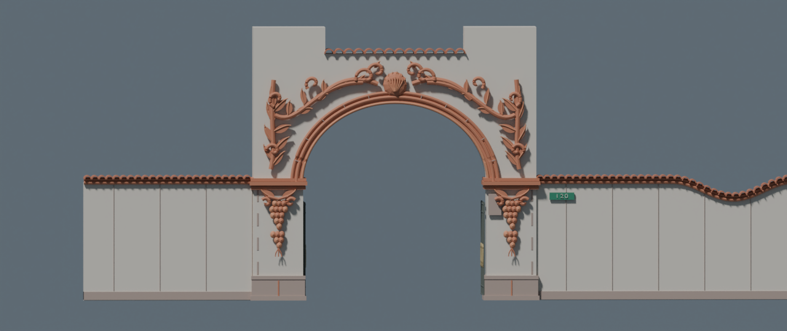

# 卫乐园泰安路街门模型核验

2014年正面照可辨认泰安路120弄口的拱门、卷草花饰、葡萄垂饰、120号牌和带筒瓦的两段矮墙。2021年1月两个街景拍摄点的水平角交会给出门洞净宽约4.30米。模型保留从泰安路进入弄内的通路，范围止于左右院墙。园内住宅另行核对。[史料、照片与配准](../../../source/precise/changning-weile-garden-taian-gate/README.md)

原始及网页模型各39,384个三角面，远景19,052个。用Blender重开30个可编辑网格，按材质比对原始几何，并从重开的文件渲染下图。三档交付模型各通过32项独立射线检查，覆盖门冠、葡萄、左右卷草、号牌、铁门扇、墙瓦及门洞。[原生重开与四件哈希](geometry-native.json) · [三档射线](visible-surfaces.json)

将四个城市图组的近远三角面投影到地面，测得门楼离既有几何最近约6.23米，八处邻屋均保留。碰撞墙覆盖可见筒瓦压顶的地面投影。初次用0.31米宽的墙体做碰撞，在每秒20帧的疾跑下发生四次穿墙。按可见压顶修正后，正式控制器在五种帧率、两种速度及双方向下完成700次行走，七条原本朝向门墩的路线滑入门洞，全部路径均未穿过墙体或门墩。近、远档的34个地面探针另行检查石墩、侧墙与开口。[原始失败](initial-wall-walk.json) · [修正后700次行走](gate-walk.json) · [实际城市几何与地面点](placement-geometry.json)

正式城市实站从200处增加到201处，此前160个候选模型的整条目录记录完全一致。从两站实取目录，并从新版本逐件下载了1105个签名文件、共1,010,863,830字节。近景与远景分别复核34处地面、八座邻屋及两类矢量源，均无需裁剪原有建筑；还在该版步行控制器上重新执行700次双向过街门行走。[前后实站与四件实取](renderer-parent-controls.json) · [近远运行结果](runtime-placement.json) · [全部文件的下载凭据](renderer-release-http.json)

实际打开独立页面的桌面和390像素手机视口，分别切换近景及远景，四件通过页面下载并核对哈希。[桌面近景](viewer-desktop-full.png) · [手机远景](viewer-mobile-lod.png) · [操作与四件下载](viewer.json)

新版本将原有200处增至201处。桌面鼠标和390像素手机触屏均从地图上的实际标牌进入街门。前后实图核对了同一街面，加入模型后门洞仍可通，两侧院墙和八个邻体保留。除普通入口外，还拍摄了门牌与葡萄装饰的近照、远景模型，四件文件在该次浏览器中重新下载并核对摘要。[前后实图与地面结果](final-map-31164/results.json) [门牌和券顶](final-map-31164/map-120-arch-and-grapes.png) [真实几何遮挡与三视口相机](default-source-visibility/31k-camera-continuity.json)

切换远景时，测试工具对同一近景瓦片的一次重复读取挂起。另一次实际页面响应已取得同址63,851字节，与签名一致。中止超时读取后，原程序完成全部资源和四次下载断言。[重复请求及原始响应](final-map-31164/duplicate-body-read.json)

GitHub 公开固定版本中，地图、入口页、来源说明和四件下载文件等共 39 项均返回 HTTP 200，字节数和 SHA-256 与提交一致。[打开本次提交的地图](https://raw.githack.com/ecojust/e-resource/6e386987a2efcc6f00b9bbe36e890cbf89e6739b/projects/shanghai/index.html#landmark=changning-weile-garden-taian-gate&mode=overview) · [固定版本逐文件核对](publication.json)

首次在 master 检查 39 项，10 项返回其他版本的内容，0 项未返回 HTTP 200。[首次 master 核验](publication-master-initial.json)
