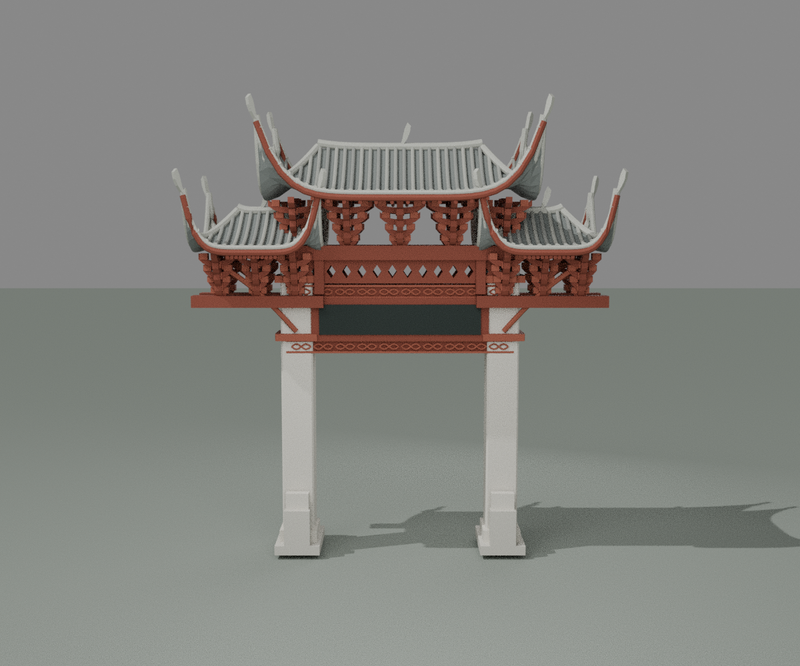
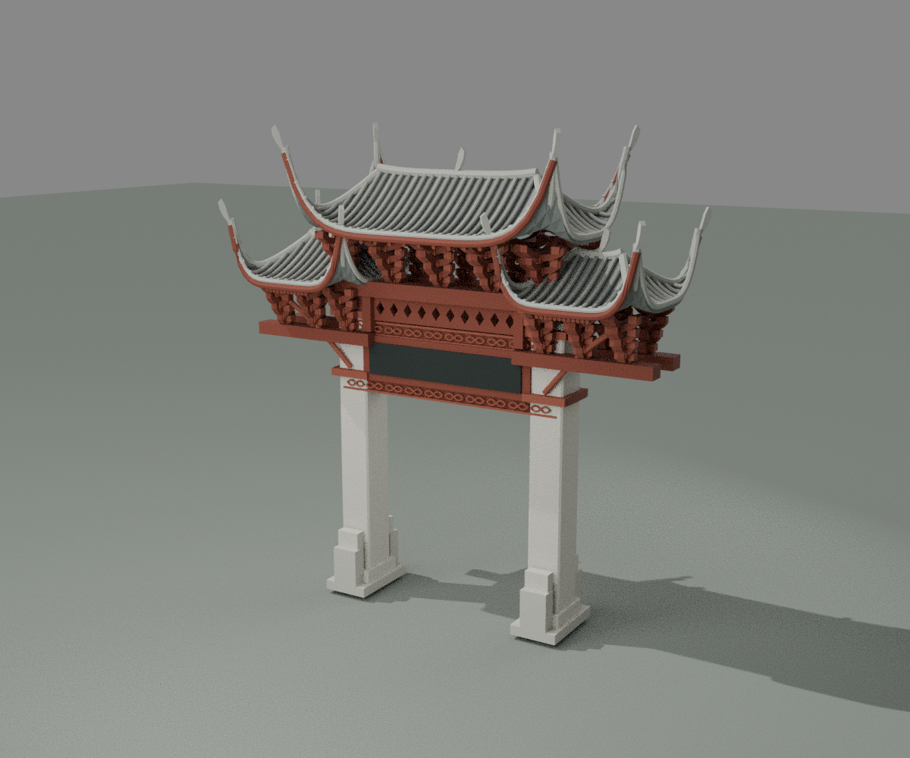
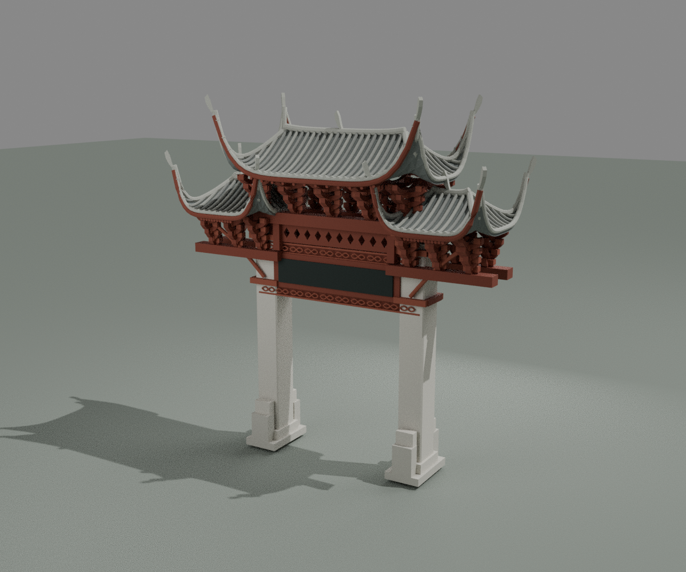
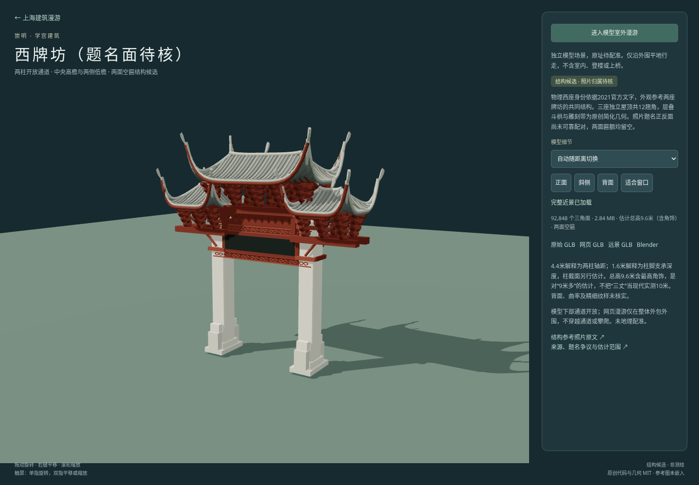

# 西牌坊结构候选检查

[独立预览](../../../west-paifang.html) · [来源与构建](../../../source/precise/chongming-xuehai-paifang/README.md) · [资产清单](../../../assets/models/candidates/chongming-xuehai-paifang/manifest.json)

交付ID `chongming-xuehai-paifang`，中文名为崇明学宫西牌坊（题名面待核）。物理西座身份采用2021年官方文字，两座照片仅用于共性结构参照；没有完成单座正反面照片身份绑定。两面匾额均为空，不把保留的资产ID当成题字验收。没有照片贴图、再分发、城市配准或东座模型。

## 资产与同批哈希

下表使用十进制 MB。下表、manifest、原生重开和网页检查均对应当前同批资产，所有交付文件小于100 MB。

| 文件 | 大小 | 三角面 | SHA256 |
|---|---:|---:|---|
| chongming-xuehai-paifang-raw.glb | 7.125356 MB | 92848 | `33f3232efd2d4507c0e1a1613675863f3083871e3c612cb9881c78a739975405` |
| chongming-xuehai-paifang-web.glb | 2.844364 MB | 92848 | `e0430c11c8a778206f2f5767b7c1feff29376b82026b0c4db91845d850355462` |
| chongming-xuehai-paifang-lod.glb | 0.631572 MB | 20996 | `7480e9688b7e639b1ef3f6926907b729a728c5953d035c2ad5b6c0d6b29dc745` |
| chongming-xuehai-paifang.blend | 3.312641 MB | 92,848（模型部分） | `da2a2d028a01f45e57badb1c95d213c3f703b892e98a71f890d9c07c71c4bffd` |

## 实际几何与原生检查

- 近景92,848面，1,037个作者构件；远景20,996面，505个作者构件。每个作者构件均为封闭正体积实体；整体允许构件相接或相交，不宣称整栋是单一布尔并集。
- 原始近景、未压缩远景检查有限顶点、无退化面、绕序一致和构件水密；最终网页GLB及远景GLB再用gltfpack解码检查，面数、外包与源模型一致，无退化面、绕序一致。两档均保留西座身份、空匾和估计范围的extras，无嵌入图片。
- 三个独立封闭屋面壳：中央一高、左右两低；每单元四个翘角，共十二角。两块空匾为真实几何，无字形或文字纹理。
- 全部构件实际外包为宽9.088909、深3.488909、高9.600000米。总高包括最高简化角饰；这些是模型计算值，不是现场量测。4.4米解释为两柱轴距；1.6米解释为每柱支承总深度，不称每根石柱截面实测。
- 下部通道沿完整深度射线检查：X为−1.65、0、1.65米，标高为0.10、0.25、1.00、2.50、4.25米，共15条水平射线均无阻挡；对应梁上方与石柱位置的对照射线命中实体。射线计算实际净宽：柱身处3.720000米、柱脚处3.440000米。梁底4.30米为模型估计。
- Blender 4.3.2文件保存后从磁盘重新打开，模型部分92,848面，几何摘要前后一致；渲染地面和灯光不计入模型摘要。导入原始GLB的SHA与当前raw一致。

原生重开几何摘要：`ed93c646e4d1386c72a097d6c68a38b426057f8bb76425f9fcff09a03f55f3cf`。

详细机器记录：[geometry.json](geometry.json)、[native.json](native.json)、[packaged.json](packaged.json)、[近景构件标记](raw-features.json)、[远景构件标记](lod-features.json)。

## 实际预览与网页

三图均由当前原生文件渲染。已对照参考拼图检查两大石柱、开放通道、三屋顶不同标高、层叠栱件和两面空匾的结构表达；不是逐构件或题名归属照片复原验收。主代理已实际查看并接受当前简化候选范围。





Chromium实际加载并通过身份、按manifest SHA256校验的GLB读取、近景→远景→近景、正面／背面／斜侧／适合窗口按钮、相机距离、模型外包生成的独立边界、进入外围漫游、实际前进和Escape退出。页面无异常或失败HTTP响应。网页边界限制在模型外包外围，不提供柱间穿行或攀爬。

[网页检查结果](browser.json) · [可重跑脚本](qa-browser.cjs)



## 保留限制

9.6米是对“9米多”的明确估计，不把“三丈”固定换成实测10米。两柱轴距及柱脚深度解释、截面、檐伸、明显上翘曲率、简化四坡端部、重复栱件密度、雕刻和角饰均未实测。后坡采用对称假设，隐蔽支承和接头也为估计；没有精确龙凤、脊兽、榫卯或文字复刻。照片拍摄日期不独立确认，不宣称2026现状。2021官方题名组、旧馆1998题名组和照片环境关联之间的差异仍保留在来源登记中。

## 重跑

先按来源README完成两档生成、原生保存及打包，再在仓库根目录执行：

```sh
python projects/shanghai/source/precise/chongming-xuehai-paifang/source/verify_geometry.py --assets /tmp/west-paifang --out projects/shanghai/data/audit/west-paifang-v1/geometry.json
python -m http.server 8776 --directory projects/shanghai
# 另一个终端；要求系统Chromium和Playwright。输出到/tmp/west-paifang-browser.*，复核后同步至本目录。
node projects/shanghai/data/audit/west-paifang-v1/qa-browser.cjs
python projects/shanghai/source/precise/chongming-xuehai-paifang/source/verify_packaged.py --assets projects/shanghai/assets/models/candidates/chongming-xuehai-paifang --audit projects/shanghai/data/audit/west-paifang-v1 --gltfpack projects/shanghai/source/city/detail/tooling/node_modules/.bin/gltfpack
```

主代理实际查看最终正面、斜侧、背面及网页四张图，复核四件资产的大小/SHA256、三档GLB来源说明以及原生/几何报告的资产对应；见[视觉复核](root-visual-review.json)。

[固定版本在线预览](https://rawcdn.githack.com/ecojust/e-resource/6673d31dee681d219078b58bc658d77a0aa4e1e5/projects/shanghai/west-paifang.html)已实际加载，西牌坊身份、92,848三角面、GLB哈希与同版本来源中的空匾／题名未验收状态核对通过，网页错误数为0。见[公开网页记录](public-browser.json)；仓库根目录可运行`node projects/shanghai/data/audit/west-paifang-v1/qa-public.cjs`复验。
