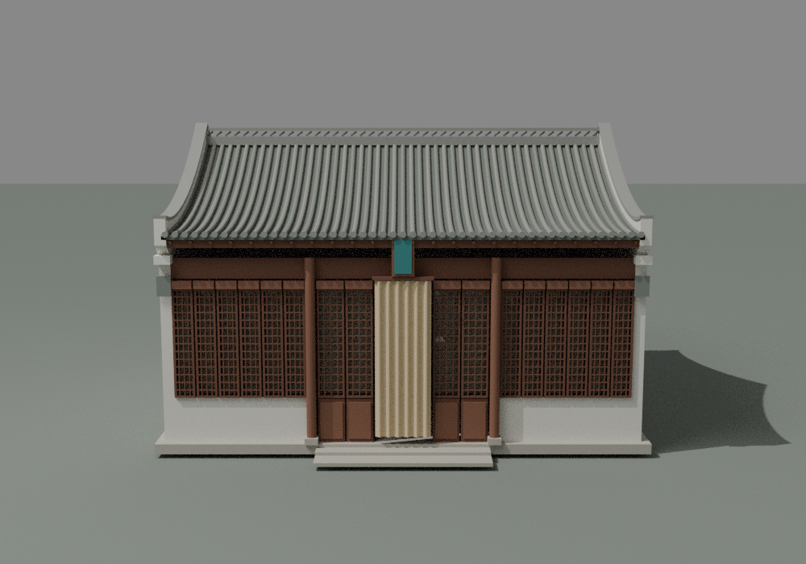
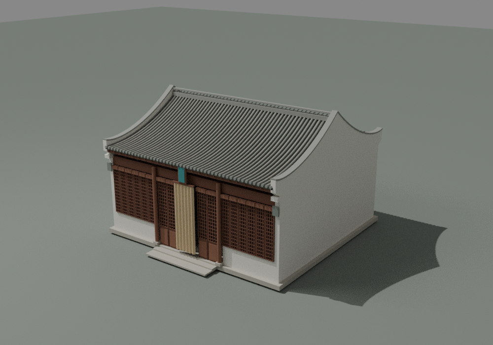
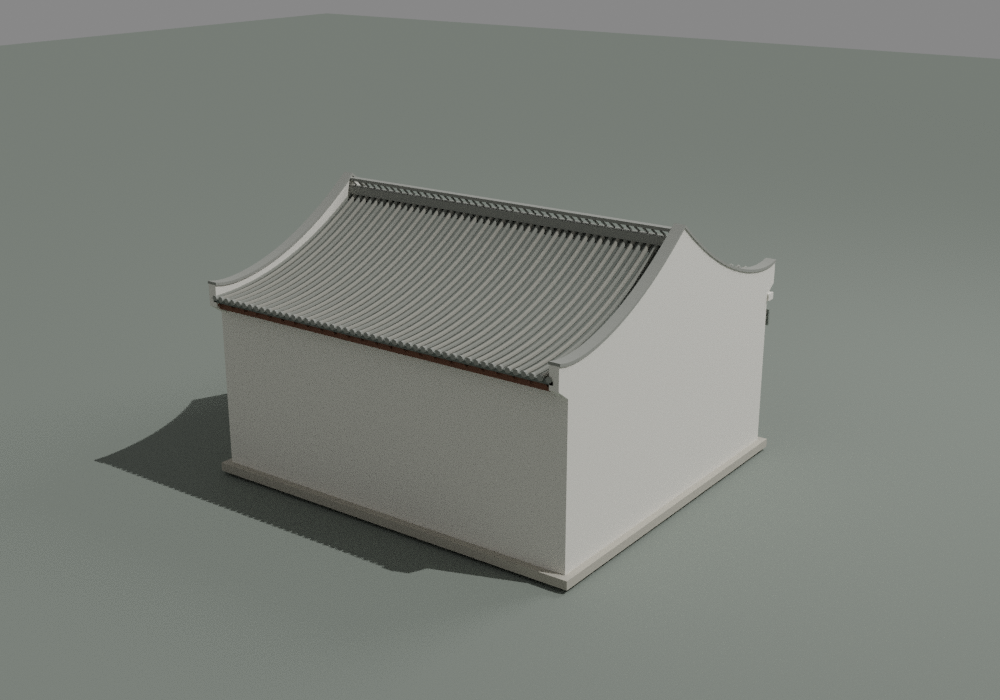
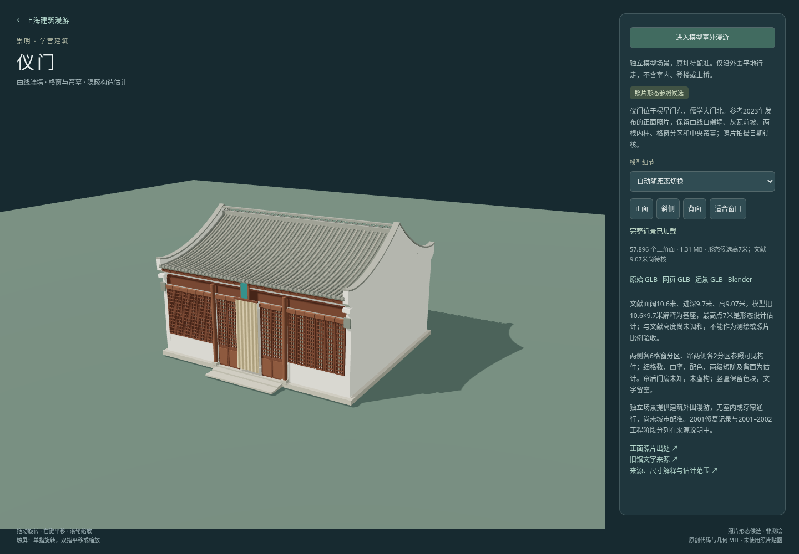

# 仪门形态候选检查

[独立预览](../../../yimen.html) · [来源与构建](../../../source/precise/chongming-yimen/README.md) · [资产清单](../../../assets/models/candidates/chongming-yimen/manifest.json)

单体为棂星门东、儒学大门北的仪门，依据题注明确的照片观察曲线端墙、前坡、内柱、格窗分区、帘幕和竖匾色块。**模型总高7米为设计估计；文献9.07米未调和。** 本记录核查候选几何与显示，不构成完整照片复原、比例测量或地理配准验收。

## 同批文件

下表使用十进制 MB，全部模型文件小于100 MB。Blender面数仅计建筑本体。

| 文件 | 大小 | 三角面 | SHA256 |
|---|---:|---:|---|
| chongming-yimen-raw.glb | 3.899412 MB | 57896 | `bfb4b924ad76202eece00f8d33368c6c14d7352108a3aff04d40bc900ebe0521` |
| chongming-yimen-web.glb | 1.305336 MB | 57896 | `de9cdf2f2f41f92b97aaf3d851e2fb9cfb1fe52c27a57be16f8a08abbd88220a` |
| chongming-yimen-lod.glb | 0.297392 MB | 13768 | `2fe4176c7f62d5a260b2e9fbe3c191c20951ee43aadcece9e7bedd00171cc2b7` |
| chongming-yimen.blend | 1.895717 MB | 57896 | `4d4c268d4d89997c0aca031aa76d560172a66a06db90aa6de09a6af695402053` |

## 几何与原生核验

近景57,896面、372个作者构件；远景13,768面、230个作者构件。两档每个作者构件均闭合、绕序一致、正体积；顶点有限且无退化三角面。构件间可接触或相交，不宣称整个聚合模型为单一布尔并集。

实际全部外包10.6000004×10.7449999×7米，含估计前阶与瓦端；基座参数10.6×9.7米单列。全部16个可见格窗分区各测试一个格洞，射线到达凹入背板而非被误填的墙面；中央射线命中有厚度的折帘。帘后门扇数量未知，模型没有添加门扇。

窗下裙墙在端墙内边±4.88米处对接，后墙宽9.76米；三原生视图中不再出现早期3厘米缝及1厘米共面搭接的竖线。两级估计台阶最终为一个封闭阶梯截面棱柱，去除嵌套盒体内部的重叠底面。近远景源几何与最终压缩文件解码均通过绕序、非退化、面数和外包检查。

Blender 4.3.2保存后从磁盘重开，建筑本体面数57,896，几何摘要前后一致：`e27c7fe188de7de33b331f47a9411a2ad61f5033520cf07c6575276082e0884b`。原始GLB输入SHA与本批文件一致；灯光、相机、预览地面不计入建筑摘要。

[geometry.json](geometry.json) · [native.json](native.json) · [packaged.json](packaged.json) · [近景构件](raw-features.json) · [远景构件](lod-features.json)

## 实际视图与网页

三图均由交付Blender本体渲染，作者实际查看正面、斜侧、背侧，并在网页实看完整近景。

Chromium核对仪门身份、按manifest大小和SHA校验GLB，完成近景→远景→近景、四个视角按钮、32米适配相机距离、按实际外包生成的室外边界、进入漫游、前进与Escape退出。异常和失败HTTP响应均为0。网页无穿帘、室内或楼梯通行；边界范围不是现场道路或建筑测绘轮廓。

[网页检查](browser.json) · [可重跑脚本](qa-browser.cjs)

## 范围限制

正面结构的大分区取自照片；细格数量、截面、曲率、折数、配色、两级短阶和完整背面均估计。竖匾留空，不复制书法。文献2001修复和2021文章所述2001–2002多建筑工程阶段分别保留。2023发布照片的拍摄日期未知，不宣称2026现状；未发布、嵌入或取样第三方照片。高度差异未解决，照片可见区域并不构成完整柱网、门叶数量或度量坐标。

复验命令见[来源与构建](../../../source/precise/chongming-yimen/README.md)。

主代理独立核对最终四资产大小／SHA、文献原文与原生／网页记录，并实看最终正面、背面和网页图；见[root-visual-review.json](root-visual-review.json)。
