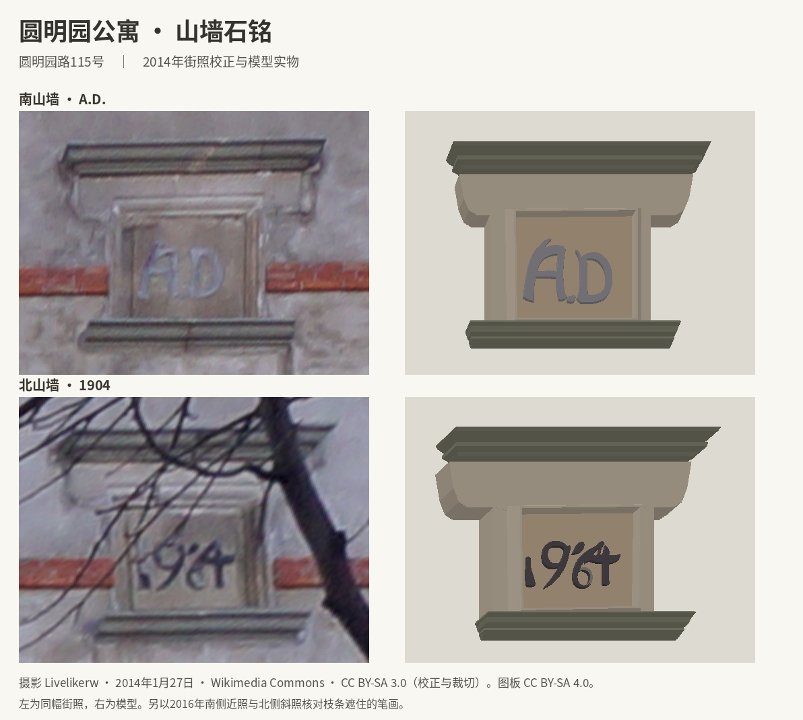

# 圆明园公寓山墙石铭

圆明园路115号东立面的南北山墙各有一块石铭。南牌两字之间的小圆点、弧起的 A 和右侧圆肚 D 在2016年3月的南侧近照中可读。北牌刻有1904。2014年街照中树枝遮住“1”的一部分和“9”的肩部，2016年北侧斜照可补见这两笔。两个日期照片中的第三个数字都保留形似小卷的内孔，右沿比其余笔画浅。历史建筑资料也记载该楼于1904年竣工。

两块石铭的上下短檐、檐下肩托、铭框和浅浮笔画均为几何。短檐四边以2014年实照校正的轮廓测定，出挑距离和约一厘米的字面高差为摄影估计。南牌末尾的表面小点缺少足以判断起伏的证据，释文沿用“A.D.”。每档26个独立构件均有闭合的前后面和侧壁，逐边检查相邻三角面的方向，并核得正体积。双档分别实测30个位置，包括两个字母的内孔、点、数字回笔及檐面。[原始几何检查](check-high.json) · [简化几何检查](check-low.json) · [近档逐件闭合性](solids-high.json) · [远档逐件闭合性](solids-low.json)

图板使用 Livelikerw 于2014年1月27日拍摄的原片，做平面透视校正与裁切。照片采用 CC BY-SA 3.0，图板和几何采用 CC BY-SA 4.0。2016年南、北资料照片用于独立比对。[原片](https://commons.wikimedia.org/wiki/File:Yuanmingyuan_Apartments_Rockbund_Shanghai.JPG) · [原片许可](https://creativecommons.org/licenses/by-sa/3.0/) · [图板许可](https://creativecommons.org/licenses/by-sa/4.0/)
