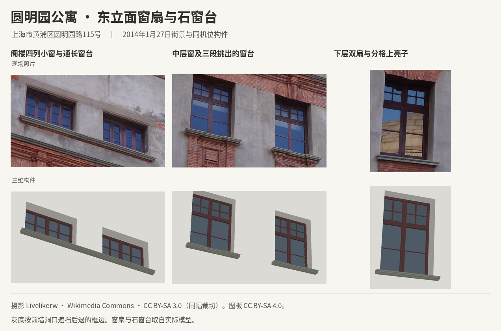

# 圆明园公寓东立面窗扇和石窗台

2014年1月27日的照片记录了圆明园路115号南、北两翼。矩窗共十二樘。街面上方两层的主窗为成对的深棕漆扇，上亮子可见四列两排。中层石窗台两头较为突出，中段收进。两座山墙下的小横窗均为一对，两樘共用一条石窗台。照片能辨出漆面和分格，窗框内部材质未有同期记录可证。

六个无遮挡的细横梃交点由2014年斜照和2016年正照共同定位。以东侧抹灰前墙为基面，细格交点的进深在0.434至0.619米之间，中位数为0.517米。两图之间的六处重投影残差均在原图一个像素以内。模型按南北两翼、上下两层分组取值。2016年正照没有收入阁楼，阁楼窗扇深度沿用同翼上一层的估计。射入两档GLB的各90条前向射线记录了窗梃、玻璃、石窗台和通长的阁楼窗台。[近档检测记录](wing-high-test.json) · [远档检测记录](wing-low-test.json)

图板仅使用 Livelikerw 署名的2014年照片，保留原透视，按细部裁切。该照片采用 CC BY-SA 3.0。重建几何和对照图板采用 CC BY-SA 4.0。2016年立面资料仅用于两相机空间复核。[2014年原片](https://commons.wikimedia.org/wiki/File:Yuanmingyuan_Apartments_Rockbund_Shanghai.JPG) · [原片许可](https://creativecommons.org/licenses/by-sa/3.0/) · [图板许可](https://creativecommons.org/licenses/by-sa/4.0/) · [2016年对照照片](http://www.heritage-architectures.com/wp-content/uploads/2019/10/HP044_DSC05610-_%E7%BC%A9%E5%B0%8F%E5%A4%A7%E5%B0%8F.jpg)
