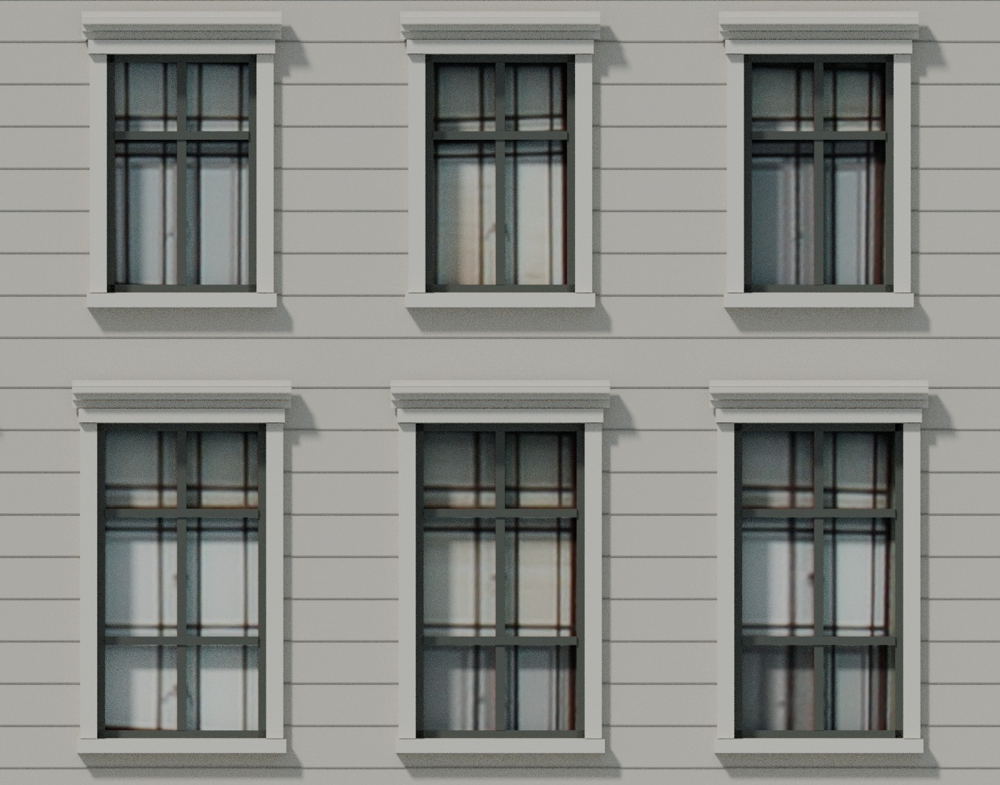

# v4.4 外滩墙面、逐窗与屋顶修正

本版修正9栋外滩建筑的墙体渲染伪影，并继续完善汇丰、字林西报大楼可对照照片的局部。全市普通建筑仍以来源轮廓和估计高度体块为主。

## 近景墙面黑线与空缝

原模型把窗间墙、窗上墙和窗下墙分别做成闭合墙块。相邻墙块在接触处保留了方向相反、位置重叠的内部面，部分正面长边也没有在邻接点分段。这些内部面与不连续的网格边缘在近景产生黑线、虚线和闪烁；关闭阴影和附加材质后仍可观察到，不能靠调亮石材消除。

2、3、12、15、17、19、20、23号按各自墙面与厚度整合结构墙，只移除被相邻墙体覆盖的内部面，并让相接边缘共用节点。真正的窗洞、洞口侧壁、玻璃退距，以及有依据的墙面前后层次保留。18号另补连续墙芯，封住墙块间原先贯通的空缝；外层石材接缝、凹槽和照片映射保留。石材之间真实可见的接缝不应作为渲染错误一并抹平。

[同机位墙面检查记录](../../tests/wall-render-v4.4.json)保留九栋逐栋检查范围；汇丰示例：[修复前](../../assets/previews/realism-v4.4/bund12-before-wall-isolated.png) / [修复后](../../assets/previews/realism-v4.4/bund12-after-wall-isolated.png)。这组独立模型截图关闭了城市背景、附加表面和阴影，用于定位几何问题，不代表最终街景光照。

13号原有墙面生成方式没有这类相邻闭合墙块问题，本轮保持原模型。地理锚点、城市背景替换范围和未涉及的建筑构件继续沿用既有资料。拓扑修复改善近景显示，不增加现场尺寸的测量精度。

| 建筑 | 当前墙体与后续重建入口 |
|---|---|
| 2、3号 | [bund_classics/wall-v4.4](../../source/bund/bund_classics/wall-v4.4/README.md) |
| 12号 | [classical_bank/wall-v4.4](../../source/bund/classical_bank/wall-v4.4/README.md)；12号的输入已经完成[photo-v4.4](../../source/bund/classical_bank/photo-v4.4/README.md) |
| 15号 | [classical_bank/curtain-v4.4](../../source/bund/classical_bank/curtain-v4.4/README.md)，以墙修复阶段为输入 |
| 17号 | [bund_classics/photo-v4.4](../../source/bund/bund_classics/photo-v4.4/README.md)，包含墙体清理、逐窗照片和屋顶修正 |
| 18号 | [chartered_bank/photo-v4.4](../../source/bund/chartered_bank/photo-v4.4/README.md) |
| 19、20、23号 | [art_deco/wall-v4.4](../../source/bund/art_deco/wall-v4.4/README.md) |

## 华俄道胜银行 · 外滩15号窗面

十个不透明窗帘体的面朝向反了，120个褶皱盒又与主体穿插。实际同机位对比确认：单独修正朝向仍有竖向短黑纹，去掉内部穿插盒后消失。最终同时纠正580个三角面的朝向并移除1,440个穿插三角；这些盒体并非零面积三角。剩余顶点位置、窗洞、窗框、柱和墙均保持。当前窗帘是简化的不透明内景，不是真实室内复原。

[当前源码](../../source/bund/classical_bank/curtain-v4.4/README.md) · [实际WebGL对比](../../tests/curtain-render-v4.4.json)。墙阶段的保留检查仍只证明该阶段，最终窗帘修正以独立报告说明例外。

## 汇丰银行大楼 · 外滩12号

正立面北侧翼楼两排共六窗，按Suicasmo 2025年5月1日CC0原图分别校准30块玻璃采样。旧的统一三等分窗格替换为39件实体主窗框；保留窗洞与退距、墙柱外轮廓、穹顶和其余窗，结构墙网格另按上节修正。实际细格栅、帘布及反射来自照片，未声称它们都是三维室内构件。照片中可见的主框像素排除在玻璃采样外，避免明显的双框。

[当前墙体源码与照片前置链](../../source/bund/classical_bank/wall-v4.4/README.md) · [当前墙体与其余构件保留核验](validation/bund12-wall-preservation-v4.4.json) · [当前原图与导出核验](validation/bund12-wall-assets-v4.4.json) · [照片阶段压缩对比（历史）](validation/bund12-compression-v4.4.json)。

## 字林西报大楼 · 外滩17号

中部五排主窗中24窗分别使用对应实拍区域，保留真正的内退玻璃和独立主窗框。底排中央窗受遮挡，继续使用几何材质；狭窗、下部门窗及侧后立面不做整面照片投射。原来重叠的中央三联窗竖饰条合并，避免近处闪烁。

屋顶旧模型的开放柱亭与照片不符，改为厚石塔身、内退暗窗、层叠檐帽和低矮浅弧顶冠。山花前移并补鼓面，顶层中央三处后退窗改用暗内景材质。未见背面简化封闭，塔体比例为照片判断，不能视为测绘尺寸。

[当前源码与屋顶依据](../../source/bund/bund_classics/photo-v4.4/README.md) · [几何和射线核验](validation/bund17-geometry-v4.4.json) · [实际解码压缩对比](validation/bund17-compression-v4.4.json)。

照片原始存储为5184×3456、EXIF方向6，正常显示为3456×5184。Blender与浏览器解码方向不同，网页按实际解码宽高校正纹理坐标；原JPEG字节与模型内原UV保持。校正只作用明确标注的照片材质，不能无条件旋转所有纹理。

## 运行时与文件体积

12、17号近景各共用一张完整原JPEG；单张解码后的RGBA8与mip估算约95.55MB，与6.94/7.58MB下载体积不同。两栋的远景版本沿用修正后的几何，但不嵌照片，玻璃有明确蓝灰底色。400m切远景、300m恢复近景的滞回规则不变，替换时释放旧模型的独占图片资源。

离开区域后，隐藏地标缓存限制为2个/32MiB；低内存设备为1个/16MiB。可见模型不因这个隐藏预算被删除，正在显示的模型总占用可能超过该数值。大照片近景优先从隐藏缓存释放；返回区域会重新加载，加载失败保留已显示的有效版本。共享PBR和环境贴图由场景统一管理。

正常设备局部阴影由1024升到2048，84m半径内阴影纹素约8.2cm；低内存仍为512。RGBA8和常用深度格式的阴影缓冲估算增加24MiB，更新仍采用缓存。几厘米窗框的投影不能因此当成完全解析的真实阴影。软件GPU检查用于正确性，不作为真实设备帧率结论。

每个发布文件采用小于100,000,000字节的检查，包括GLB、Blender和启动ZIP；城市分块与建筑按独立文件保存。

## 仍未达到的范围

本轮包括9栋建筑的墙体修复，以及12、17号的逐窗照片和17号屋顶修正。普通城市建筑仍以来源轮廓和估计高度体块为主，未完成全市逐楼真实窗位、外墙、屋顶和街道设施；历史建筑侧后、精细雕刻、风化分布及可游览室内仍有缺项。现状照片具有拍摄日期、透视、遮挡和固定光照，局部照片映射不等于摄影测量。

## 发布验证

[实际解码核验](../../tests/bund-decode-v4.4.json)覆盖九栋近景与远景共18个GLB；[公开模型校验](../../tests/public-assets-v4.4.json)记录固定提交下载的字节与SHA。每栋便携重建、墙体开孔及照片采样范围仍以各自源码包为准。

[74.0MB启动包校验](../../tests/launcher-v4.4-remote.json)检查了公开下载、全部243个ZIP条目的CRC及25个运行时模型；1,708个城市分块和ID索引使用固定提交的联网地址。完整的网页检查入口见[验证记录](../../tests/verification.json)。
