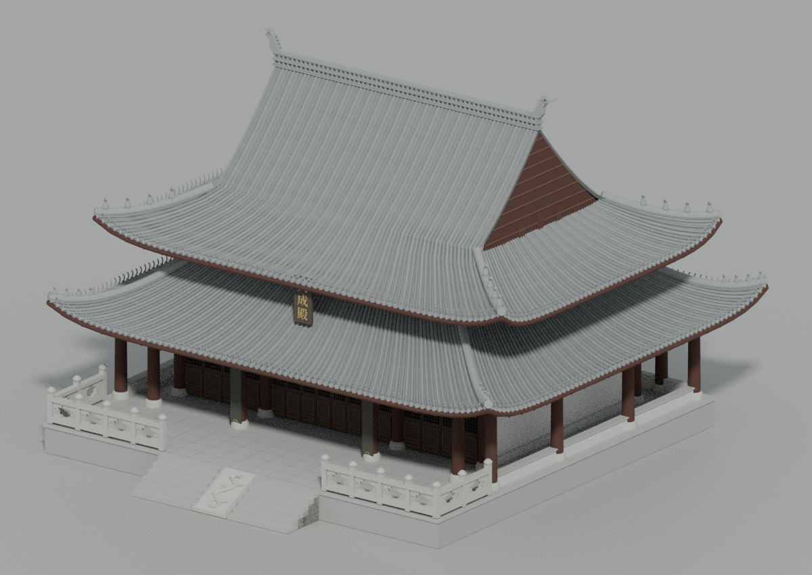

# 宝山孔庙大成殿 · 当前模型

[直接进入漫游](../../../index.html#landmark=baoshan-confucian-dacheng-hall&mode=walk) · [实际检查范围](../../../data/audit/precise-buildings-v15/baoshan-confucian-dacheng-hall/README.md)

| 文件 | 字节 |
| --- | ---: |
| [网页GLB](../../../assets/models/precise/14-13721-6684/baoshan-confucian-dacheng-hall/baoshan-confucian-dacheng-hall-web.glb) | 11,876,292 |
| [原始GLB](../../../assets/models/precise/14-13721-6684/baoshan-confucian-dacheng-hall/baoshan-confucian-dacheng-hall-raw.glb) | 29,752,792 |
| [远景GLB](../../../assets/models/precise/14-13721-6684/baoshan-confucian-dacheng-hall/baoshan-confucian-dacheng-hall-lod.glb) | 2,939,940 |
| [Blender](../../../assets/native/precise/14-13721-6684/baoshan-confucian-dacheng-hall/baoshan-confucian-dacheng-hall.blend) | 14,479,200 |

现代外观按实景复原三间主体、灰瓦重檐歇山屋顶、环廊、中央8扇格扇、石栏与御路石。全部单文件低于100MB。

高度约13m来自二手辞典，局部尺寸和未拍清的构件仍为推估；没有照片贴图，未测绘室内。雕刻和材质风化简化，楹联未虚构铭文。源码复现与许可见[README](README.md)。
