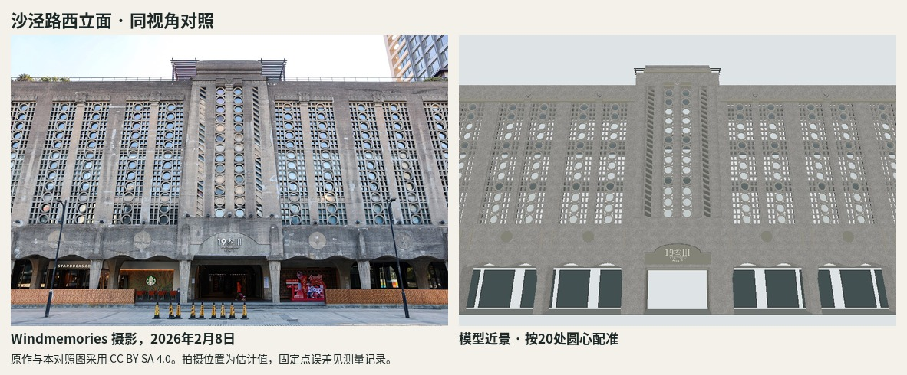
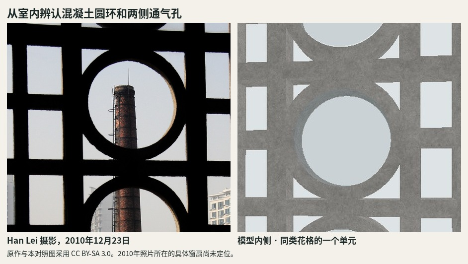

# 1933老场坊西立面圆环花格窗

从沙泾路看向原上海公共租界工部局宰牲场，中央入口两边各有四跨双扇花格。每扇纵列12个圆环，入口上方两列窄窗各有13个，共218个。普通窗在圆环四角留出透孔，两侧还有四列矩孔。模型将水泥花格和后方的玻璃分开制作，从楼内也能看到孔壁。[旋转查看模型](../../../slaughterhouse-west-concrete-screen.html) · [原照与测量](reference-review.json)

## 从街上看西立面

2015年12月的街景交会测得，两端之间的直立面长约61.85米，入口净宽约5.21米，中央高檐宽约6.14米。靠入口的普通双窗，南侧组合宽约5.29至5.33米，北侧约4.76至5.00米。摄站对遮挡处的判断有差异，源表保留各站位置和残差。模型采用代表性的重复开间。[三站窗宽与高程](measurements/three-station-screen-measurements.json) · [两端墙面与入口](measurements/two-end-cornices-and-entrance.json)

普通窗上方的齿形饰带在中梃处收成一个扇形柱头。中央两列圆窗相邻的竖缝内排有斜片，高檐朝街的一侧为圆鼻形。下层门廊保留双肩起伏的檐底、切角柱身和较暗的商铺窗线。正门三行字按2026年照片绘制，近景可辨。2010年室内照片用来研究花格，2024、2026年外景用来核对圆环排列、斜片和入口现状。用十列窗上的20处圆心配准2026年原照，1800×1200像素图像中的均方根距离约8.35像素。[配准点与残差](measurements/registered-front.json) · [街景原照](https://commons.wikimedia.org/wiki/File:20260208_Shanghai_International_Settlement_Slaughterhouse_01.jpg)

## 从楼内看花格

Han Lei 2010年的照片可透过圆孔看到街外烟囱。将一个格子的清边校正到同一平面，在两条环缘上得到332个拟合点。圆孔内径约为上下两环中心距的0.698，外径约0.904，单侧环带约0.103。普通窗中心距在本模型中取0.97米，水泥板从前沿到背面约0.21米。拍摄从哪扇窗向外看仍待考，下面对照两者的构造比例。[环缘量测与原图坐标](measurements/normalised-ring-section.json) · [透孔与阴影复核](measurements/west-grille-measurements.json)

## 登记范围与时代

市级名录4F011将沙泾路10号、29号列在同项。本模型取10号沿街西立面与其后3.16米的截面，楼板和门廊进深为研究估计。原街区的整栋轮廓保留在主图中，其地图高度12.8米会穿过上层花窗，精细截面提供独立查看。两侧附楼和院内栈桥仍有各自的调查范围。[市房管局名录](https://fgj.sh.gov.cn/yxlsjzcs/20200414/b9946bf8508e4b9689671fcd4146bb86.html) · [现场位置与地图楼栋](measurements/registration-and-source-owners.json)

1933年工部局公报第4410项记载沙泾路新场开始运营，1934年年报记载全部业务于1月24日完成移交。现有较早的室内花格影像可追至2010年，单块花格和玻璃的安装年代仍待早期施工图或照片核实。[公报、年报及原文](reference-review.json)

## 重新生成模型

~~~sh
python source/build_model.py --output west-screen-full.glb
python source/build_model.py --lod --output west-screen-low.glb
python source/build_model.py --out /path/to/models --audit /path/to/audit --blender /path/to/blender
~~~

近景保留圆环的滚边、门额三行字和柱头凹槽，远景保留各个开孔与主要轮廓。水泥纹理按1.48米重复。原始网格与近远两档解码件均可用同一组空间探测复核。[建模源码](source/build_model.py) · [核验记录](../../../data/audit/slaughterhouse-west-concrete-screen-v1/preflight/model-review.json) · [来源与许可](SOURCES-LICENSE.md)
