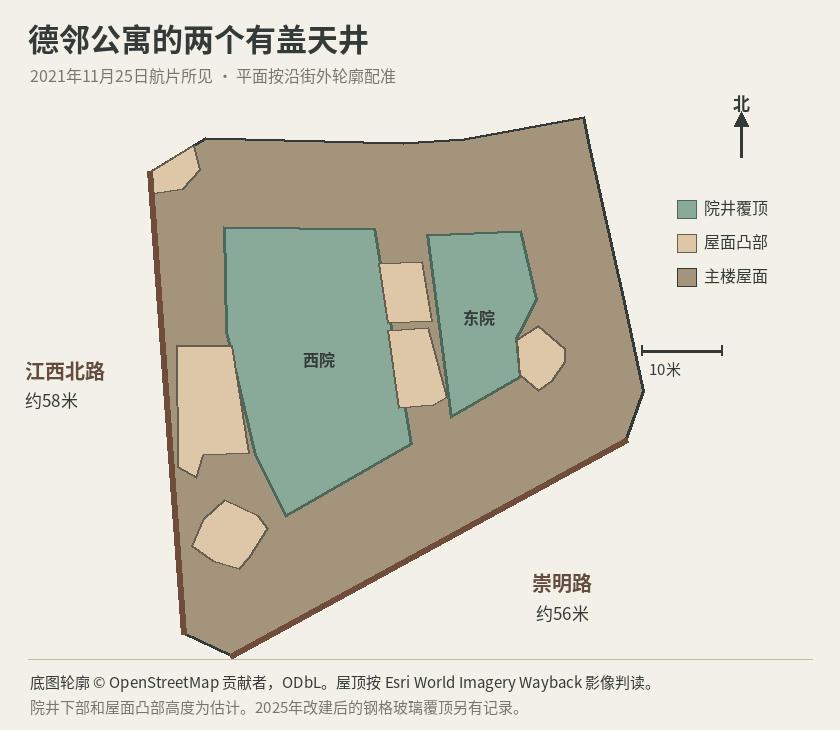

# 德邻公寓街角与双天井

德邻公寓建于1935年。站在江西北路与崇明路交会处，可以看到西南切角的石门面，抬头是由两道小券组成的阳台。街道两翼以褐色泰山面砖墩分隔钢窗，窗下浅色饰板与中段拉毛墙面的质地相异。本模型记录2019至2022年修缮前的外观。[旋转查看模型](../../../derring-apartments-corner-courts.html) · [上海市房管局名录](https://fgj.sh.gov.cn/yxlsjzcs/20200414/b9946bf8508e4b9689671fcd4146bb86.html) · [2022年记者街照及铭牌](https://m.nbd.com.cn/articles/2022-11-02/2534689.html)

市级名录4F003登记四川北路71号1至6幢，并列崇明路82号。本件制作两条有同期街照的长立面、西南与东南、西北三个转角，以及主楼屋顶上的两处有盖天井。附接的东、北两边以屋面界线收边。其余登记楼号、院内地面和室内空间保留在调查清单中。[建成和修缮沿革](https://www.shanghai.gov.cn/nw4411/20250629/d5be5671fcfe49e98f362714cf4268af.html) · [来源与核对范围](reference-review.json)



## 门面与屋顶

- 西南门廊的矩形双扇门、扁盲券门额和上层一排小盲券分别建模。2019年与2021年的街照还可见门额残饰，模型采用2022年记者照片中已覆盖的浅色门额。两片窗墙之间有连续砖墩，浅色饰板有上缘和折边浮线。最高一层保留可辨的双券、外挑阳台、柱头和栏杆。绿色琉璃和螺旋壁柱的材料依据修缮设计师的记述，细部纹样与断面为简化。[修缮团队访谈](https://www.shanghai.gov.cn/nw4411/20250629/d5be5671fcfe49e98f362714cf4268af.html)
- 江西北路和崇明路两翼的临街外边线约58.1米及56.5米。西南切角在公共地图上约6.5米。五个独立街景机位用于估计最高山花与门廊标高，山花约22.5米。当每次扣除一个机位重新估算时，结果约21.6至22.6米。门窗完整排列、后部屋面高差和玻璃后方均留有估计。[街道与外轮廓](measurements/street-edges.json) · [五站高度复核](measurements/crown-height-controls.json)
- 屋面依据2021年11月25日采集的航片。较大的西院覆顶约643平方米，东院约230平方米。二者之间保留横向连接部分。西北角低盖只采用三期资料都支持的约24平方米下口范围。屋面凸部高度和院井下部进深尚无测绘资料。[航片时期和配准误差](measurements/public-court-roofs.json) · [西北角三期对照](measurements/northwest-roof-attribution.json)
- 2025年启用后的建筑保留了双院布局，屋面已换成钢格玻璃覆顶，并开出贯通南北的公共廊道。项目原城的同名建筑约19.2米高，底面封合两个院井。这件修前模型使用独立展示页，原城对象和入口计数沿用现有记录。[2025年启用报道](https://www.shanghai.gov.cn/nw4411/20250629/d5be5671fcfe49e98f362714cf4268af.html)

## 重建

使用项目的 Python 建模依赖。完整打包另使用 Blender、gltfpack 和 Open Image Denoise，原生工程保留网格组、原创面砖纹理、按面角写入的砖纹坐标和七个预设相机。

```sh
python source/build_model.py --output derring-full.glb
python source/build_model.py --lod --output derring-low.glb
python source/build_model.py --out /path/to/models --audit /path/to/audit --blender /path/to/blender
```

[源码](source/build_model.py) · [三档模型几何检查](../../../data/audit/derring-apartments-corner-courts-v1/preflight/model-review.json) · [来源与许可](SOURCES-LICENSE.md)
