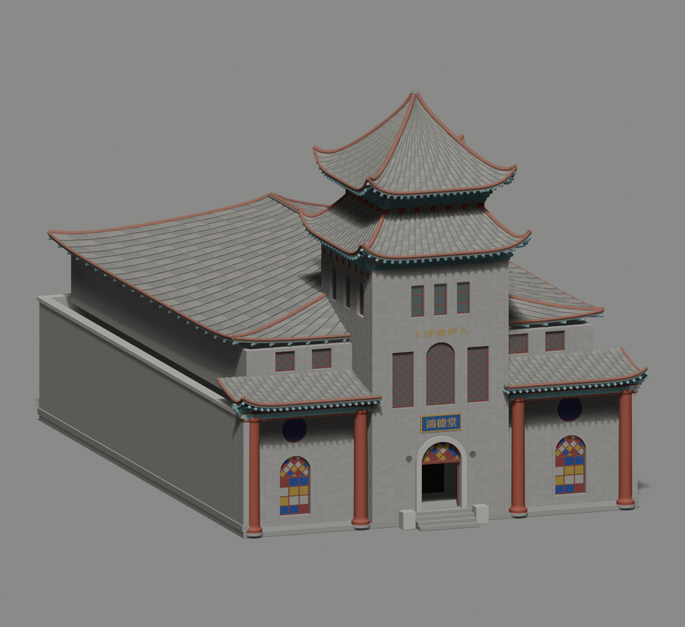

# 虹口多伦路59号鸿德堂：2024可见立面模型



按公开原图分别建立中央砖塔、退进两翼、独立红柱、真拱门／圆窗、深窗框和彩玻璃分格、曲面重檐、椽子、斗拱和分节搭接瓦。采用2024年可见位置的蓝底金字牌和上部文字；未把2014年红十字留作2024已核状态。2014日间照片只辅助确认结构与材料类别。原图未修改，也没有贴成整面照片平板。

[交付及验收范围](DELIVERY.md)记录独立模型交付时的实际检查。该阶段原生外观、有限开孔、压缩解码和离线重建通过；HTML视角、近远景替换与目录生命周期尚未验收。后续应用状态由项目独立记录，不回写这些冻结源码报告。

源环是现有城市要素的四点近似平行四边形，前缘21.0277m、面积632.89㎡，未正交化或以附近POI替代。对应真实OSMway1085786138@2和GERS c7f84dab-b7a1-4cf2-9e1e-f33bce1860bc；只允许替换local2557，原微块另10个要素保留。塔翼分面、21.55m总高、隐藏背面和屋顶深度是照片引导估计，不能称激光扫描、实测高度或2026完整现状。

普通Python3.12、numpy、Shapely>=2.1及fontTools可离线重建：

```sh
python build_model.py --output /一个全新输出目录
python check_raw.py --glb /一个全新输出目录/hongkou-hongde-church-raw.glb --report /另存检查.json
```

本目录的common、fonts、photos、geometry-input.json和calibration.json一起保留；不依赖工作区绝对路径。可选Blender导入脚本是common/blender_finish.py；建议方位25.574730186207086°、仰角12°。实体地面为0，预览地面应低于0，不能整体抬高建筑适应预览。

模型和照片CC BY-SA4.0；源码MIT；OSM/Overture轮廓ODbL1.0；字体SIL OFL1.1。见[COPYRIGHT.md](COPYRIGHT.md)。
