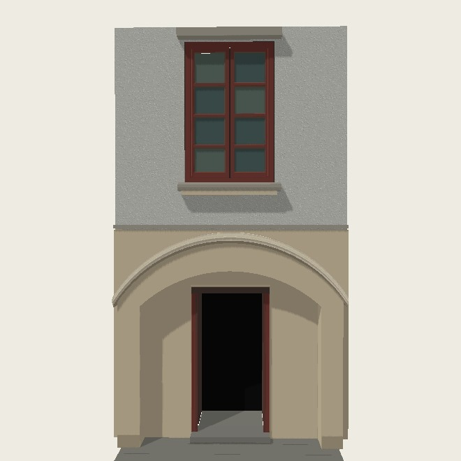
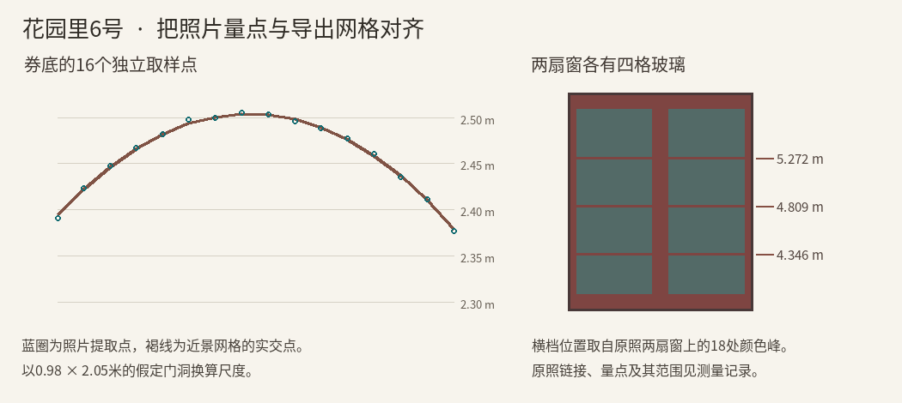

# 花园里6号曾联松旧居院内券门与双窗

花园里位于虹口区山阴路145弄，市级名录编号4F023，建成年份1927。6号是国旗设计者曾联松的旧居。券门向院内挑出，门框退在券下，跨过一道石门槛便进入照片中的暗处。楼上两扇红框窗各由三道横档分成四格，窗下有坡面石窗台。模型取这一个开间。

[打开三维模型](../../../huayuanli-six-court-arch.html) · [上海市房屋管理局名录](https://fgj.sh.gov.cn/yxlsjzcs/20200414/b9946bf8508e4b9689671fcd4146bb86.html)

## 照片依据

曾居此处的张国文于2020年发表《山阴路花园里秘闻》。门牌近照写有「曾联松旧居 山阴路145弄6号」。券门照片没有独立图注，前后两段均述及6号，下一段记述作者再访旧居。龙钢2024年的报道补充了花园里的位置和居住史，其街景所见为整排住宅。原照、原文与各自支持的范围单列在资料表中。

[2020年原文](https://m.thepaper.cn/baijiahao_8312780) · [原文中的门牌](https://imagepphcloud.thepaper.cn/pph/image/78/162/721.jpg) · [券门原照](https://imagepphcloud.thepaper.cn/pph/image/78/162/725.jpg) · [2024年回访](https://www.thepaper.cn/newsDetail_forward_28909276) · [来源记录](reference-review.json)

## 尺寸如何估计

以门洞净宽0.98米、净高2.05米作为比例假定。沿券底提取17个影像点拟合圆弧，再从另外16处对照导出模型的券底。另在两扇窗上共取18处颜色峰，确定三道横档的高度。图中蓝圈与褐线的接近程度说明模型与这张照片的轮廓吻合。门洞尺度、纸面以外的进深和券脚受遮挡部分仍属估计。

[采样与比例](measurements/plate-725.json) · [独立像点复查](measurements/independent-photo-check.json) · [二层粗灰墙与玻璃颜色采样](measurements/visible-material-regions.json)

## 三维文件

近景有5,242个三角面，64个可编辑网格组。远景有1,864个三角面，52个网格组。两档均保留八格玻璃、内退门框、门槛与券顶的叠层滴水。根据原照中门洞内的暗影，在截断处放了一块独立可移除的暗面；模型内留出约1.1米深的可见段。原创灰色粗抹灰纹理按0.88米平铺。

[建模程序](source/build_model.py) · [Blender生成器](source/build_blender_source.py) · [尺寸假定](source/dimensions.json) · [材料与许可](SOURCES-LICENSE.md)
