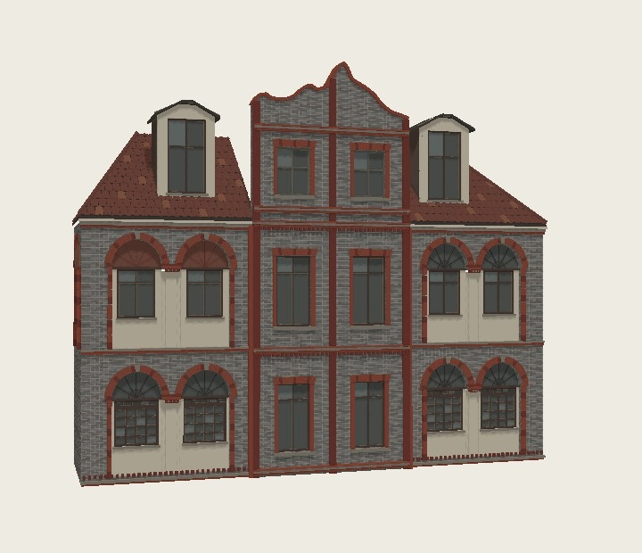

# 霍山路119–121号住宅双拱窗与砖砌女儿墙

上海第四批优秀历史建筑名录将霍山路119–121号、127–137号及125弄3–5号合列为4F027，记为1910年住宅。这个模型取119–121号的临街上部。沿街从两翼往中间看，上下成对的砖券窗之间是三层方窗，砖砌女儿墙从中间升起，两侧各有一座凸出屋面的窗。[打开三维模型](../../../huoshan-119-121-arcaded-front.html) · [市房管局名录](https://fgj.sh.gov.cn/yxlsjzcs/20200414/b9946bf8508e4b9689671fcd4146bb86.html)

## 两期照片中的细部

2015年照片可同时辨认中央女儿墙和两翼拱窗。2026年近照中，下层每扇拱窗的扇形亮窗与十六格方窗之间还有五格窄亮窗，两拱之间的浅色立柱从窗台一直通到柱头。屋面窗正面的小屋檐两端斜收，瓦列沿坡上下相接。模型分开制作券石、拱顶灰石、长窗柱、瓦列和逐段抬高的压顶。上层扇形窗的暗红色填面按2026年照片处理，两期照片中的填面有差异。[2015年全景对照](study-views/2015-street-and-model.jpg) · [下层亮窗对照](study-views/five-transom-lights.jpg) · [屋面窗对照](study-views/clipped-dormer-roof.jpg)

## 尺寸及覆盖范围

以2020年2月17日四处街景中可共同辨认的19个点估计立面尺度。檐口宽约16.23米，改变站点组合和视角约束后为15.78至16.41米。左右两对上层窗轴距分别约2.22米和2.11米，中央方窗轴距约2.67米，两座屋面窗约相隔9.32米。街檐高约11.05米，中央女儿墙顶约16.47米。这些数字使用街景报告的相机位置和高度估算。[量点和站点](measurements/2020-street-frontage.json) · [拟合及敏感性](measurements/four-station-facade-adjustment.json) · [模型采用的参数](source/dimensions.json)

展示截面从离地约2.71米起，向内取4.18米。底层、后屋面及同一名录条目的其他门牌仍待补充。地图轮廓的临街边约14.37米，且原城块包含整幢住宅。局部立面放在独立页，原城块1037及相邻的645、1005保留。[原有轮廓比对](measurements/historical-address-and-city.json)

## 网格与下载

| 版本 | 三角面 | 可编辑网格组 | 组成构件 |
| --- | ---: | ---: | ---: |
| 近景及未压缩源模型 | 60,732 | 253 | 1,627 |
| 远景 | 21,440 | 214 | 778 |

原始模型与两档网页导出各有239处几何检查。两档各从七个相同机位渲染。灰砖使用原创256像素方形纹理，每1.08米横向、0.60米竖向重复一次。网页可切换细节并下载模型。[生成程序](source/build_model.py) · [Blender工程生成器](source/build_blender_source.py) · [来源与许可](SOURCES-LICENSE.md)
