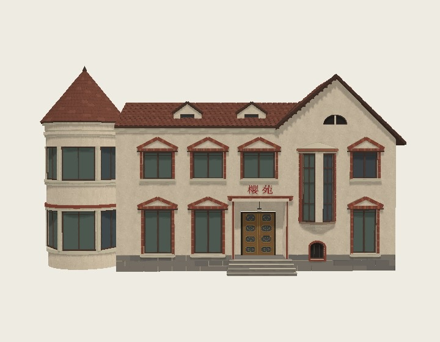

# 樱苑别墅东北立面三角窗楣与题名门廊

上海第四批优秀历史建筑名录将四川北路2365号列为「樱苑别墅」，编号4F019，建成年份1927。模型取东北侧沿街的一段，从圆塔延伸到楼梯凸窗旁的末间。打开网页后，可以单独切换到题名门廊、楼梯凸窗或屋顶。

[打开三维模型](../../../yingyuan-villa-pedimented-entrance.html) · [市房管局名录](https://fgj.sh.gov.cn/yxlsjzcs/20200414/b9946bf8508e4b9689671fcd4146bb86.html)

## 如何从照片确定形状

Fayhoo在同一文件页上传过两个版本。2014年的夜景能一起辨认圆塔、三角窗楣和门廊。2020年10月25日的日景显示木门上的八块八角玻璃、浅色凸窗中墩及砖红色窗楣。门扇用菱形金属条压在深色玻璃面上。凸窗两侧的玻璃各分四层，中央留有约0.41米宽的实墙。屋顶按照片可见的两座老虎窗、横向山墙和圆塔锥顶建模。

[夜景与模型并置](study-views/night-and-street-front.jpg) · [楼梯凸窗并置](study-views/two-storey-stair-oriel.jpg) · [门扇并置](study-views/eight-entrance-lights.jpg) · [照片版本记录](https://commons.wikimedia.org/wiki/File:Yingyuan_Bieshu.jpg#filehistory)

以三处2021年1月街景定位二楼前三扇平窗的中心，第四处用于辨认侧面。相邻窗轴间距为2.658米、2.703米，门廊两柱外缘宽3.004米，门楣外宽3.419米。分别用两张照片的窗轴对齐模型后，再检查各自未参与对齐的四处门廊边缘，其水平像素均方根误差分别为8.56和8.47。圆塔可见半径估计为1.92至2.40米，模型取2.15米。纵深取沿街截面的4.70米。檐高、屋面坡度和背街截面仍为估计值。

[街景量测](measurements/frontage-controls.json) · [两期照片对位与残差](measurements/two-date-window-registration.json) · [尺寸与坐标系](source/dimensions.json)

## 网格和下载

| 版本 | 三角面 | 可编辑网格组 | 组成构件 |
| --- | ---: | ---: | ---: |
| 近景及未压缩源模型 | 81,862 | 201 | 2,619 |
| 远景 | 28,478 | 189 | 1,334 |

原始模型与两档网页导出各检查229处几何位置。近景和远景各从七个相同机位渲染，核查砖窗楣、门扇、凸窗、屋面交线和塔檐。赭色抹灰使用原创256像素方形纹理，实物重复尺度为1.41米。网页提供模型文件和下载状态。

[构建脚本](source/build_model.py) · [Blender工程生成器](source/build_blender_source.py) · [相机参数](source/cameras.json) · [来源与许可](SOURCES-LICENSE.md)
