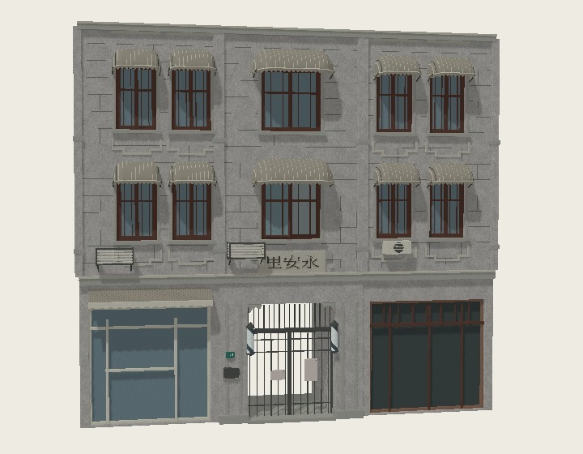
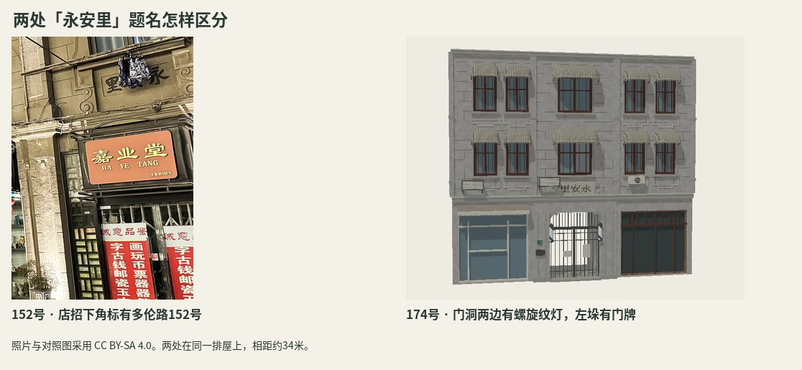

# 永安里多伦路174号题名门与双窗条篷

从多伦路看，174号门洞上方有一扇宽窗，两边各有两扇窄窗。两层共十顶灰色条篷，宽窗上的布篷随窗加宽。旋转模型可以看到布篷前沿的波浪、两侧支臂和窗下外挑的金属栏箱。门洞两边各装一盏螺旋纹灯，右起读「永安里」。[打开模型](../../../yonganli-duolun-174-awning-front.html) · [查看核验记录](../../../data/audit/yonganli-duolun-174-awning-front-v1/preflight/model-review.json)

## 两处同题「永安里」的门

市第四批优秀历史建筑名录将永安里登记为四川北路1953弄、多伦路152—192号，成片建筑前半段建于1925年，后半段建于1945年后。沿多伦路相距约34米的两道门上都刻有「永安里」。2024年夜景中橙色店招下角可读「多伦路152号」，2014年照片最近的完整黑色店招可读「多伦路154号」。174号的位置、窗轴和立面高程取自2020年2月的沿街影像。两幅公开照片记录了同排住宅在不同年份的篷形与店面。[市房管局名录](https://fgj.sh.gov.cn/yxlsjzcs/20200414/b9946bf8508e4b9689671fcd4146bb86.html) · [两道门定位](measurements/152-and-174.json) · [2014年店招读数](measurements/original-door-numbers-2014.json)

## 尺寸与复核

截取街面宽11.74米，向里深3.09米。门洞净宽约2.50米，两灯之间约2.37米；二、三层窗台分别高5.11米、8.09米。女儿墙采用10.91米，原测站约束范围为10.73至11.05米。五个窗轴由三个机位共15条观测线定位，与模型窗轴的平面距离均方根为0.153米。从第三个机位斜看时部分窗面受遮挡，高程和位置均按街景估算。其余里弄、屋顶背面和住宅室内留待另行调查。该局部保留原地图的174号和152号两处既有建筑。[建模尺寸](source/dimensions.json) · [五窗轴配准](measurements/registered-five-window-axes.json) · [三机位基础数据](measurements/174-window-controls.json)

## 编辑与导出

建筑网格、题字、窗篷、相机和灰色墙面纹理均有制作源文件。原始网格和近景各64,016面，远景24,076面；近景有119个可编辑几何组，远景有104个。近远两档各保存七个解码后的观察视角。三种几何各以248处射线检查门洞、门灯、窗玻璃、条篷、支臂及栏箱。下载入口见独立模型页。[建模入口](source/build_model.py) · [可编辑 Blender 文件制作器](source/build_blender_source.py) · [七个相机位](source/cameras.json) · [来源与许可](SOURCES-LICENSE.md)
