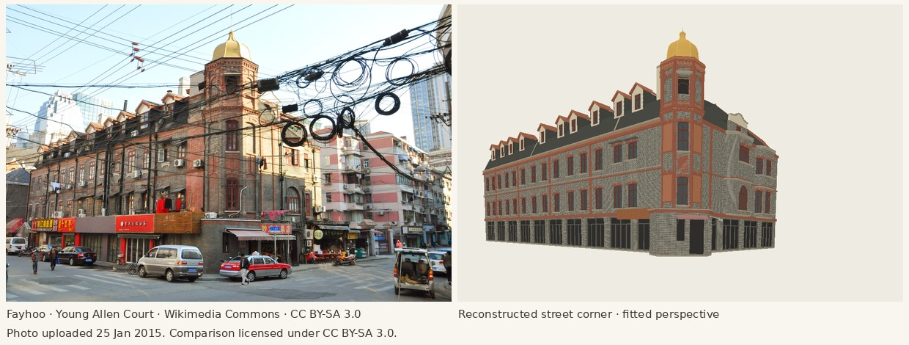

# 乍浦路260号金顶角楼与老虎窗

站在乍浦路与昆山路交会处，八角塔楼正对路口。上层正面是深敞口，左右两面带有盲券。金色曲顶沿八道折边上收，在颈部收细后接顶帽。楼下沿昆山路展开两排木窗，乍浦路一侧则有大拱窗、折面凸窗和单独的曲线山花。模型记录2015至2019年街照可辨的外观。[旋转查看模型](../../../young-allen-court-gilded-corner.html) · [Fayhoo原照](https://commons.wikimedia.org/wiki/File:Young_Allen_Court.jpg)



上海市房管局名录将景林庐登记为4F007，年代栏为1923年，列有乍浦路260号、254弄22至27号和昆山路141至177号。部分名录将昆山路末号记为171。此处复原的是街口金顶和它连接的两段街面。沿弄住宅与同街区的景灵堂另有建筑身份。本图依据两个街道方向和多个摄站核定，临街后方的进深与隐藏墙面保留估计。[市房管局名录](https://fgj.sh.gov.cn/yxlsjzcs/20200414/b9946bf8508e4b9689671fcd4146bb86.html) · [原城对象与登记范围](measurements/registered-street-corner.json)

## 抬头看塔楼

两个2015年12月的街景机位分别给出塔楼正面开口宽约0.86米、高约1.28至1.30米。正面檐边高出窗顶约1.08至1.13米。换到斜侧，可以看见旁边的砖砌盲券，沿砖檐再向上是有八道立缝的金色外皮。两个前方摄站估计小顶帽根部高约16.22至16.69米。色泽取自原照，外皮的合金成分尚无材料记录。[同一砖面的窗台、窗顶和檐边](measurements/front-facet-cornice-and-openings.json) · [角楼与两翼的挑出量](measurements/wing-plane-and-facet-offsets.json)

## 沿两条街辨认窗列

- 昆山路上下各有14个窗轴，屋面有10处带白色三角山墙的老虎窗。靠街角的前两扇上层窗有短雨板和略高的窗台，较远的窗使用较高的窗框。三期航片还显示两道横跨坡屋顶的浅色压带，相对金顶沿街方向约7.9米和24.0米。[两站逐窗位置](measurements/two-street-facade-controls.json) · [三期屋面量读](measurements/cross-pitch-cappings.json)
- 从乍浦路近看，大拱窗内有扇形窗格，上层宽横窗和侧面窄窗位于同一处凸窗。浅色山花中央隆起，两端有低肩。较正的两站量得拱窗宽约1.70米，三站合算约1.84米。沿街向南还有第二组折面窗。[逐站对照和误差](measurements/two-street-facade-controls.json)
- 街角底层宽于上面的单个八角塔面。Fayhoo照片中的灰砖面、窄侧口、两片布篷和旁边的木条檐板均能单独选取。其余商铺采用简化开间，背街、室内和被遮住的屋面细部仍待资料。[照片与年份](reference-review.json)

将街照上的塔冠、两处窗台、九个可见屋面尖点及乍浦路大窗共21个位置投到模型上，2060×1372像素原图中的均方根距离约6.7像素。最后一处被烟道遮去的老虎窗由2015年另一方向的街景辨认。屋面深度、照片配准与高程均为建筑研究估计。[摄影对照点](measurements/fit-to-original.json)

## 重建与下载

独立页面提供原始和两种距离档位的GLB。建模脚本使用项目现有的Python依赖。完整打包使用Blender、gltfpack和Open Image Denoise，原生工程保留分组网格、砖纹坐标和七个预设相机。

```sh
python source/build_model.py --output young-allen-full.glb
python source/build_model.py --lod --output young-allen-low.glb
python source/build_model.py --out /path/to/models --audit /path/to/audit --blender /path/to/blender
```

[建模源码](source/build_model.py) · [三档几何和图像核验](../../../data/audit/young-allen-court-gilded-corner-v1/preflight/model-review.json) · [来源与许可](SOURCES-LICENSE.md)
