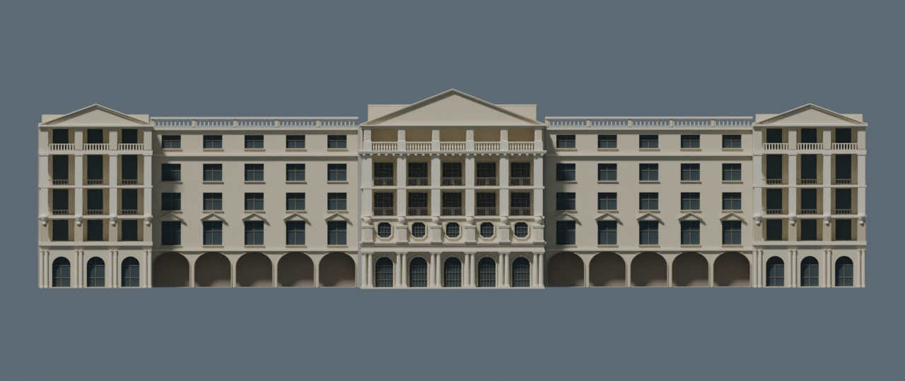

# 宏恩医院历史主楼花园立面（三处山花与两段拱廊窗墙）

静安区延安西路221号，上海项目制作队列第39项。站在主楼南花园，从左至右可见西端三开间柱廊、一段五开间窗墙、中央五开间柱廊、另一段五开间窗墙和东端柱廊。模型制作了园侧约78米长的这段立面。中央圆拱窗、八角窗、两层通高廊柱、阳台及三角山花均设有独立几何，连接段底层留出拱洞，上层四排窗嵌入墙体。原生文件按构件组织，保留独立网格和材质。



## 查看与下载

[主地图定位](../../../index.html#landmark=jingan-country-hospital&mode=overview) · [单体预览](../../../country-hospital.html) · [清单与 SHA256](../../../assets/models/candidates/jingan-country-hospital/manifest.json) · [逐资产立面开孔检查](../../../data/audit/country-hospital-v1/surface-checks.json) · [原生文件与几何检查](../../../data/audit/country-hospital-v1/geometry-native.json) · [单体浏览器记录](../../../data/audit/country-hospital-v1/viewer.json)

| 文件 | 十进制 MB | 三角面 |
| --- | ---: | ---: |
| [原始 GLB](../../../assets/models/candidates/jingan-country-hospital/jingan-country-hospital-garden-front-raw.glb) | 5.009 | 75,388 |
| [网页 GLB](../../../assets/models/candidates/jingan-country-hospital/jingan-country-hospital-garden-front-web.glb) | 2.072 | 75,388 |
| [远景 LOD](../../../assets/models/candidates/jingan-country-hospital/jingan-country-hospital-garden-front-lod.glb) | 0.757 | 32,128 |
| [Blender 原生文件](../../../assets/models/candidates/jingan-country-hospital/jingan-country-hospital-garden-front.blend) | 0.599 | — |

## 身份、年代与范围

- Virtual Shanghai 将 Country Hospital 记为1926年建成，旧址为大西路17号。建筑名录第1批24号把“宏恩医院”和“华东医院干部病房楼”列于同一行，地址为延安西路221号。医院机构于1951年重建，早期主楼及园侧立面先于现机构。医院历史、出处版本和名录来源状态分别可查。[Virtual Shanghai 建筑记录1788](https://www.virtualshanghai.net/Data/Buildings?ID=1788) · [历史条目，修订95200788](https://zh.wikipedia.org/w/index.php?oldid=95200788) · [名录线索 sh-historic-b1-024](../../../data/model-todo/discovered-buildings.json)
- 1926年编目照片和一幅记作1928年、收录于1930年画册第50版的照片共同显示园侧三处山花和两段窗墙。中央五开间下方有成排券窗与八角窗，端部柱廊较窄；两端与中央之间各有五处底层券洞，上方第一排窗有三角窗楣。相近的档案图可能来自同一底片。右端被画幅截去的部分参照左端估计。[档案1993](https://www.virtualshanghai.net/Photos/Images?ID=1993) · [档案1438](https://www.virtualshanghai.net/Photos/Images?ID=1438) · [档案15128](https://www.virtualshanghai.net/Photos/Images?ID=15128)
- Fayhoo 的2015年园侧照片可辨中央五跨、两层阳台、八角窗、底层券窗与暖浅色墙面。Legolas1024 的2014年照片另见“1”号标记、侧部翼墙及转角。档案决定长立面布局，现代照片用于中央细部和配色。两端现状、树木遮挡处和建筑内部仍待核实。[2015年园侧照片](https://commons.wikimedia.org/wiki/File:Country_Hospital.JPG) · [2014年侧部照片](https://commons.wikimedia.org/wiki/File:Huadong_Hospital,_Shanghai.jpg) · [逐项资料记录与获取字节、SHA256](reference-review.json)

## 地图定位与尺寸

建筑所在源为宏块 `14-13718-6695` 的建筑2764，对应 OSM way `1226645404`，其内有名为“宏恩医院”的 POI。花园在南侧。屋面参考区中心约为东经121.436885、北纬31.220087，长轴向东的真方位角约75°，正面朝165°。这组坐标标记屋面参考区，安装立面时还要偏移至园侧正面。影像估计中段山花宽约17.6米，两端各约10.5米，窗墙后退约3.1米。位置与进深有米级不确定性。[地图源、影像瓦片和邻楼核对](footprint-review.json)

屋面参考带约77.54 × 12.75米。模型沿其园侧制作约5米厚的立面截段，保留拱廊凹入和窗洞深度；截面用素面封边。横向连接翼、其余屋顶、两端超出照片的范围、主楼背面、庭院和现代病楼另待调查。标高、轮廓、栏杆密度、遮挡处门窗以及可见饰件均按影像估计。几何总高约18.8米，所有尺寸都没有测绘精度。[尺寸参数](source/parameters.json) · [预研记录](../../../data/model-todo/country-hospital-preflight.json)

## 重建

从仓库根目录执行。准备 Python 3、NumPy、Shapely 2.1 或以上版本、Blender 4.3、Node.js 和 gltfpack 0.25。预览渲染需要 ImageMagick 7 的 `magick` 和 Open Image Denoise 2.5.1 的 `oidnDenoise` 可执行文件；两者放在 PATH 中，或用 `--oidn` 指定后者路径。Python 几何导出复用仓库中上海邮政总局的通用构件库；稀疏检出时同时恢复该库、同目录的压缩和解码脚本、项目 vendor 中的 meshopt 解码器及上轮的通用网格读取器。[共享几何导出器](../hongkou-general-post-office/source/common/photo_architecture.py)

```sh
python -m pip install 'numpy>=2,<3' 'shapely>=2.1,<3'
npm install --prefix /tmp/country-hospital-tools gltfpack@0.25.0
python -B projects/shanghai/source/precise/jingan-country-hospital/source/build_garden.py \
  --with-wings --out /tmp/country-hospital-build --audit /tmp/country-hospital-audit \
  --gltfpack /tmp/country-hospital-tools/node_modules/.bin/gltfpack
```

`--with-wings` 同时制作中央和两侧，输出原始 GLB、网页压缩 GLB、简化 LOD、可编辑 Blender 文件、预览及本次构建的 SHA256 清单。构建过程重开 Blender 文件后渲染并降噪，并对解压后的完整与 LOD 网格逐材质校验三角面。导出单体时采用局部坐标，地图接入单独应用定位与方位。在 Blender 打开原生文件可逐项选取山花、柱、拱窗和栏板。[构建入口](source/build_garden.py) · [中央柱廊](source/portico.py) · [两端柱廊与窗墙](source/garden_wings.py)

## 许可与署名

原创几何、程序与参数按仓库 MIT 许可提供。照片仅作目视研究；成品采用程序化实色材质。Fayhoo 的照片许可为 CC BY-SA 3.0，Legolas1024 的照片许可为 CC BY-SA 4.0。Virtual Shanghai 及其馆藏出版物的图像权利见对应原记录。名录整理沿用维基百科 CC BY-SA 4.0 署名；地图源归属 © OpenStreetMap contributors（ODbL 1.0），经 Overture 建筑记录匹配。Esri World Imagery 及其数据提供方影像仅供核对方向和范围。[仓库 MIT 许可](../../../../../LICENSE) · [研究资料记录](reference-review.json) · [地图取数及署名](footprint-review.json) · [名录来源与许可](../../../data/model-todo/README.md)
