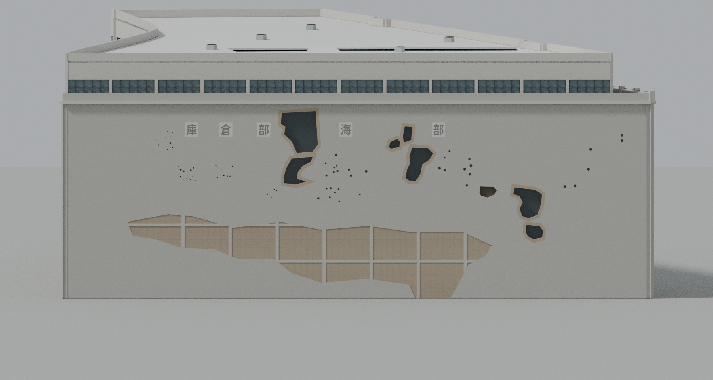

# 四行仓库与毗邻大陆银行仓库

按公开照片及设计资料制作的完整双库建筑模型，表现修复后的外观。南侧两套立面、两个凹入口、钢窗、退台第六层、天窗、入口雨篷和西墙损伤分别建模。

| 文件 | 大小 | 下载 |
| --- | ---: | --- |
| 原始 GLB | 25,721,072 字节 | [下载](../../../assets/models/precise/14-13720-6693/jingan-sihang-warehouse/jingan-sihang-warehouse-raw.glb) |
| 网页 GLB | 9,109,892 字节 | [下载](../../../assets/models/precise/14-13720-6693/jingan-sihang-warehouse/jingan-sihang-warehouse-web.glb) |
| 远景 GLB | 5,513,608 字节 | [下载](../../../assets/models/precise/14-13720-6693/jingan-sihang-warehouse/jingan-sihang-warehouse-lod.glb) |
| Blender | 12,868,230 字节 | [下载](../../../assets/native/precise/14-13720-6693/jingan-sihang-warehouse/jingan-sihang-warehouse.blend) |

每个文件均严格低于100,000,000字节。网页与远景GLB采用Meshopt压缩；远景版仅省去细砖缝，保留门窗、字牌、破损墙体和屋顶构件。使用Blender编辑可选择原始GLB或原生文件。

建筑几何和三张原生视图已经核对，模型先单独备份；第三人称场景接入另行验证，不能把本页当作网页漫游通过的证明。见[独立建筑审阅](delivery/evidence/FINAL_BUILDING_REVIEW_V6.md)与[原生视图审阅](delivery/evidence/root_native_review.json)。

主要依据：[上海建筑设计研究院项目资料](https://www.siadr.com/projectdetails/5c3d7dd0e4d1cc0728c7c61d/)、[设计者改造文章](https://www.sohu.com/a/416719455_170361)、[九张许可参考照片清单](photo-reference-register.json)。参考照片用于辨认构件，未作为模型贴图；未获再分发许可的设计研究图片不随模型发布。[署名与许可](ATTRIBUTION.md)。

27.7米采用项目公布的名义总高。局部尺寸、北侧窗格、字形、表面风化和屋顶设备仍有估计；西墙记录七处玻璃背衬洞口、一处砖背深凹及65个选取的小损伤点，不代表逐一复原全部历史弹痕。这是依据照片和图纸的建筑复原，不是测绘或摄影测量模型。

[建模源码](build_model.py) · [参数与估计](calibration.json) · [冻结源码清单](source-freeze.json)
