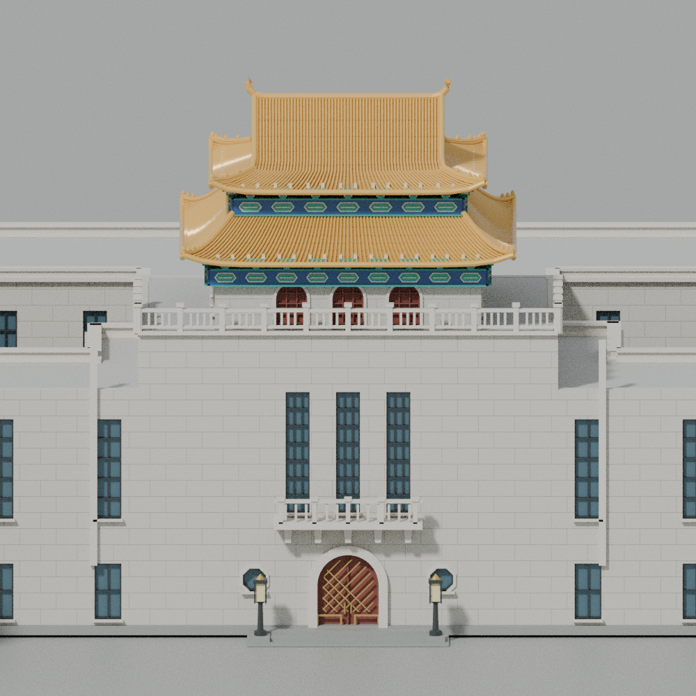
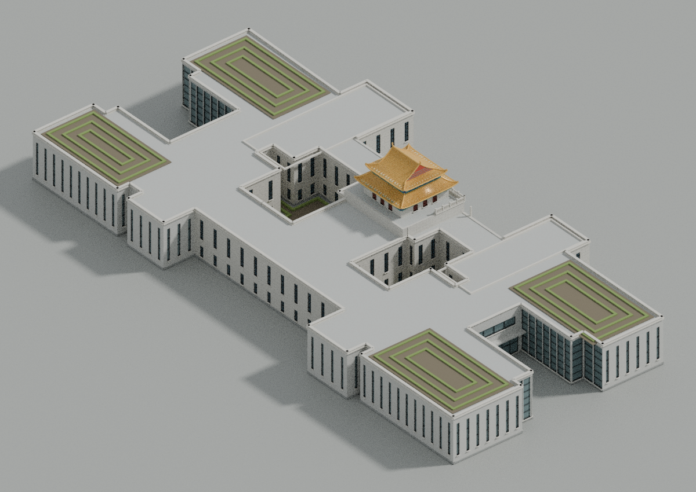

# 杨浦区图书馆整馆 · v13

已新增完整旧馆与扩建馆体，覆盖两处露天内院、四角现代翼部和南侧入口。主门细化重檐歇山琉璃瓦、瓦垄、斗拱彩画、三跨高窗、八角窗、入口格栅门、石栏杆与灯座；两条旧长翼东端含高窗、拱门和小阳台。

[打开漫游入口](../../../index.html#landmark=yangpu-library&mode=walk) · [建模源码与重建说明](authoring/README.md) · [照片署名与许可](authoring/ATTRIBUTION.md) · [本轮网页实际检查](../../../data/audit/precise-buildings-v13/yangpu-library/README.md)

| 文件 | 实际大小与下载 |
|---|---|
| 原始 GLB | [20564732 字节](../../../assets/models/precise/14-13722-6690/yangpu-library/yangpu-library-raw.glb) |
| 网页 GLB | [6622720 字节](../../../assets/models/precise/14-13722-6690/yangpu-library/yangpu-library-web.glb) |
| 远景 LOD | [2217772 字节](../../../assets/models/precise/14-13722-6690/yangpu-library/yangpu-library-lod.glb) |
| Blender 可编辑文件 | [10088881 字节](../../../assets/native/precise/14-13722-6690/yangpu-library/yangpu-library.blend) |

所有文件均严格小于100,000,000字节。完整模型365,524三角形，作者简化远景模型122,688三角形；LOD省去细石缝、竖槽并减少瓦垄与曲面采样，不是原模型三角面的严格子集。网页版Meshopt压缩的实际解码几何与原始模型位置、绕序和材质一致；Blender文件已重新打开并核对模型三角数。

三图来自同一份最终模型，渲染相机未按照片标定。预览地面和灯光在独立Blender集合内，不属于导出的建筑GLB。模型不含照片贴图，材料、彩画与装饰为程序几何及估计色值。

这是依据公开照片、规划资料和地图轮廓制作的外观模型，未经现场测绘或摄影测量。背面与内院窗数、局部尺寸、彩画和脊兽细节为推估；室内孔雀门和室内陈设未建模。 规划图18.49m记为檐口值，本模型将其作为上层檐口约束；最高顶饰约22.48m，22.51m登记值是建模包络，并非官方实测总高。现代部分10.8m与图上H11.05的基准差异仍未解决。名义地面为0，门框收口最低约−0.02m。

四张Commons参考照片保留各自CC BY-SA许可；政府规划图仅用于内部研究，公开包没有其图像像素。代码与原创几何、地图轮廓及参考照片分别遵循[署名说明](authoring/ATTRIBUTION.md)中的许可。

