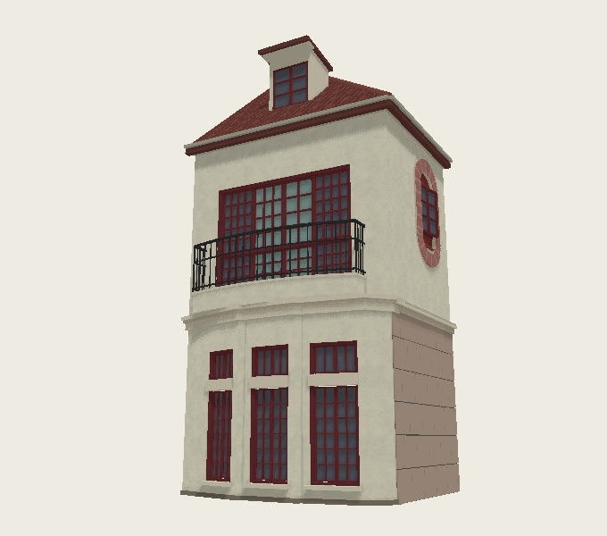

# 杨树浦路3061弄住宅端部阳台与椭圆砖窗

上海第四批优秀历史建筑名录把杨树浦路3061弄列为新式里弄住宅，编号4G004。本页制作2013年照片右端的一开间和与它相连的侧墙。沿弄堂看，底层有三个木窗洞，楼上弧形铁栏后有四扇格窗。转过墙角可以看见一扇六格红窗，窗顶、窗底都有放射形砌砖。[打开三维模型](../../../yangshupu-3061-end-balcony-and-oval-window.html) · [上海市房管局名录](https://fgj.sh.gov.cn/yxlsjz/20200331/e3b99cf457ae48cab87ad5c02aa0fee3.html)

## 从原照辨认构件

Legolas1024于2013年10月3日拍下这排住宅。底层三扇窗随外墙微微转折，每扇窗上都有独立亮窗。楼上外侧两扇的木格密，中间的窗格较宽。侧面砖饰上下收圆，窗扇右边向外伸出，掩住了一部分砖圈。坡屋面之上另有一座带短披檐的窗，两扇各分三格。[原照与署名](https://commons.wikimedia.org/wiki/File:Lane_3061,_Yangshupu_Road,_Shanghai.jpg) · [端角对照](study-views/corner-and-balcony.jpg) · [砖窗对照](study-views/open-casement-and-radial-brick.jpg) · [坡面窗对照](study-views/paired-dormer-sashes.jpg)

## 怎样估计尺寸

原照的EXIF记录了佳能EOS 600D、18毫米镜头与原传感器像素。将竖框、前后两向的檐线和楼上四扇窗的总框对齐后，以窗高2.20米作为尺度假设，得到窗框总宽约3.04米。四个框角的投影偏差约1.0至1.3像素。假设窗高改为2.05至2.35米时，估得的窗宽为2.83至3.25米。[原始像素点](measurements/front-and-return-pixels.json) · [相机及尺度](measurements/camera-and-relative-dimensions.json)

以底层中部约0.52米的外挑为假设，三个窗洞的估算宽度自左至右约0.77、0.82、0.88米。侧窗按约0.77米宽的开启扇估算，右侧打开约10度。将坡面窗的位置向墙内取0.92米，屋面坡角约41度。13条额外的横切线用原照中的砖色边缘检查模型外圈，两个细节等级的均方根差均约0.03米。这些数值依赖单张影像和尺度假设。[底层三开间](measurements/lower-bay-registration.json) · [打开的窗扇](measurements/projecting-casement-fit.json) · [屋面](measurements/dormer-and-roof.json) · [外圈检查](measurements/independent-oval-check.json)

住区地址点周边95米内有44个既有建筑轮廓。复核2017年院内22处街景后，仍无法确认照片中的阳台和椭圆窗对应哪一户。本页仅展示该端角，整排住宅的其他山花、后屋面和各户门牌继续待查。[住区与既有建筑](measurements/lane-and-existing-buildings.json)

## 网格与下载

| 版本 | 三角面 | 可编辑网格组 | 组成构件 |
| --- | ---: | ---: | ---: |
| 近景及未压缩源模型 | 38,544 | 133 | 1,702 |
| 远景 | 13,092 | 107 | 567 |

在源模型及两档网页解码网格上各检查259处。两档各从七个机位渲染。窗扇、铁栏、券砖、挑檐和瓦面保留独立网格组。石灰饰面使用原创192像素方形纹理，重复尺度为1.16米。[生成程序](source/build_model.py) · [原生工程生成器](source/build_blender_source.py) · [来源与许可](SOURCES-LICENSE.md)
